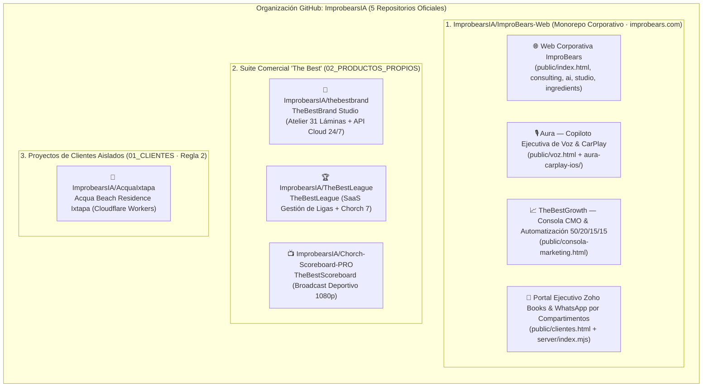

# 🏛️ Arquitectura Oficial de Proyectos y Repositorios — IMPROBEARS (Directiva C-00 · Brandbook V5.1)

**Propietario Ejecutivo:** Jorge Benítez `"El Oso"` — Director General & Socio Fundador (`ImproBears — Business Improvement`)  
**Organización Oficial en GitHub:** [`https://github.com/ImprobearsIA`](https://github.com/ImprobearsIA)  
**Estándar de Ingeniería:** *Un Repositorio por Unidad de Dominio/Despliegue + Módulos Claramente Separados + Aislamiento Estricto Cliente/Producto (Reglas 1 y 2)*

---

## 🗺️ Mapa Visual de la Arquitectura Global

---

## 📋 Directorio Completo de los 8 Sistemas y Dónde Vive Cada Uno

| # | Sistema / Producto | Categoría | Repositorio en GitHub | Ruta Exacta en el Código | URL en Producción (Cloud 24/7) | Acceso en el Dock de tu Mac |
| :-: | :--- | :--- | :--- | :--- | :--- | :--- |
| **1** | **Web Oficial de ImproBears** *(Marca Madre + Consulting, AI, Studio, Ingredients, Calculadora Hopzoil®)* | `03_SISTEMAS_IMPROBEARS` | [`ImprobearsIA/ImproBears-Web`](https://github.com/ImprobearsIA/ImproBears-Web) | `public/index.html`, `public/consulting.html`, `public/ai.html`, `public/studio.html`, `public/ingredients.html` | `https://improbears.com` (`https://improbears-com.web.app`) | Navegador Web |
| **2** | **Aura** *(Cabina de Voz Ejecutiva + App Nativa iPhone & CarPlay conectada a Zoho One y WhatsApp)* | `03_SISTEMAS_IMPROBEARS` | [`ImprobearsIA/ImproBears-Web`](https://github.com/ImprobearsIA/ImproBears-Web) | Web: `public/voz.html` iOS/CarPlay: `aura-carplay-ios/AuraApp.swift`, `CarPlaySceneDelegate.swift` | `https://improbears.com/voz` + Nodo `http://34.121.182.185:4747` | **App `Aura`** en el Dock de macOS y en tu iPhone (`iChorch`) |
| **3** | **TheBestGrowth** *(Consola CMO, Parrilla 50/20/15/15, Guiones 5 Ingredientes, HeyGen Avatar `Jorge Improbears`)* | `02_PRODUCTOS_PROPIOS` / `03_SISTEMAS` | [`ImprobearsIA/ImproBears-Web`](https://github.com/ImprobearsIA/ImproBears-Web) | `public/consola-marketing.html` + `server/index.mjs` | `https://improbears.com/consola-marketing#automatizacion-marketing` | **App `TheBestGrowth`** en el Dock de macOS |
| **4** | **Portal de Clientes Zoho Books & WhatsApp por Compartimentos** *(Edith, Vero, Gerardo, Pablo + Ventana 120s de Jorge)* | `03_SISTEMAS_IMPROBEARS` | [`ImprobearsIA/ImproBears-Web`](https://github.com/ImprobearsIA/ImproBears-Web) | `public/clientes.html`, `public/js/improbears-app.js`, `server/index.mjs` | `https://improbears.com/clientes` | Desde `improbears.com/clientes` |
| **5** | **TheBestBrand Studio** *(Atelier de Identidad Visual Algorítmica · 31 Láminas en Curvas Brandbook V5.1)* | `02_PRODUCTOS_PROPIOS` | [`ImprobearsIA/thebestbrand`](https://github.com/ImprobearsIA/thebestbrand) | Frontend: `apps/web/index.html` API Cloud: `apps/api/main.py` | `https://thebestbrand-studio.web.app/studio?studio=1` | **App `TheBestBrand`** en el Dock de macOS |
| **6** | **TheBestLeague** *(Plataforma SaaS de Gestión Deportiva de Ligas + Agencia de Prensa IA Chorch 7)* | `02_PRODUCTOS_PROPIOS` | [`ImprobearsIA/TheBestLeague`](https://github.com/ImprobearsIA/TheBestLeague) | `artifacts/`, `lib/`, `Project_Tracker_The_Best_League_PMI.csv` | Repositorio SaaS Independiente | Workspace Local / GitHub |
| **7** | **TheBestScoreboard (`Chorch-Scoreboard-PRO`)** *(Marcador Deportivo Profesional Broadcast 1920×1080)* | `02_PRODUCTOS_PROPIOS` | [`ImprobearsIA/Chorch-Scoreboard-PRO`](https://github.com/ImprobearsIA/Chorch-Scoreboard-PRO) | `artifacts/`, `lib/`, `scripts/` | Repositorio SaaS Independiente | Workspace Local / GitHub |
| **8** | **Acqua Ixtapa (`Acqua Beach Residence`)** *(Sitio Inmobiliario de Lujo + Cotizador Financiero USD/MXN en Vivo)* | `01_CLIENTES` *(Regla 2)* | [`ImprobearsIA/AcquaIxtapa`](https://github.com/ImprobearsIA/AcquaIxtapa) | `artifacts/acqua-ixtapa/`, `wrangler.jsonc` | `https://acquaixtapa.jorge-benitez.workers.dev` | Cloudflare Workers Cloud 24/7 |

---

## 🛡️ Reglas de Oro de Ingeniería y Sincronización (`Zero-Touch`)

1. **¿Por qué Web, Aura, TheBestGrowth y el Portal de Clientes viven juntos en `ImproBears-Web`?**
   - Porque los 4 operan bajo el mismo dominio (`https://improbears.com`), comparten las mismas credenciales de **Zoho CRM v6** y **Zoho Books v3** (`Org ID 923290625`), y utilizan el mismo diseño del **Brandbook V5.1 (Regla 1)**.
   - Así, un solo `git push` actualiza los 4 sistemas de forma atómica en menos de 60 segundos vía **GitHub Actions → Firebase Hosting**.
2. **Confirmación Obligatoria en Cada `git push` / `git pull`:**
   - **En Chat (Antigravity / Claude):** Siempre se verifica con `git fetch` que `LOCAL_SHA === REMOTE_SHA (origin/main)` y que el workflow de **GitHub Actions** termine en `completed / success`.
   - **En tu Mac (`improbears_zero_touch_guardian.sh`):** Cada vez que el guardián descarga o despliega cambios en segundo plano, dispara una notificación nativa en macOS (sonido `"Glass"`) y escribe el registro exacto en `~/Desktop/git_sync_confirmations.txt`.
