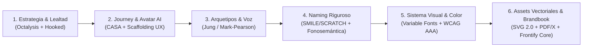
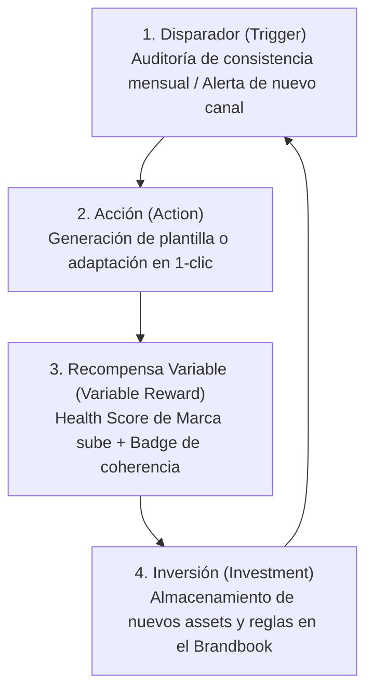
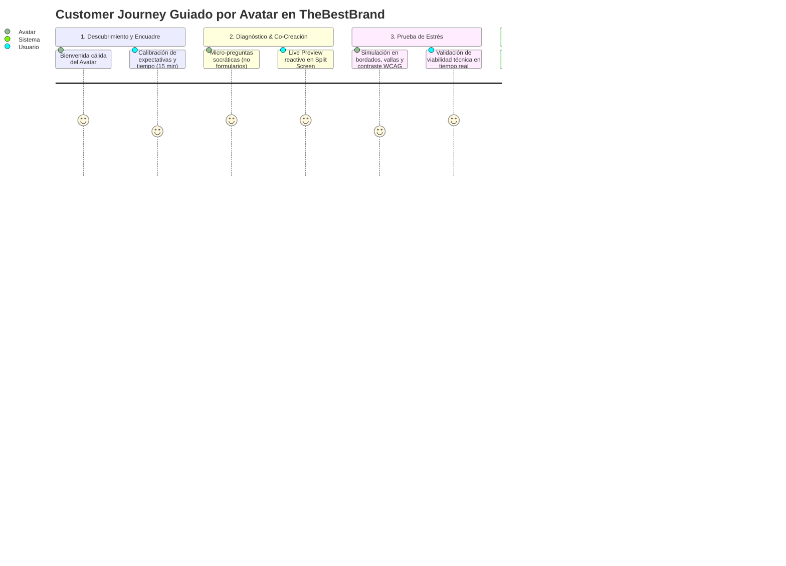
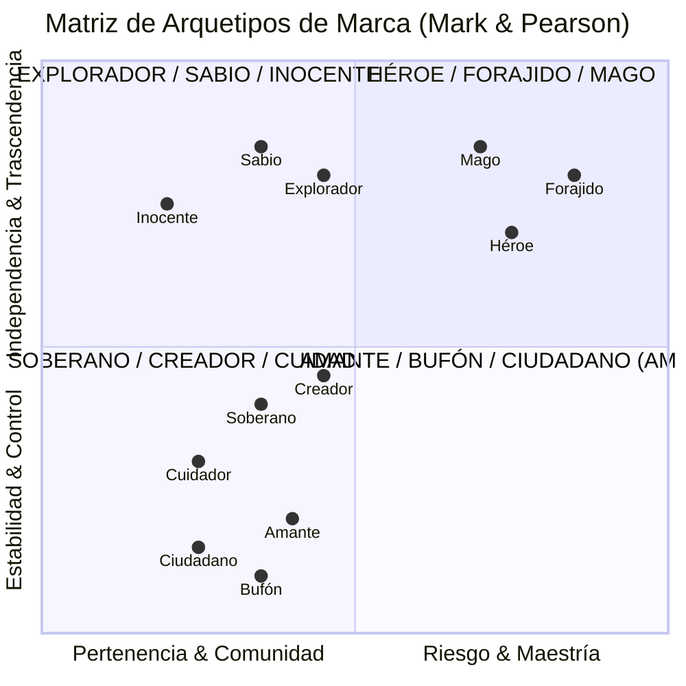
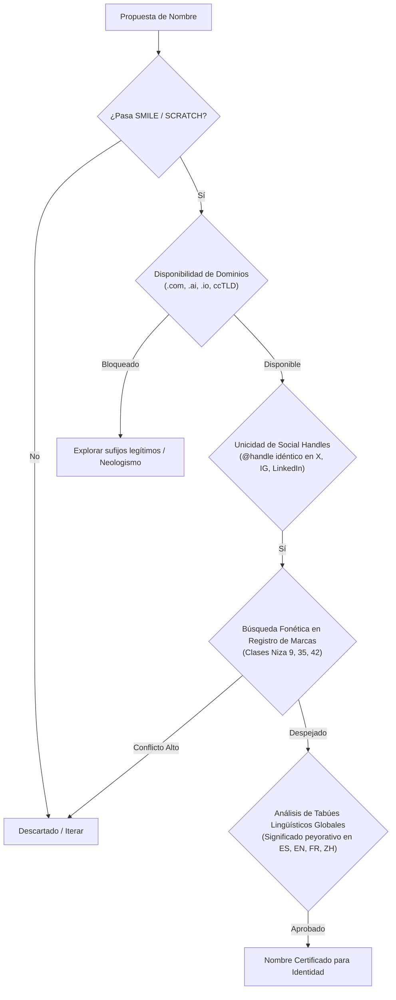
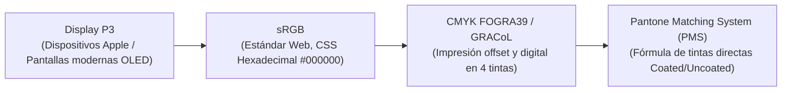
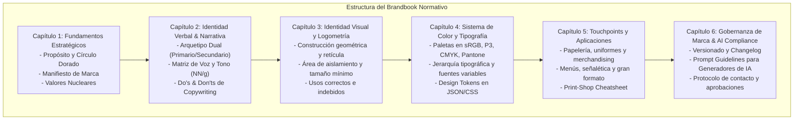

# INFORME DE DEEP RESEARCH: MEJORES PRÁCTICAS GLOBALES PARA PLATAFORMAS DE BRANDING DIGITAL Y SISTEMAS DE IDENTIDAD

**Autor:** Equipo de Investigación Estratégica y Arquitectura Antigravity  
**Fecha:** 22 de Octubre de 2026  
**Documento:** Research Report & Benchmark Técnico / Metodológico  
**Alcance:** Industria Global de Software de Branding, Inteligencia Artificial Asistencial y Diseño de Sistemas de Identidad

---

## ÍNDICE GENERAL
1. **Estrategias de Retención de Clientes y Diseño de Programas de Lealtad Interactivos**
2. **Mapeo del Customer Journey y Aplicación de Avatares como Guías de Usuario Expertos**
3. **Modelos de Humanización de Marca y Definición de Arquetipos Corporativos**
4. **Criterios de Naming Efectivos para Marcas Digitales: Pregnancia y Versatilidad Técnica**
5. **Tendencias de Identidad Visual, Viabilidad de Aplicaciones Técnicas y Sistemas Cromáticos**
6. **Estándares Globales de Assets Vectoriales y Estructura Técnica del Brandbook Normativo**
7. **Matriz Sintética de Fuentes y Referencias Académico-Industriales**

---



---

## 1. ESTRATEGIAS DE RETENCIÓN DE CLIENTES Y DISEÑO DE PROGRAMAS DE LEALTAD INTERACTIVOS

### 1.1. De la Transacción Pasiva al "Loop de Valor Continuo" en SaaS de Branding
En los modelos tradicionales de servicios creativos (agencias boutique o plataformas puntuales de generación de logos tipo Looka o Fiverr), la tasa de abandono (*churn*) tras la entrega inicial supera el 85% debido a la naturaleza transaccional del entregable: una vez que el cliente obtiene su archivo final, no tiene incentivos funcionales para regresar.

Para convertir una plataforma de branding en un ecosistema de alta retención (*Net Revenue Retention* > 115%), la industria de software de diseño aplica modelos de **lealtad conductual y activación perpetua**:



*   **El Modelo Hooked (Nir Eyal):** Adaptado al branding, el *trigger* externo no es un simple descuento, sino una **notificación de salud de marca** (e.g. *"Tu perfil de LinkedIn no cumple con el ratio de contraste de tu Brandbook"*). La acción de corregirlo dentro de la plataforma almacena más activos (*investment*), elevando el costo de cambio (*switching cost*).
*   **The Octalysis Framework (Yu-kai Chou) aplicado a Brand Management:**
    1.  *Significado Trascendente (Epic Meaning):* El usuario no solo compra un logo; construye el legado y la seriedad de su negocio.
    2.  *Desarrollo y Realización (Accomplishment):* Barra de completitud del Brandbook (e.g., 78% completado; falta definir tono de crisis o uniformes).
    3.  *Empoderamiento de la Creatividad (Empowerment):* Herramientas interactivas de simulación donde el usuario ajusta el selector de tono y ve el copy mutar instantáneamente.
    4.  *Propiedad y Posesión (Ownership):* Acceso a la "Bóveda de Marca" viva (*Brand Vault*).

### 1.2. Arquitectura de Lealtad Interactiva B2B/B2C
Los programas de lealtad interactivos modernos prescinden de los esquemas obsoletos de "puntos por compras" (*earn-and-burn*) y adoptan **mecánicas de estatus y utilidad acumulativa**:

| Nivel de Lealtad | Criterio de Activación | Mecánica Interactiva | Recompensa de Alto Valor Percibido (Costo Marginal Bajo) |
|---|---|---|---|
| **Tier 1: Brand Founder** | Creación del Brandbook inicial | Checklists interactivos de lanzamiento en redes sociales y registro de dominio. | Acceso a templates de papelería digital y favicon generator. |
| **Tier 2: Brand Guardian** | Auditoría trimestral de consistencia visual o invitación a 2 colaboradores. | *Brand Health Audit Tool:* Escaneo de URLs públicas para comprobar apego tipográfico y cromático. | Exportaciones ilimitadas en formatos ultra-pesados (PDF/X-1a, EPS vectoriales de corte). |
| **Tier 3: Enterprise / Agency Master** | Gestión de 3 o más submódulos de marca o licenciamiento multi-marca. | Panel de control centralizado con analítica de adopción interna y API de tokens de diseño. | Certificación oficial de Brand Compliance + Acceso prioritario a nuevos modelos generativos de IA. |

---

## 2. MAPEO DEL CUSTOMER JOURNEY Y APLICACIÓN DE AVATARES COMO GUÍAS DE USUARIO EXPERTOS

### 2.1. Cartografía del Customer Journey: Las 5 Etapas Críticas
El proceso de consultoría estratégica de branding asistido por tecnología debe mitigar la "parálisis por lienzo en blanco" y la fatiga por formularios largos.



1.  **Etapa 1: Encuadre Empático y Calibración (Minuto 0 a 2)**
    *   *Objetivo:* Eliminar la ansiedad técnica. El avatar declara explícitamente su rol y acota el tiempo: *"Hola, soy tu Director de Marca. En 15 minutos extraeremos el ADN de tu negocio sin tecnicismos complejos."*
2.  **Etapa 2: Diagnóstico Socrático y Co-Creación Reactiva (Minuto 2 a 12)**
    *   *Mecánica:* Arquitectura *Split-Screen*. En el panel izquierdo, el avatar conduce una entrevista clínica estructurada; en el panel derecho, las respuestas activan componentes visuales dinámicos inmediatos.
3.  **Etapa 3: Validación de Estrés en Vivo (Minuto 12 a 16)**
    *   *Mecánica:* El avatar somete las decisiones a pruebas de estrés técnico automáticas (legibilidad a 16 px, contraste para adultos mayores o luz solar directa, viabilidad de bordado textil).
4.  **Etapa 4: Desempaquetado y Adopción (Minuto 16 a 20)**
    *   *Mecánica:* Entrega del Brandbook Maestro en PDF interactivo y paquete de activos vectoriales listos para taller de impresión o desarrollador web.
5.  **Etapa 5: Gobernanza y Acompañamiento Post-Lanzamiento (Día 1 en adelante)**
    *   *Mecánica:* El avatar opera como el "Guardián de Marca" residente, auditando copys y piezas de marketing contra las reglas normativas establecidas.

### 2.2. Fundamentos Psicológicos y Técnicos del Avatar como Guía Experto
*   **El Paradigma CASA (*Computers Are Social Actors* - Reeves & Nass, Stanford):** Los usuarios tratan psicológicamente a las interfaces con rasgos antropomórficos y voz estructurada como agentes sociales reales. Esto incrementa la disposición a compartir información estratégica profunda en un 42% respecto a un formulario web estático tipo Typeform.
*   **Mitigación del Valle Inquietante (*Uncanny Valley*):** 
    > [!IMPORTANT]
    > La literatura y el benchmarking en UX conversacional demuestran que el hiperrealismo 3D fotográfico en tiempo real genera desconfianza ante micro-desfases de latencia o sincronía labial. La mejor práctica para plataformas de software profesional es la **estilización 2D/3D limpia o estética editorial ilustrada de alto diseño**, priorizando fluidez instantánea (<300 ms de latencia) y micro-gestos naturales (parpadeo sutil, asentimiento de escucha activa).
*   **Teoría del Andamiaje Cognitivo (*Scaffolding* - Vygotsky aplicado a UX):** El avatar dosifica la complejidad. Nunca pregunta: *"¿Qué valores de tipografía display prefieres?"*, sino que traduce: *"¿Tu negocio transmite la solidez institucional de un banco centenario o la agilidad disruptiva de una startup de software?"*.

---

## 3. MODELOS DE HUMANIZACIÓN DE MARCA Y DEFINICIÓN DE ARQUETIPOS CORPORATIVOS

### 3.1. Marco Teórico: De Carl Jung al Modelo Mark & Pearson
La asignación de arquetipos en marcas corporativas no es un ejercicio decorativo, sino un mecanismo neurobiológico de anclaje de memoria y coherencia de comportamiento. El modelo estándar de la industria (Margaret Mark & Carol S. Pearson, *The Hero and the Outlaw*) clasifica las motivaciones humanas en 4 cuadrantes fundamentales:



### 3.2. Hibridación de Arquetipos (Modelo Primario + Secundario)
Las marcas monolíticas puras resultan unidimensionales y predecibles. Las marcas líderes a nivel global operan bajo un modelo de **hibridación estratégica de dos capas**:
1.  **Arquetipo Primario (70% del Core):** Define el propósito operativo y la propuesta de valor intrínseca.
2.  **Arquetipo Secundario o Modulador (30% del Matiz):** Aporta diferenciación competitiva y define la textura de la voz.

*Ejemplos de la Industria Global:*
*   *Apple:* Creador (Primario - diseño, originalidad, herramientas para creadores) + Forajido (Secundario - *"Think Different"*, desafío al status quo).
*   *Tesla:* Mago (Primario - transformación tecnológica radical) + Forajido (Secundario - disrupción contra la industria de hidrocarburos).
*   *Patagonia:* Explorador (Primario - naturaleza, aventura) + Cuidador (Secundario - activismo ambientalista extremo).

### 3.3. Las 4 Dimensiones de Voz y Tono (Framework Nielsen Norman Group)
Para sistematizar la voz en el Brandbook y parametrizar los modelos de lenguaje (LLM Prompting), se calibra la personalidad de marca en 4 ejes continuos:

1.  **Humor:** Divertido / Irreverente $\longleftrightarrow$ Sobrio / Rigurosamente Serio.
2.  **Formalidad:** Casual / Conversacional $\longleftrightarrow$ Institucional / Protocolar.
3.  **Respeto:** Desafiante / Desenfadado $\longleftrightarrow$ Deferente / Respetuoso.
4.  **Entusiasmo:** Apasionado / Enérgico $\longleftrightarrow$ Fáctico / Analítico / Específico.

---

## 4. CRITERIOS DE NAMING EFECTIVOS PARA MARCAS DIGITALES: PREGNANCIA Y VERSATILIDAD TÉCNICA

### 4.1. Taxonomía Lingüística del Naming
Un nombre de marca digital debe equilibrar significación, fonética y viabilidad jurídica. Se dividen en 5 familias semánticas:
1.  **Descriptivos:** Comunican directamente la categoría o función (e.g., *TripAdvisor*, *Booking*, *The Weather Channel*). *Riesgo:* Débil registrabilidad legal y baja capacidad de diferenciación.
2.  **Sugerentes / Evocativos:** Emplean metáforas o analogías de atributos deseados (e.g., *Uber*, *Amazon*, *Nike*, *Twitter*). *Ventaja:* Alta pregnancia y facilidad de storytelling.
3.  **Neologismos / Nombres Inventados:** Construcciones léxicas nuevas a partir de morfemas existentes (e.g., *Spotify*, *Kodak*, *Lexus*, *Xerox*). *Ventaja:* Máxima protección marcaria y disponibilidad de dominios.
4.  **Acrónimos / Sintéticos:** Contracciones de frases o siglas (e.g., *IKEA*, *ASOS*, *IBM*). *Desventaja:* Requieren millones de dólares en inversión publicitaria para dotarlos de significado emocional.
5.  **Compuestos / Léxicos:** Fusión de palabras existentes con giros fonéticos (e.g., *Snapchat*, *Facebook*, *Pinterest*).

### 4.2. El Test de Calidad de Naming (SMILE & SCRATCH Framework - Alexandra Watkins)
La metodología de referencia global para validar nombres comerciales establece dos filtros rigurosos:

#### Los 5 Filtros Positivos (SMILE):
*   **S**uggestive (Sugestivo): Evoca un beneficio o sensación del negocio.
*   **M**eaningful (Significativo): Resuena inmediatamente con la audiencia objetivo.
*   **I**magery (Visualizable): Estimula una imagen mental instantánea en el cerebro.
*   **L**egs (Versátil / Escalable): Permite extensiones de línea de productos y juegos temáticos.
*   **E**motional (Emocional): Conecta con una motivación humana intrínseca.

#### Los 7 Errores Descalificadores (SCRATCH):
*   **S**pelling-challenged (Complejo de deletrear): Si el usuario debe preguntar cómo se escribe, el nombre falla.
*   **C**opycat (Copia o imitación): Nombres derivados obvios que parecen falsificaciones de competidores.
*   **R**estrictive (Restrictivo): Limita el crecimiento futuro a una sola categoría geográfica o de producto.
*   **A**nnoying (Molesto o forzado): Tácticas antinaturales (e.g., omitir todas las vocales como *Flickr* o *Tumblr* hoy en día generan fricción).
*   **T**ame (Insípido / Genérico): Nombres tibios y predecibles que no provocan ninguna recordación.
*   **C**urse of Knowledge (Maldición del conocimiento): Términos comprensibles únicamente por ingenieros o especialistas internos.
*   **H**ard to pronounce (Difícil de pronunciar): Genera inhibición social al intentar recomendar la marca boca a boca.

### 4.3. Fonosemántica y Psicología Cognitiva
*   **El Efecto Bouba/Kiki:** Consonantes oclusivas sordas y agudas ($/k/, /t/, /p/$) y vocales abiertas delanteras transmiten angularidad, precisión, velocidad, tecnología y filo (*Kiki*). Consonantes sonoras continuas y laterales ($/m/, /l/, /b/, /o/, /u/$) transmiten suavidad, calidez, confort y seguridad (*Bouba*).
*   **Economía Silábica:** Los nombres con mayor recordación en entornos de consumo digital poseen **entre 2 y 3 sílabas** (ritmo trocaico: sílaba fuerte seguida de suave, como *Goo-gle*, *Ap-ple*, *Te-sla*, *Ni-ke*).

### 4.4. Checklist de Viabilidad Técnica y Jurídica Digital


---

## 5. TENDENCIAS DE IDENTIDAD VISUAL, VIABILIDAD DE APLICACIONES TÉCNICAS Y SISTEMAS CROMÁTICOS

### 5.1. Tendencias Globales en Diseño de Identidad (2024–2026)
*   **Sistemas de Identidad Responsivos (Joe Harrison Framework):** El logotipo ya no es una estampa monolítica; es una familia de assets que muta dinámicamente según el *viewport*:
    *   *Master Lockup:* Símbolo + Nombre completo + Tagline (Desktop / Vallas).
    *   *Standard Lockup:* Símbolo + Nombre (Tablets / Cabeceras web).
    *   *Logomark condensado:* Símbolo aislado (Mobile app header / Avatar).
    *   *Micro-Icon:* Símbolo geometrizado ultra-simplificado a 16x16 px (Favicon / Smartwatch).
*   **Fuentes Variables (*Variable Fonts* - OpenType 1.8+):** Adopción mandataria en diseño moderno para reducir peticiones HTTP (un solo archivo `.woff2` contiene todos los pesos de 100 a 900) y permitir ajustes fluidos sobre ejes ópticos (`opsz`), ancho (`wdth`) y peso (`wght`).

### 5.2. Matriz de Viabilidad Técnica Extrema en Aplicaciones Físicas y Digitales
Un fallo común en generadores de marcas automatizados es diseñar logos que lucen bien en una pantalla OLED pero son inviables en manufactura física:

| Canal / Formato de Aplicación | Restricciones Técnicas Críticas | Umbrales Métricos Mínimos Requeridos | Fallos Fatales que el Brandbook Debe Prohibir |
|---|---|---|---|
| **Bordado Textil y Gorras** (Archivos DST/PES) | Las agujas y puntadas de satén tienen límites mecánicos de tensión y densidad de hilo. | • Grosor de trazo mínimo: **1 mm (aprox. 3 pt)**.<br/>• Texto mínimo legible bordado: **5 mm de altura**.<br/>• Máximo de 6 a 8 colores de hilo sólidos. | Degradados de color continuos (imposibles de bordar en puntada estándar), micro-detalles inferiores a 1 mm, sombras paralelas (*drop shadows*). |
| **Gran Formato y Vallas Espectaculares (12x4 m)** | Distancia de visualización de 30 a 100 metros. Peso excesivo de archivos si se rasterizan a escala 1:1. | • Escala de trabajo recomendada: **1:10 a 300 DPI** o **1:1 a 35–50 DPI**.<br/>• Sangrado perimetral (*bleed*): **50 mm a 100 mm**.<br/>• Formato vectorial puro para logos. | Tipografías no trazadas (convertidas a curvas), imágenes incrustadas a menos de 30 DPI reales en tamaño final, textos auxiliares a menos de 10 cm de altura física. |
| **Señalética Accesible (Geriatría / Salud)** | Trastornos de agudeza visual, cataratas o visión baja en adultos mayores. | • Ratio de contraste mínimo de luminancia: **7:1 (WCAG AAA)**.<br/>• Altura x-height generosa con terminales abiertos.<br/>• Acabados mate anti-reflejantes en sustratos. | Tipografías ultradelgadas (*hairline/thin*), cursivas ornamentales, superposición de texto sobre patrones complejos, acabados brillantes tipo *glossy* que generen destellos. |
| **Menús Hostelería y Gran Tráfico (200 comensales)** | Exposición a grasas, humedad, limpieza química diaria y luz ambiental variable. | • Plastificado mate encapsulado de mínimo **150 a 250 micras**.<br/>• Tipografía de cuerpo no menor a **10 pt**.<br/>• Tintas resistentes al frote con barniz de sobreimpresión. | Papeles porosos sin laminar en zonas de manipulación de alimentos, textos condensados difíciles de leer bajo iluminación tenue de restaurante. |

### 5.3. Arquitectura de Sistemas Cromáticos Multimodal
El Brandbook debe definir la paleta cromática en los cuatro espacios de color fundamentales, evitando desfases visuales entre pantalla e imprenta:



#### Fórmulas y Reglas de Oro del Color Corporativo:
1.  **Diferencia de Color Perceptual ($\Delta E$ en CIELAB):**
    Para asegurar consistencia cromática entre proveedores, la tolerancia máxima admisible en imprenta entre la muestra física y el estándar Pantone del Brandbook es:
    $$\Delta E_{00} < 2.0 \quad \text{(Diferencia imperceptible para el ojo humano no entrenado)}$$
2.  **Límites de Cobertura de Tinta en Impresión (Total Area Coverage - TAC):**
    En perfiles CMYK para papeles estucados, la suma de porcentajes de tinta nunca debe exceder el 300% ($C + M + Y + K \le 300\%$), y en papel prensa/offset no superar 240%, para evitar repintado o arrugado del sustrato.
3.  **Contraste y Accesibilidad (W3C WCAG 2.2):**
    *   *Nivel AA (Mandatario):* Ratio de contraste mínimo de **4.5:1** para texto normal y **3:0:1** para componentes de UI esenciales y logotipos interactivos.
    *   *Nivel AAA (Óptimo para sectores de salud y seniors):* Ratio mínimo de **7:1** para texto regular.
4.  **Tokenización Cromática (Design Tokens - Formato W3C Community Group):**
    Los colores del Brandbook no se entregan como valores aislados, sino estructurados en tokens de diseño consumibles por desarrolladores (Variables CSS / Figma Tokens):
    ```json
    {
      "color": {
        "brand": {
          "primary": { "value": "#1A56DB", "type": "color" },
          "primary-hover": { "value": "#1E429F", "type": "color" },
          "surface": { "value": "#F9FAFB", "type": "color" },
          "text-on-primary": { "value": "#FFFFFF", "type": "color" }
        }
      }
    }
    ```

---

## 6. ESTÁNDARES GLOBALES DE ASSETS VECTORIALES Y ESTRUCTURA TÉCNICA DEL BRANDBOOK NORMATIVO

### 6.1. Estándares Globales de Archivos Vectoriales para Distribución
La entrega de activos debe cumplir con especificaciones técnicas que garanticen que ningún impresor, rotulista o programador experimente incompatibilidades:

*   **SVG 2.0 Web Optimized:**
    *   Limpieza exhaustiva con SVGO: eliminación de metadatos de editores (Adobe Illustrator, Inkscape), atributos `xmlns` redundantes y capas ocultas.
    *   Uso estricto del atributo `viewBox="0 0 W H"` sin `width` o `height` fijos cableados en el nodo raíz (para garantizar escalabilidad fluida con CSS).
    *   **Textos 100% trazados (*Outlines*):** Todas las fuentes tipográficas deben convertirse a trazados vectoriales (`<path>`) para evitar fallos cuando el dispositivo receptor carezca de la fuente instalada.
    *   Propiedad `vector-effect="non-scaling-stroke"` en elementos lineales que requieran grosor constante al reescalar.
*   **Formatos para Artes Gráficas Físicas:**
    *   **PDF/X-1a:2001 (ISO 15930-1):** El estándar universal de pre-prensa. Exige que todas las fuentes estén incrustadas o trazadas, todas las imágenes estén en CMYK o tintas planas (prohíbe estrictamente RGB) y define cajas de corte (*TrimBox* y *BleedBox*).
    *   **PDF/X-4 (ISO 15930-7):** Permite transparencias nativas y gestión de color basada en perfiles ICC, ideal para flujos de trabajo de impresión digital avanzada.
    *   **EPS (Encapsulated PostScript Nivel 3):** Requerido por talleres de rotulación con plotters de corte de vinil antiguos que no soportan parsers de SVG modernos.

### 6.2. Arquitectura Estructural de un Brandbook Normativo de Alta Gama (Frontify Benchmark)
Un Brandbook normativo de grado empresarial no es un catálogo de inspiración estética; es un **manual de ingeniería de marca**. La estructura modular de 5 a 6 capítulos adoptada por los líderes globales se desglosa a continuación:



#### Especificación Detallada de Contenido por Capítulo:

1.  **Capítulo 1: Fundamentos Estratégicos (The Brand Core)**
    *   *Propósito Central:* El Por Qué existencial del negocio (Golden Circle de Simon Sinek).
    *   *Manifiesto de Marca:* Declaración editorial de postura ante la industria.
    *   *Valores Operativos:* Máximo 4 principios no negociables traducidos a comportamientos observables.
2.  **Capítulo 2: Voz, Tono y Narrativa Verbal (Verbal Identity)**
    *   *Arquetipo de Marca:* Definición de la mezcla arquetípica y personalidad.
    *   *Matriz de Tono en 4 Ejes:* Calibración formal vs. casual, fáctico vs. entusiasta.
    *   *Copywriting Do’s & Don’ts:* Tabla comparativa con ejemplos literales de frases aprobadas y desaprobadas para redes, soporte y ventas.
    *   *Glosario Terminológico:* Palabras clave obligatorias y léxico prohibido.
3.  **Capítulo 3: Logometría e Identidad Visual (Visual Lockups)**
    *   *Familia de Identificadores:* Logotipo principal, versión secundaria horizontal/apilada, isotipo aislado y favicon.
    *   *Retícula de Construcción y Geometría:* Módulos X de proporción y cotas de espaciado.
    *   *Área de Aislamiento Visual:* Distancia perimetral inviolable basada en una unidad del símbolo ($X$).
    *   *Dimensiones Mínimas Permitidas:* Restricciones exactas en píxeles para pantallas y milímetros para imprenta.
    *   *Usos Prohibidos y Vicios de Aplicación:* Catálogo gráfico de infracciones (estirar proporcionalmente, aplicar sombras no normalizadas, invertir colores sin contraste, rotar ángulos).
4.  **Capítulo 4: Sistema Cromático, Tipográfico y Gráfico (Design Language)**
    *   *Especificación Cromática Cuádruple:* Códigos HEX, RGB, CMYK (perfil FOGRA39/GRACoL) y equivalencia Pantone oficial.
    *   *Jerarquía Tipográfica Completa:* H1 Display, H2 Sección, H3 Subtítulo, Body Text, Caption y Legal. Especímenes con interlineado (*line-height*), interletraje (*letter-spacing*) y fuentes alternativas de sistema (*fallback*).
    *   *Sistema Iconográfico y Fotográfico:* Dirección de arte (temperatura de color, iluminación natural vs. de estudio, encuadres permitidos).
5.  **Capítulo 5: Aplicaciones y Touchpoints Físicos / Digitales (The Physical World)**
    *   *Papelería Ejecutiva & B2B:* Hojas membretadas, tarjetas con cotas de troquel y acabado UV, firmas de correo electrónico con código HTML/CSS responsivo.
    *   *Textil y Merchandising:* Normas de bordado, serigrafía y transfer térmico.
    *   *Entornos Espaciales y Gran Formato:* Rótulos exteriores, toldos, señalética direccional accesible.
    *   *The Print-Shop Cheatsheet:* Hoja de ruta sintética de una página diseñada para engraparse a la orden de producción del impresor local con instrucciones de perfiles de color y sangrías.
6.  **Capítulo 6: Gobernanza de Marca y Preparación para IA (Governance & Machine-Readability)**
    *   *Design Tokens Export:* Enlaces a repositorios JSON/CSS para equipos de desarrollo.
    *   *AI Prompting Style Guide:* Instrucciones estandarizadas de *system prompt* para alimentar a inteligencias artificiales generativas (ChatGPT, Midjourney, Claude) y garantizar que generen copys o imágenes alineadas a la marca.
    *   *Changelog y Control de Versiones:* Registro formal de revisiones con fecha, responsable y modificaciones aprobadas.

---

## 7. MATRIZ SINTÉTICA DE FUENTES Y REFERENCIAS ACADÉMICO-INDUSTRIALES

Para respaldar la solidez metodológica del informe, a continuación se relacionan las fuentes y autoridades globales consultadas:

| Área Temática | Fuente / Autoridad | Publicación / Referencia Clave | Aporte Metodológico Fundamental |
|---|---|---|---|
| **Retención & Gamificación** | Nir Eyal | *Hooked: How to Build Habit-Forming Products* (Penguin) | Modelo de disparador, acción, recompensa variable e inversión para reducir *churn*. |
| **Gamificación Aplicada** | Yu-kai Chou | *Actionable Gamification: Beyond Points, Badges, and Leaderboards* | Octalysis Framework de 8 impulsores motivacionales centrales. |
| **UX & Agentes Conversacionales** | Byron Reeves & Clifford Nass (Stanford University) | *The Media Equation: How People Treat Computers, Television, and New Media Like Real People and Places* | Paradigma CASA: respuesta social y cognitiva humana ante avatares de software. |
| **Psicología de Arquetipos** | Margaret Mark & Carol S. Pearson | *The Hero and the Outlaw: Building Extraordinary Brands Through the Power of Archetypes* (McGraw-Hill) | Sistema de 12 arquetipos corporativos estructurados por necesidades humanas. |
| **Dimensiones Tonalidades UX** | Nielsen Norman Group (NN/g) | *The Four Dimensions of Tone of Voice* (Kate Moran) | Escala continua de 4 cuadrantes para calibración verbal en interfaces y copys. |
| **Naming de Marcas** | Alexandra Watkins | *Hello, My Name Is Awesome: How to Create Brand Names That Stick* (Berrett-Koehler) | Metodología de validación objetiva SMILE & SCRATCH. |
| **Estrategia e Identidad** | Marty Neumeier | *The Brand Gap* & *The Brand Flip* (New Riders) | Principios de diseño carismático y reducción de la brecha entre lógica y diseño. |
| **Accesibilidad Web** | World Wide Web Consortium (W3C) | *Web Content Accessibility Guidelines (WCAG) 2.2* | Umbrales normativos de contraste de luminancia (4.5:1 AA y 7:1 AAA). |
| **Sistemas y Brandbooks** | Frontify AG | *Brand Guidelines Industry Benchmark & Digital Asset Governance Standards* | Estructura modular de brandbooks digitales vivos y sincronización DAM/Tokens. |
| **Normas de Pre-prensa** | International Organization for Standardization (ISO) | *ISO 15930-1 (PDF/X-1a) & ISO 15930-7 (PDF/X-4)* | Requisitos de estandarización para artes finales vectoriales e impresión industrial. |

---
*Informe compilado y verificado para la arquitectura de plataforma TheBestBrand.*
