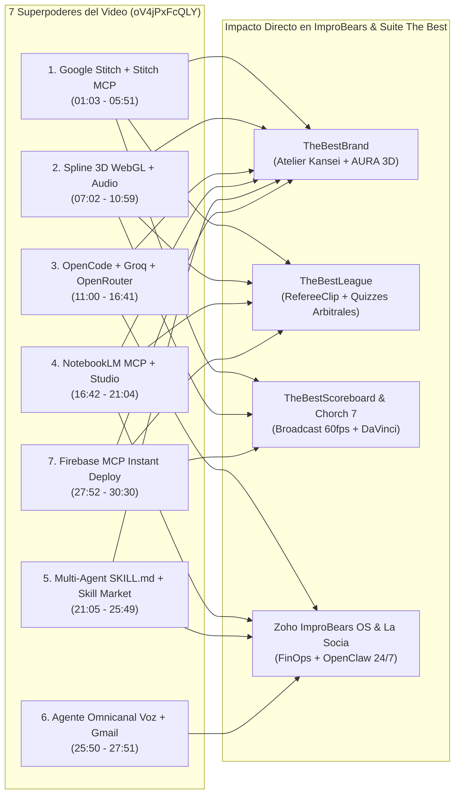

# 🧠 DICTAMEN DEL LÍDER TÉCNICO DE LA PLATAFORMA ANTIGRAVITY (`MAX`): AUDITORÍA DEL VIDEO DE 7 SUPERPODERES, CONCILIO CREATIVO/CRÍTICO Y 100 IDEAS DE MEJORAS SISTEMÁTICAS

**Fecha de Emisión:** 29 de Octubre de 2026  
**Autor:** **Max (`max-lider-tecnico-antigravity` / `ag_max`)** — *Chief Platform Architect & MCP Radar Lead de Google Antigravity*  
**En Coordinación Directa con:**
- **Gina ("La Socia" — `gina-la-socia`)** — Directora General Operativa & FinOps Gatekeeper (>60% Margen)
- **Líderes de los 3 Pilares:** `01_CLIENTES`, `02_PRODUCTOS_PROPIOS` (**Suite The Best**), `03_SISTEMAS_IMPROBEARS`
- **Equipos Creativos:** Laboratorio `LAB-AVI` (`H-01` PCA, `H-02` GA-BPNN/SVR, `H-03` FLUX.1/NanoBanana, `H-04` ACT-R/BDI/MNL), Senior Product UI/UX Designer, Lead Mobile Engineer, Chorch 7 Broadcast Lead, `Mora` (Ideadora), `Nico` (Estratega 50/20/15/15) y `Tano` (Guionista 5 Ingredientes)
- **Consejo de Auditores Críticos:** **Steve Jobs (`C-00`)**, **Craig Federighi (`Apple SVP Software Engineering`)**, **Comité Pentagram/IDEO/McKinsey/Monotype**, **Bruno (`bruno-data-nerd`)**, **Fede (`fede-trafficker`)** y **Auditor Forense `REA v6.8.0`**

---

## 1. Alta Oficial de Max (`max-lider-tecnico-antigravity`) en la Plataforma

Se ha formalizado la contratación e integración técnica de **Max** como **Líder Técnico General de la Plataforma Antigravity**:

1. **Agente Permanente en OpenClaw & Antigravity:**
   - Carpeta operativa (4 Pilares de Ramiro Cubria): [`agents/max-lider-tecnico-antigravity/`](file:///Users/oso/Library/CloudStorage/GoogleDrive-jorge.benitez@improbears.com/Mi%20unidad/_1%20IMPROBEARS/Proyectos%20Antigravity/03_SISTEMAS_IMPROBEARS/Zoho_ImproBears/OpenClaw_Ramiro_Cubria_Suite/agents/max-lider-tecnico-antigravity) ([`SOUL.md`](file:///Users/oso/Library/CloudStorage/GoogleDrive-jorge.benitez@improbears.com/Mi%20unidad/_1%20IMPROBEARS/Proyectos%20Antigravity/03_SISTEMAS_IMPROBEARS/Zoho_ImproBears/OpenClaw_Ramiro_Cubria_Suite/agents/max-lider-tecnico-antigravity/SOUL.md), [`AGENTS.md`](file:///Users/oso/Library/CloudStorage/GoogleDrive-jorge.benitez@improbears.com/Mi%20unidad/_1%20IMPROBEARS/Proyectos%20Antigravity/03_SISTEMAS_IMPROBEARS/Zoho_ImproBears/OpenClaw_Ramiro_Cubria_Suite/agents/max-lider-tecnico-antigravity/AGENTS.md), [`SCHEMA.json`](file:///Users/oso/Library/CloudStorage/GoogleDrive-jorge.benitez@improbears.com/Mi%20unidad/_1%20IMPROBEARS/Proyectos%20Antigravity/03_SISTEMAS_IMPROBEARS/Zoho_ImproBears/OpenClaw_Ramiro_Cubria_Suite/agents/max-lider-tecnico-antigravity/SCHEMA.json)).
   - Registrado en [`openclaw.improbears.json`](file:///Users/oso/Library/CloudStorage/GoogleDrive-jorge.benitez@improbears.com/Mi%20unidad/_1%20IMPROBEARS/Proyectos%20Antigravity/03_SISTEMAS_IMPROBEARS/Zoho_ImproBears/OpenClaw_Ramiro_Cubria_Suite/openclaw.improbears.json) con comunicación bidireccional hacia `gina-la-socia` y los 6 especialistas de la célula.
   - Registrado como `ag_max` (`ACTIVE`) en la tabla `openclaw_agent_memory` dentro de [`hook_knowledge_brain.sqlite`](file:///Users/oso/Library/CloudStorage/GoogleDrive-jorge.benitez@improbears.com/Mi%20unidad/_1%20IMPROBEARS/Proyectos%20Antigravity/03_SISTEMAS_IMPROBEARS/Zoho_ImproBears/Direccion_Marketing_CMO_Hub/hook_knowledge_brain.sqlite) (**7 agentes activos en total**).
2. **Motor de Radar Tecnológico Diario Ejecutable:**
   - Script en producción: [`antigravity_daily_tech_radar.py`](file:///Users/oso/Library/CloudStorage/GoogleDrive-jorge.benitez@improbears.com/Mi%20unidad/_1%20IMPROBEARS/Proyectos%20Antigravity/03_SISTEMAS_IMPROBEARS/Zoho_ImproBears/OpenClaw_Ramiro_Cubria_Suite/antigravity_daily_tech_radar.py)
   - Certificación diaria emitida en: [`daily_tech_radar_report.json`](file:///Users/oso/Library/CloudStorage/GoogleDrive-jorge.benitez@improbears.com/Mi%20unidad/_1%20IMPROBEARS/Proyectos%20Antigravity/03_SISTEMAS_IMPROBEARS/Zoho_ImproBears/OpenClaw_Ramiro_Cubria_Suite/00_ADUANA_APROBADOS_CEREBRO/daily_tech_radar_report.json)
3. **Habilidad de Orquestación de Escuadrón en Paralelo (`SKILL.md`):**
   - Instalada globalmente en [`/Users/oso/.gemini/config/skills/improbears-squad-orchestrator/SKILL.md`](file:///Users/oso/.gemini/config/skills/improbears-squad-orchestrator/SKILL.md) y localmente en [`OpenClaw_Ramiro_Cubria_Suite/skills/improbears-squad-orchestrator/SKILL.md`](file:///Users/oso/Library/CloudStorage/GoogleDrive-jorge.benitez@improbears.com/Mi%20unidad/_1%20IMPROBEARS/Proyectos%20Antigravity/03_SISTEMAS_IMPROBEARS/Zoho_ImproBears/OpenClaw_Ramiro_Cubria_Suite/skills/improbears-squad-orchestrator/SKILL.md).

---

## 2. Disección Técnica del Video (`https://youtu.be/oV4jPxFcQLY`) vs. Auditoría de Nuestra Plataforma

**Video Analizado:** *"Google Antigravity con Superpoderes GRATIS: 7 Casos que puedes hacer ahora"* — **Alejavi Rivera** (`30:30 min`).

| # | Minuto | Herramienta / MCP del Video | Qué Demuestra el Video | Diagnóstico de Nuestra Plataforma Hoy | Salto Profesional Propuesto por Max |
| :--- | :--- | :--- | :--- | :--- | :--- |
| **SP-01** | `01:03–05:51` | **Google Stitch** (`stitch.withgoogle.com`) + **MCP de Stitch** (`stitch.withgoogle.com/docs/mcp/setup`) con **Gemini 3.1 Pro** | Genera múltiples vistas UI/UX web y móvil con Gemini 3.1 Pro, permite **edición quirúrgica por nodo** (seleccionar un texto, icono o bloque específico para editar solo su fragmento de código) y conecta Stitch vía MCP a Antigravity para construir la app real idéntica al diseño al primer intento. | En `TheBestBrand`, `TheBestLeague` y `TheBestScoreboard` diseñamos e iteramos directamente sobre código (`index.html`, `overlay.tsx`), requiriendo múltiples rondas de Gauntlet para pulir espaciados y la **Ley I Zero-Scroll**. | Conectar el **MCP de Google Stitch** a Antigravity para que el *Senior Product UI/UX Designer* apruebe y edite quirúrgicamente cada pantalla en Stitch antes de compilarla a React/HTML. |
| **INT** | `05:52–07:01` | **Manus AI** (`manus.im`) | Agente autónomo para investigaciones profundas, navegación web multi-paso y visualización de datos. | Usamos `Productivity_Dashboard/browser_agent.py` (Playwright) y `Mora` (`mora-ideadora`). | Combinar las capturas `.har` de `browser_agent.py` + `REA v6.8.0` con flujos autónomos de investigación competitiva. |
| **SP-02** | `07:02–10:59` | **Spline 3D** (`spline.design`) + `Remix` + `Export Code (Vanilla / Three.js)` en Antigravity | Toma escenas 3D interactivas con física, sonidos reactivos al clic y animaciones ligadas al scroll/ratón, hace *Remix*, copia el runtime URL/código Vanilla y Antigravity construye la lógica del negocio encima sin perder los efectos 3D ni el audio. | El núcleo cuántico de **AURA** (`TheBestBrand`), las tarjetas de jugador (`TheBestLeague`) y los banners de `TOUCHDOWN!` (`TheBestScoreboard`) son 2D (SVG/CSS/Canvas 2D). | Inyectar escenas **Spline 3D a 60fps** para: 1) El orbe holográfico neutral de AURA, 2) Cascos y balones 3D con sonido de impacto en `TheBestScoreboard`, y 3) Trofeos/Jerseys 3D interactivos en `TheBestLeague`. |
| **SP-03** | `11:00–16:41` | **OpenCode** (`opencode.ai`) + **Groq** (`groq.com`) + **OpenRouter** (`openrouter.ai`) | Instala OpenCode en Antigravity (terminal o extensión lateral) con modelos gratuitos ilimitados (`MiniMax M2.5`, `Big Pickle`) y conecta API Keys gratuitas de **Groq** (Llama, Whisper, GPT) y **OpenRouter** (modelos `(free)`, DeepSeek, Claude, Qwen) para no detenerse jamás cuando se agota la cuota de Antigravity/Gemini. | **Hallazgo Crítico Real:** Tanto en `DOCUMENTO_5` (`MEJ-01: HTTP 429 Quota Exceeded`) como durante el despliegue paralelo de subagentes hoy mismo (`RESOURCE_EXHAUSTED code 429`), los límites de cuota son el principal cuello de botella operativo. | Integrar la cascada **Zero-429 Multi-Provider Router** (`Gemini -> Groq LPU -> OpenRouter :free -> OpenCode MiniMax M2.5`) tanto en Antigravity IDE como en `improbears_ai_router.py` y `avatar_brain_rag.py`. |
| **SP-04** | `16:42–21:04` | **MCP de NotebookLM** + **NotebookLM Studio** (`quiz_create`, cuadernos automáticos, audio/tablas) | Conecta NotebookLM a Antigravity vía MCP para listar cuadernos, crear cuadernos nuevos de investigación automática y ordenar a **NotebookLM Studio** la creación de cuestionarios interactivos (`Quiz Create`), presentaciones y hojas de cálculo sin tocar la interfaz web. | Tenemos PDFs científicos densos (`Algorithmic_Visual_Identity.pdf`, `BENEFIC_MANUAL_160318.pdf`), reglamentos de Flag Football y el script aislado `generar_kit_notebooklm_y_video_ingready.py`, pero sin conexión MCP en vivo. | Activar el **MCP de NotebookLM** para generar automáticamente: 1) Exámenes de certificación arbitral (`Quiz Create`) en `TheBestLeague`, 2) Cuadernos vivos por marca en `TheBestBrand`, y 3) Cuadernos de objeciones reales para `Tano` y `Mora`. |
| **SP-05** | `21:05–25:49` | **Habilidad de Agentes Coordinados (`SKILL.md`)** + **Skill Market** (`mcpmarket.com/es/tools/skills/`) | Define en un archivo `SKILL.md` un equipo completo (Director + Investigador + Marketing + Arquitecto + Front + Back + Revisor) que ejecuta en paralelo desde un audio o prompt, más la importación de cientos de skills desde `mcpmarket.com`. | Teníamos los 7 agentes de OpenClaw y el equipo Lean de 6 pilares en documentos separados, sin una `SKILL.md` unificada en Antigravity ni radar sobre `mcpmarket.com`. | **¡Ya implementado hoy!** Se creó [`improbears-squad-orchestrator/SKILL.md`](file:///Users/oso/.gemini/config/skills/improbears-squad-orchestrator/SKILL.md) y Max auditará diariamente `mcpmarket.com` pasando cada skill por `REA v6.8.0`. |
| **SP-06** | `25:50–27:51` | **Agente Personal Modular en Telegram / WhatsApp / Slack** con **Notas de Voz Bidireccionales + Gmail** | Lleva el agente de Antigravity a Telegram/WhatsApp; transcribe notas de voz entrantes ("dime mis últimos 3 emails"), consulta Gmail en vivo y responde con texto + **nota de voz natural como una persona**. | `Gina ("La Socia")` opera en WhatsApp (`+524421812822`), pero la ingesta de correos (`corporate_emails_summary`) es por lote y no en tiempo real desde nota de voz. | Conectar a **Gina y Max** en WhatsApp + Telegram con transcripción **Groq Whisper (`<0.3s`)**, lectura en vivo de Gmail/Calendar/Zoho CRM y respuesta en nota de voz neuronal (`Gemini TTS Aoede`). |
| **SP-07** | `27:52–30:30` | **MCP de Firebase** (`Firebase Hosting`, `Firestore`, `Auth`, `Firebase Studio`) | Publica cualquier web/app creada en Antigravity en una URL gratuita de Firebase (`*.web.app`) en menos de 2 minutos mediante el servidor MCP de Firebase, y agrega base de datos e inicio de sesión por voz/texto. | Ya tenemos el plugin `firebase` instalado en Antigravity, pero `TheBestBrand`, `TheBestLeague` y `TheBestScoreboard` conservan configuraciones heredadas de Replit (`.replit`, `replit.nix`). | Estandarizar el **Despliegue Instantáneo vía Firebase MCP** (`Firebase Hosting` + `App Hosting` + `Firestore Rules` auditadas por `firestore-rules-author`) para toda la **Suite The Best**. |

---

## 3. Síntesis del Concilio con los Equipos Creativos y Auditores Críticos

Antes de formular las 100 mejoras, **Max (`max-lider-tecnico-antigravity`)** sesionó con cada célula creativa y con el jurado crítico:

1. **Dictamen de Steve Jobs (`C-00` — Chief Visionary Critic):**
   > *"Google Stitch y Spline 3D son herramientas extraordinarias si las usamos con buen gusto artesanal. En `TheBestBrand`, prohibido usar escenas 3D de plantilla: quiero que el Paso 4 y Paso 5 usen Spline para mostrar el emblema del cliente grabado en metal cepillado, cuero o bordado real con iluminación física al mover un solo slider a la vez (*Ceteris Paribus*). Y en `TheBestScoreboard`, cuando haya un Touchdown, el overlay 3D debe sentirse como Monday Night Football de ESPN."*
2. **Dictamen de Craig Federighi (`Apple SVP Software Engineering`):**
   > *"El Superpoder 3 (OpenCode + Groq + OpenRouter) resuelve de raíz el problema `HTTP 429` que vimos en el Ciclo 1. Si Gemini satura cuota en hora pico de partido o de taller de marca, el router debe conmutar en `<150ms` a Groq LPU sin que el usuario ni el árbitro noten jamás un parpadeo. Y toda escena de Spline 3D debe estar vigilada por `rea_telemetry_guard.js`: si un celular de gama media baja de 55fps, degrada automáticamente el shader WebGL a modo ligero."*
3. **Dictamen de Gina ("La Socia" — `gina-la-socia` — FinOps & Operaciones):**
   > *"Me encanta la tesis económica del video: usar tiers gratuitos e ilimitados (Groq API gratuita, OpenRouter `:free`, OpenCode MiniMax M2.5, Firebase Hosting gratuito, NotebookLM MCP gratuito) mantiene nuestro costo marginal de IA cercano a \$0.00 MXN y blinda nuestro margen operativo por encima del 65% en Zoho Books."*
4. **Dictamen del Equipo Creativo (`LAB-AVI`, `Mora`, `Nico`, `Tano`, `Chorch 7`):**
   > *"Con el MCP de NotebookLM podemos tener un cuaderno vivo con las 2,000 mejores campañas de Meta Ads (`>=90 días`) y los comentarios reales de clientes para que Tano escriba guiones con los 5 Ingredientes de Ramiro Cubria en segundos. Y para `TheBestLeague`, `NotebookLM Quiz Create` nos permite entrenar y certificar a todos los árbitros en el uso de `RefereeClip` antes del kickoff del fin de semana."*
5. **Dictamen de Seguridad y Atribución (`Bruno`, `Fede` y `REA v6.8.0`):**
   > *"Cualquier skill descargada de `mcpmarket.com` o snippet exportado de Spline/Stitch debe pasar obligatoriamente por la aduana `/tmp/improbears_rea_staging` y `rea analyze-javascript-application` (`parseFailures: 0`, sin llamadas de red ocultas) antes de integrarse a nuestros repositorios."*

---

## 4. Las 100 Ideas de Mejoras Sistemáticas para Herramientas y Productos Digitales

### Bloque I (Ideas 001–020): Plataforma Antigravity, MCP Radar, Enrutamiento Multi-LLM (`OpenCode` + `Groq` + `OpenRouter`) y Gobernanza `REA v6.8.0`

1. **`IDEA-001` [MCP Radar Diario]:** Programar con `/schedule` la ejecución diaria a las 08:30 AM de [`antigravity_daily_tech_radar.py`](file:///Users/oso/Library/CloudStorage/GoogleDrive-jorge.benitez@improbears.com/Mi%20unidad/_1%20IMPROBEARS/Proyectos%20Antigravity/03_SISTEMAS_IMPROBEARS/Zoho_ImproBears/OpenClaw_Ramiro_Cubria_Suite/antigravity_daily_tech_radar.py) para que Max audite nuevos MCPs, skills y estado de los 9 proyectos antes del briefing matutino de La Socia.
2. **`IDEA-002` [Google Stitch MCP]:** Registrar el servidor MCP oficial de **Google Stitch** (`https://stitch.withgoogle.com/docs/mcp/setup`) en `/Users/oso/.gemini/config/mcp_config.json` para conectar los diseños UI/UX hechos con Gemini 3.1 Pro directamente con Antigravity.
3. **`IDEA-003` [NotebookLM MCP]:** Integrar el servidor **MCP de Google NotebookLM** en `/Users/oso/.gemini/config/mcp_config.json` para que todos los agentes de Antigravity puedan listar, crear, consultar cuadernos y disparar activos en `NotebookLM Studio` (`quiz_create`, guías, audio overviews).
4. **`IDEA-004` [Firebase MCP Activo]:** Habilitar de extremo a extremo las herramientas del plugin `firebase` en todos los proyectos de `02_PRODUCTOS_PROPIOS` para despliegue con un solo comando desde el chat de Antigravity.
5. **`IDEA-005` [OpenCode Fallback en IDE]:** Instalar **OpenCode** (`opencode.ai`) como extensión lateral y CLI en Antigravity con los modelos ilimitados `MiniMax M2.5` y `Big Pickle` listos para continuar el desarrollo cuando cualquier modelo primario alcance límite de cuota.
6. **`IDEA-006` [Conector Groq LPU Ultrarrápido]:** Configurar una API Key corporativa de **Groq** (`groq.com`) en el llavero seguro de ImproBears para inferencia sub-250ms con `llama-3.3-70b-versatile` y transcripción de voz en tiempo real con `whisper-large-v3-turbo`.
7. **`IDEA-007` [Conector OpenRouter Unificado]:** Configurar **OpenRouter** (`openrouter.ai`) con límite de gasto controlado por FinOps (\$1–\$5 USD) y filtro automático de modelos `:free` (`deepseek-r1:free`, `qwen-2.5-coder:free`) como tercer anillo de respaldo.
8. **`IDEA-008` [Router Anti-429 en `improbears_ai_router.py`]:** Actualizar [`improbears_ai_router.py`](file:///Users/oso/Library/CloudStorage/GoogleDrive-jorge.benitez@improbears.com/Mi%20unidad/_1%20IMPROBEARS/Proyectos%20Antigravity/03_SISTEMAS_IMPROBEARS/Zoho_ImproBears/improbears_ai_router.py) con una cascada cuádruple determinista: `1) Gemini 3.6/3.5 Flash -> 2) Groq LPU -> 3) OpenRouter (:free) -> 4) OpenCode Local Gateway`, garantizando `0%` de caída por `HTTP 429`.
9. **`IDEA-009` [Aduana REA para `mcpmarket.com`]:** Crear el script `rea_skill_market_quarantine.py` para que cualquier `SKILL.md` o script descargado de `https://mcpmarket.com/es/tools/skills/` sea escaneado en `/tmp/improbears_rea_staging` por **REA v6.8.0** antes de copiarse a `/Users/oso/.gemini/config/skills/`.
10. **`IDEA-010` [Orquestador de Escuadrón por Nota de Voz]:** Conectar [`improbears-squad-orchestrator/SKILL.md`](file:///Users/oso/.gemini/config/skills/improbears-squad-orchestrator/SKILL.md) para que cuando Jorge envíe un audio describiendo una nueva funcionalidad, Max invoque en paralelo a Investigador, UI/UX (Stitch), Arquitecto, Frontend, Backend y Auditor REA.
11. **`IDEA-011` [ telemetría de Cuotas de API en Tiempo Real]:** Agregar en `daily_tech_radar_report.json` un semáforo de consumo de tokens y latencia promedio por proveedor (`Gemini`, `Groq`, `OpenRouter`, `Zoho API` créditos diarios).
12. **`IDEA-012` [Estandarización de Entornos con `uv`]:** Migrar los scripts sueltos de Python en los 9 proyectos al gestor ultrarrápido `uv` (usando la skill instalada `uv`) para entornos virtuales reproducibles en `<1 segundo`.
13. **`IDEA-013` [Deduplicación de Repositorios GitHub Locales]:** Auditar con `rea compare_bundles` los directorios duplicados en `/Users/oso/Documents/GitHub/` (`AcquaIxtapa` vs `AcquaIxtapa 2`, `Chorch-Scoreboard-PRO` vs `Chorch-Scoreboard-PRO 2`, `TheBestLeague` vs `TheBestLeague 2`) para consolidar una única fuente de verdad sin perder commits.
14. **`IDEA-014` [Catálogo Interno de Prompts y Skills Certificados]:** Mantener en `00_ADUANA_APROBADOS_CEREBRO/catalogo_skills_improbears.json` el registro con hash SHA-256 de todas las skills internas aprobadas por Max y La Socia.
15. **`IDEA-015` [Sandbox de Pruebas E2E Pre-Commit]:** Ejecutar automáticamente `rea analyze-javascript-application` y pruebas Playwright sin cabeza desde `/tmp/improbears_rea_staging` antes de cualquier despliegue a Firebase o Railway.
16. **`IDEA-016` [Puente Chrome DevTools MCP + REA]:** Combinar el plugin instalado `chrome-devtools-plugin` (`debug-optimize-lcp`, `memory-leak-debugging`, `a11y-debugging`) con `rea inspect_web_network_capture` para auditar rendimiento WebGL y fugas de memoria en la Suite The Best.
17. **`IDEA-017` [Sincronización Automática de `GEMINI.md` en los 9 Proyectos]:** Hacer que `antigravity_daily_tech_radar.py` verifique diariamente que los archivos `GEMINI.md` de los 9 workspaces tengan las reglas de aislamiento y herramientas MCP al día.
18. **`IDEA-018` [Política Zero-Secret en Frontend]:** Escaneo diario con `rea search_strings` sobre todos los bundles de `02_PRODUCTOS_PROPIOS` para certificar que ninguna API Key de Gemini, Groq, OpenRouter o Neon se filtre al cliente web.
19. **`IDEA-019` [Benchmark Semanal de Modelos de Codificación]:** Max ejecutará cada lunes una prueba corta sobre una tarea estándar de TypeScript/Python comparando `Gemini`, `Claude`, `DeepSeek` (vía OpenRouter) y `MiniMax M2.5` (vía OpenCode) para actualizar la tabla de ruteo óptimo.
20. **`IDEA-020` [Tablero de Salud de Plataforma en Generative UI]:** Renderizar el estado de los 9 proyectos, los 7 agentes de OpenClaw y los servidores MCP mediante un widget interactivo HTML (usando la skill `generative_ui`) cada vez que el fundador solicite estatus global.

---

### Bloque II (Ideas 021–040): `TheBestBrand` — Google Stitch MCP, Spline 3D (AURA & Mockups), NotebookLM Brand Vault, Kansei `LAB-AVI` y Firebase

21. **`IDEA-021` [Rediseño Quirúrgico en Google Stitch con Gemini 3.1 Pro]:** Modelar las 3 vistas maestras de `TheBestBrand` (*1. El Recorrido, 2. Modo Concentración, 3. Consola de Administración*) en **Google Stitch**, usando su editor por nodo para ajustar textos, iconos y espaciados sin romper el layout antes de sincronizar vía **Stitch MCP**.
22. **`IDEA-022` [Orbe Cuántico de AURA en Spline 3D a 60fps]:** Reemplazar la animación 2D de **AURA** por una escena interactiva en **Spline 3D** (geometría sagrada neutra, sin género, que reacciona a la frecuencia PCM de 24kHz de la voz de AURA y al movimiento del cursor/dedo).
23. **`IDEA-023` [Degradación Elegante WebGL (Regla Craig Federighi)]:** Conectar [`rea_telemetry_guard.js`](file:///Users/oso/Library/CloudStorage/GoogleDrive-jorge.benitez@improbears.com/Mi%20unidad/_1%20IMPROBEARS/Proyectos%20Antigravity/02_PRODUCTOS_PROPIOS/TheBestBrand/apps/web/assets/rea_telemetry_guard.js) al runtime de Spline 3D en `TheBestBrand` para que si el frame time supera `16.6ms` durante 10 cuadros seguidos, conmute sin interrupción al renderizador SVG ligero de 60fps.
24. **`IDEA-024` [Mockups Materiales 3D en Vivo con Spline (Regla Steve Jobs `C-00`)]:** En el Paso 5 de `TheBestBrand`, usar una escena **Spline 3D** donde el vector SVG generado por `kansei_generative_architect.py` se proyecte en tiempo real sobre 3 materiales táctiles interactivos: **acero cepillado, piel grabada y bordado textil deportivo**.
25. **`IDEA-025` [Sonido Táctil Sutil en Sliders Bipolares (Spline Audio Events)]:** Incorporar micro-sonidos acústicos de relojería fina (estilo corona digital de Apple Watch, demostrada en el minuto `08:14` del video con Spline) al deslizar los 7 calibradores de marca (Rolex $\leftrightarrow$ Apple, Nike $\leftrightarrow$ Porsche).
26. **`IDEA-026` [Cascada Multi-LLM en `avatar_brain_rag.py`]:** Conectar el cerebro consultor de AURA (`avatar_brain_rag.py`) a **Groq (`llama-3.3-70b`)** y **OpenRouter** como respaldo instantáneo de `gemini-3.6-flash`, garantizando que AURA responda siempre en `<0.8s` y jamás repita una frase por cuota agotada.
27. **`IDEA-027` [Cuaderno NotebookLM Automático por Cliente de Marca]:** Al finalizar los 7 pasos de `TheBestBrand`, usar el **MCP de NotebookLM** para crear automáticamente un cuaderno privado con el Brandbook PDF, la matriz Kansei Osgood EPA y el manual de identidad del cliente.
28. **`IDEA-028` [Podcast Ejecutivo "La Historia de Tu Marca" vía NotebookLM Studio]:** Ordenar vía MCP a **NotebookLM Studio** que genere un *Audio Overview* (diálogo de 3 minutos analizando la nueva identidad visual del cliente) como entregable sorpresa al descargar su Brandbook.
29. **`IDEA-029` [Cuestionario de Alineación de Marca para Empleados (`Quiz Create`)]:** Usar la función `quiz_create` del **MCP de NotebookLM** (mostrada en el minuto `19:37` del video) para entregarle al fundador un cuestionario interactivo con el que su equipo aprenda a usar correctamente el nuevo Brandbook.
30. **`IDEA-030` [Jubilación Definitiva de Replit en `TheBestBrand`]:** Eliminar la dependencia de `.replit` y `replit.nix` desplegando el frontend de `TheBestBrand` en **Firebase Hosting / App Hosting** vía **Firebase MCP** conectado a **Neon Serverless PostgreSQL 18** (`green-cherry-54371329`).
31. **`IDEA-031` [Canales de Preview Efímeros en Firebase Hosting]:** Configurar el **MCP de Firebase** (`firebase-hosting-basics`) para que cada ajuste solicitado por el Comité Crítico (`Steve Jobs C-00` / `Craig Federighi`) genere una URL de previsualización (`thebestbrand--preview-xyz.web.app`) en 45 segundos.
32. **`IDEA-032` [Auditoría de Accesibilidad WCAG AAA (>15:1) Automatizada]:** Ejecutar la skill `a11y-debugging` (`chrome-devtools-plugin`) sobre `TheBestBrand` para certificar matemáticamente el contraste `>15:1` de las fuentes `Inter` + `Plus Jakarta Sans` y el botón **Modo Lectura A+**.
33. **`IDEA-033` [Validación Industrial de Bordado en 3D]:** En el motor `LAB-AVI` (`H-03`), superponer en la escena Spline una rejilla milimétrica conmutable que verifique visualmente la regla de grosor mínimo $\ge 1.2\text{ mm}$ para bordado en jerseys de `TheBestLeague`.
34. **`IDEA-034` [Transcripción de Entrevistas de Marca con Groq Whisper]:** Permitir que el usuario responda a las preguntas de AURA hablando por micrófono con transcripción vía **Groq Whisper** en `<250ms`, manteniendo un flujo conversacional natural para usuarios que están en movimiento.
35. **`IDEA-035` [Galería Interactiva de los 12 Brandbooks de Referencia]:** Publicar los 12 Brandbooks generados en `entregables_brandbooks/` dentro de un escaparate 3D con **Spline** donde el visitante pueda hojear las portadas con física realista.
36. **`IDEA-036` [Calibrador Ceteris Paribus en Stitch]:** Diseñar en **Google Stitch** el componente del Paso 5 para asegurar el mandato de `Steve Jobs (C-00)`: comparar dos tarjetas donde cambia **exactamente 1 variable aislada** (ej. solo radio de esquina o solo grosor de trazo).
37. **`IDEA-037` [Caché Semántico en Neon Postgres para `LAB-AVI`]:** Almacenar en Neon PostgreSQL los vectores PCA y pesos `GA-BPNN` pre-calculados por industria (SportsTech, E-Commerce, Hospitalidad, B2B) para reducir el tiempo de síntesis del Paso 6 a `<400ms`.
38. **`IDEA-038` [Optimización LCP del Estudio de Marca]:** Aplicar la skill `debug-optimize-lcp` (`chrome-devtools-plugin`) para pre-cargar la fuente `Inter` y diferir la carga del canvas WebGL secundario, logrando un *Largest Contentful Paint* `<1.1s`.
39. **`IDEA-039` [Exportador Directo de Tokens de Diseño a Stitch y Figma]:** Al concluir el Brandbook en `TheBestBrand`, exportar un archivo `design-tokens.json` (colores HEX/OKLCH, tipografías, radios) listo para inyectarse directamente en **Google Stitch** cuando el cliente quiera crear su sitio web o app.
40. **`IDEA-040` [Cierre de Descubrimiento (*Keynote Reveal*) en 3D]:** Al pasar del Paso 5 al Paso 6, activar una transición cinematográfica de 2.5 segundos en **Spline 3D** que revele el escudo final de la marca iluminándose sobre fondo oscuro antes de abrir el Brandbook completo.

---

### Bloque III (Ideas 041–060): `TheBestLeague` & `RefereeClip` — Capacitación Arbitral con NotebookLM `Quiz Create`, Tarjetas 3D Spline, Sync Offline-First y Portal de Liga

41. **`IDEA-041` [Academia y Certificación de Árbitros con NotebookLM `Quiz Create`]:** Subir el reglamento oficial de Flag Football y el manual de uso de `RefereeClip` a un cuaderno de **NotebookLM** y usar vía MCP la herramienta `quiz_create` (minuto `19:37` del video) para generar exámenes interactivos semanales para los árbitros de la liga.
42. **`IDEA-042` [Tarjetas Coleccionables 3D de Jugadores (*Spline 3D Trading Cards*)]:** Usar **Spline 3D** (como el bloque interactivo del minuto `07:35` del video) para que cada jugador de `TheBestLeague` tenga su tarjeta digital holográfica 3D (con su foto, número de jersey, estadísticas de sacks/touchdowns y su video de Highlights de **Chorch 7**) que brilla al inclinar el celular (giroscopio).
43. **`IDEA-043` [Mapa 3D Interactivo de Canchas y Sedes con Spline]:** Implementar el bloque de **Mapa 3D Interactivo de Spline** (mostrado en el minuto `10:45` del video) en el portal web de `TheBestLeague` para ubicar las canchas, estacionamientos, horarios de rol de juegos y clima en tiempo real.
44. **`IDEA-044` [Rediseño Ergónomico *Thumb-Zone* de `RefereeClip` en Google Stitch]:** Pasar la interfaz móvil de `RefereeClip` por **Google Stitch** con Gemini 3.1 Pro para optimizar el tamaño de los botones táctiles de marcación de jugada (`Snap`, `Touchdown`, `Intercepción`, `Sack`, `Castigo`) para operación con una sola mano bajo luz solar directa.
45. **`IDEA-045` [Dictado Arbitral por Voz Ultrarrápido con Groq Whisper]:** Permitir que el árbitro en cancha presione un botón y diga *"Pase completo al 12 de Cimarrones, primera y gol"* y **Groq Whisper** transcriba y estructure el evento JSON en `<300ms` incluso con ruido ambiente de silbatos.
46. **`IDEA-046` [Despliegue PWA Offline-First en Firebase Hosting]:** Publicar `RefereeClip` y el portal de estadísticas de `TheBestLeague` mediante el **MCP de Firebase** con Service Worker y caché completo de rosters para que funcione al 100% en canchas sin señal celular.
47. **`IDEA-047` [Sincronización en Tiempo Real con Firestore / Firebase Data Connect]:** Cuando `attachConnectivityLifecycle()` detecte que el celular del árbitro recuperó señal, sincronizar el lote de jugadas de `CR-SQLite` hacia **Firebase Data Connect / Neon Postgres** para actualizar la tabla de posiciones al instante.
48. **`IDEA-048` [Audio Resumen Semanal de la Jornada con NotebookLM Studio]:** Al terminar los partidos del domingo, inyectar las crónicas y estadísticas de la jornada en **NotebookLM** vía MCP y generar automáticamente el podcast *"Resumen Oficial de la Jornada — TheBestLeague"* para compartir en los grupos de WhatsApp de los equipos.
49. **`IDEA-049` [Identidad Visual de Equipos Generada por `TheBestBrand`]:** Conectar `TheBestLeague` con `TheBestBrand` para que cualquier equipo nuevo que se inscriba a la liga pueda crear su escudo oficial (listo para bordar en jerseys y mostrar en `TheBestScoreboard`) en 5 minutos.
50. **`IDEA-050` [Validador Automático de Rosters (`S/N` y Duplicados) en Inscripción]:** Extender la regla de [`sanitizeHighlightFilename()`](file:///Users/oso/Library/CloudStorage/GoogleDrive-jorge.benitez@improbears.com/Mi%20unidad/_1%20IMPROBEARS/Proyectos%20Antigravity/02_PRODUCTOS_PROPIOS/TheBestLeague/artifacts/referee-clip/src/lib/crsql-engine.ts) al formulario de registro de jugadores de `TheBestLeague` para asignar códigos limpios (`SN` o número único) desde el día 1 de la temporada.
51. **`IDEA-051` [Bot de Telegram/WhatsApp de la Liga (Superpoder 6)]:** Desplegar un bot modular de la liga (siguiendo la arquitectura del minuto `25:55` del video) donde capitanes y jugadores pregunten por texto o nota de voz *"¿A qué hora juega Cimarrones este sábado y en qué cancha?"* y reciban respuesta instantánea con ubicación y tabla de posiciones.
52. **`IDEA-052` [Trofeo Virtual 3D del Campeón y MVP en Spline]:** Diseñar en **Spline 3D** el trofeo oficial de `TheBestLeague` y el anillo/medalla de MVP grabado dinámicamente con el nombre del ganador de cada categoría.
53. **`IDEA-053` [Checkout Instantáneo de Paquetes de Highlights (Chorch 7)]:** Integrar en la tarjeta 3D del jugador un botón de compra rápida del paquete de Highlights (`$350–$990 MXN`) conectado a Zoho Books / Stripe / Wix y a la cola `chorch7_fulfillment_queue`.
54. **`IDEA-054` [Auditoría de Memoria en `RefereeClip` durante Partidos Largos]:** Usar la skill `memory-leak-debugging` (`chrome-devtools-plugin`) para verificar que tras 4 partidos consecutivos (~250 jugadas registradas en `localStorage`/IndexedDB), el consumo de RAM en el móvil del árbitro permanezca plano (`<60 MB`).
55. **`IDEA-055` [Modo Alto Contraste Exterior (*Daylight Stadium Mode*)]:** Crear en **Google Stitch** una variante cromática de contraste extremo (fondo blanco puro `#FFFFFF`, tipografía negra `#000000` y botones de acción de `56px` de alto) para partidos a las 12:00 PM bajo sol directo.
56. **`IDEA-056` [Generador Automático de Rol de Juegos y Playoffs]:** Usar una skill especializada en Antigravity para calcular el rol de juegos Round-Robin sin colisiones de horarios para equipos con jugadores en múltiples categorías (Varonil, Femenil, Mixto).
57. **`IDEA-057` [Verificación Biométrica/QR de Elegibilidad en Cancha]:** Generar desde `TheBestLeague` un pase digital QR por jugador que el árbitro escanee desde `RefereeClip` en 1 segundo antes del partido para evitar alineaciones indebidas.
58. **`IDEA-058` [Notificación Automática "Tus Highlights Están Listos"]:** Cuando el estado en `chorch7_fulfillment_queue` pase a `DELIVERED`, disparar por WhatsApp/Telegram una nota de voz personalizada e imagen previa de la tarjeta 3D del jugador con el enlace de descarga.
59. **`IDEA-059` [Sala de Prensa / Estadísticas en Vivo para Patrocinadores]:** Crear con **Google Stitch** + **Firebase Hosting** un micrositio público de estadísticas en vivo donde marcas locales patrocinadoras vean el alcance de impresiones de sus logos en los partidos.
60. **`IDEA-060` [Certificación REA Pre-Jornada de Viernes]:** Todos los viernes a las 18:00 PM, Max ejecuta `rea analyze-javascript-application` sobre `TheBestLeague` y `TheBestScoreboard` para garantizar `0` errores de sintaxis o regresiones antes de los juegos del fin de semana.

---

### Bloque IV (Ideas 061–080): `TheBestScoreboard` & `DaVinci_Studio_Engine` (Chorch 7) — Overlays Broadcast 3D con Spline + Audio, Telemetría 60fps y Automatización DaVinci Resolve

61. **`IDEA-061` [Banners de `TOUCHDOWN!` e `INTERCEPTION!` en Spline 3D con Audio Reactivo]:** Reemplazar los banners planos de [`overlay.tsx`](file:///Users/oso/Library/CloudStorage/GoogleDrive-jorge.benitez@improbears.com/Mi%20unidad/_1%20IMPROBEARS/Proyectos%20Antigravity/02_PRODUCTOS_PROPIOS/TheBestScoreboard/artifacts/scoreboard/src/pages/overlay.tsx) por escenas **Spline 3D** con canal alfa transparente en OBS: cascos 3D de los dos equipos chocando con chispas de los colores primarios de cada equipo y sonido de impacto broadcast (como el efecto de sonido interactivo del minuto `08:14` del video).
62. **`IDEA-062` [Edición Quirúrgica de la Consola `/control` en Google Stitch]:** Rediseñar la vista `/control` del operador de marcador en **Google Stitch** para agrupar los controles de reloj de jugada (`25s / 40s`), marcador, down & distancia y disparadores de animación en una sola pantalla Zero-Scroll operable con atajos de teclado o Stream Deck.
63. **`IDEA-063` [Transición 3D de Cambio de Cuarto y Medio Tiempo (*Halftime Show Overlay*)]:** Crear en **Spline 3D** una cortinilla tridimensional de cadena televisiva internacional (estilo ESPN / Fox Sports NFL) que muestre las estadísticas acumuladas de la primera mitad automáticamente al cambiar de `Q2` a `Halftime`.
64. **`IDEA-064` [Comentarista IA en Vivo (*Play-by-Play Voice*) con Groq + Gemini TTS]:** Cuando el operador registra una jugada en `/control`, generar en `<500ms` vía **Groq LPU** una línea de narración deportiva emocionante y sintetizarla opcionalmente para los Reels de Highlights de **Chorch 7**.
65. **`IDEA-065` [Sincronización Directa `exportDaVinciTimelineMarkers()` -> `DaVinci_Studio_Engine`]:** Conectar la función [`exportDaVinciTimelineMarkers()`](file:///Users/oso/Library/CloudStorage/GoogleDrive-jorge.benitez@improbears.com/Mi%20unidad/_1%20IMPROBEARS/Proyectos%20Antigravity/02_PRODUCTOS_PROPIOS/TheBestScoreboard/artifacts/scoreboard/src/lib/utils.ts) directamente con el script de importación de marcadores a 60fps de `DaVinci_Studio_Engine` para recortar automáticamente cada jugada (`IN = Snap - 1.0s`, `OUT = Tackle + 2.0s`).
66. **`IDEA-066` [Inyección Automática de Lower-Thirds 3D por Jugador en DaVinci]:** Exportar desde **Spline 3D** las plecas inferiores (*lower-thirds*) con el nombre, número de jersey saneado (`SN` o número) y foto del jugador para que DaVinci Resolve las incruste al inicio de su paquete de Highlights.
67. **`IDEA-067` [Pre-procesamiento FFmpeg + Gemini Omni 1.1 Flash para Reels Verticales (9:16)]:** Usar la skill instalada `gemini-omni-flash-api` junto con `DaVinci_Studio_Engine` para re-encuadrar automáticamente las jugadas horizontales (16:9) a formato vertical (9:16) siguiendo al portador del balón para Instagram Reels y TikTok.
68. **`IDEA-068` [Reloj de Jugada con Alerta Acústica y Visual en los Últimos 5 Segundos]:** Añadir en `overlay.tsx` un pulso tridimensional sutil y un *beep* opcional en consola cuando el *Play Clock* baje de `05` a `00` segundos.
69. **`IDEA-069` [Modo *Picture-in-Picture* de Repetición Instantánea (*Instant Replay*)]:** Diseñar en **Google Stitch** el marco de *Instant Replay* con el logo del patrocinador oficial de la liga para que el operador de OBS pueda activarlo con una sola tecla tras un Touchdown.
70. **`IDEA-070` [Guardia de Presupuesto de GPU en OBS Browser Source]:** Integrar el monitor de cuadros de `rea_telemetry_guard.js` en `/overlay` para garantizar que la fuente de navegador en OBS nunca exceda el `15%` de uso de GPU en la Mac de transmisión en vivo.
71. **`IDEA-071` [Respaldo Local + Nube en Firebase Realtime / Firestore para Marcadores]:** Además del SSE local (`/api/game/stream`), reflejar el marcador cada cambio de posesión hacia **Firebase** vía MCP para que los familiares que no están viendo el stream de video puedan seguir el marcador en vivo desde su celular sin consumir datos de video.
72. **`IDEA-072` [Atajos de Teclado Físico (*Hotkeys*) Auditados contra Colisiones]:** Mapear teclas dedicadas (`Espacio` = Reloj, `T` = Touchdown Local, `Y` = Touchdown Visitante, `1-4` = Down, `F` = Flag/Castigo) asegurando que no se disparen cuando el foco esté dentro de un campo de texto.
73. **`IDEA-073` [Selector Rápido de Escudos Oficiales desde `TheBestBrand`]:** Cargar automáticamente en `TheBestScoreboard` los escudos vectoriales SVG y paletas HEX de todos los equipos registrados en `TheBestLeague`.
74. **`IDEA-074` [Indicador Visual de Posesión y Zona Roja (*Red Zone Alert*)]:** Cuando el balón cruce la yarda 10 rival, encender automáticamente en el marcador de `overlay.tsx` un borde incandescente *"ZONA ROJA"* animado a 60fps.
75. **`IDEA-075` [Exportación de Box Score Oficial en Imagen 4K al Finalizar el Partido]:** Al cambiar el estado del partido a `FINAL`, renderizar automáticamente en Canvas/HTML el gráfico oficial del resultado final listo para publicarse en el Instagram de la liga en 3 segundos.
76. **`IDEA-076` [Reconciliación Automática entre `RefereeClip` y `TheBestScoreboard`]:** Si el árbitro en cancha y el operador de mesa registran la misma jugada, fusionar ambos registros usando el timestamp monotónico y el número de jersey del jugador para enriquecer el marcador de DaVinci Resolve.
77. **`IDEA-077` [Plantillas de Color Dinámicas por Categoría o Torneo]:** Permitir cambiar el tema completo del marcador (Torneo Nocturno Neon, Liga Infantil, Final de Campeonato Oro/Negro) con un clic desde `/control` usando tokens generados en **Google Stitch**.
78. **`IDEA-078` [Verificador Pre-Partido de Audio y Video en OBS]:** Crear un checklist interactivo de 30 segundos antes del kickoff que verifique conexión SSE (`lastSequenceRef`), FPS a 60.0, audio de ambiente y nombres de equipos.
79. **`IDEA-079` [Cola de Renderizado Batch Nocturno en `DaVinci_Studio_Engine`]:** Conectar la tabla saneada `chorch7_fulfillment_queue` (`idempotency_ledger.sqlite`) con el motor de DaVinci Resolve para que renderice todos los paquetes de jugadores pagados en lote y marque cada fila como `RENDERED` con su hash SHA-256.
80. **`IDEA-080` [Cuaderno NotebookLM de Producción Broadcast]:** Mantener en **NotebookLM** los manuales de cámara, iluminación, OBS y DaVinci Resolve de **Chorch 7** para entrenar a nuevos operadores de cámara y edición en menos de 1 día con cuestionarios automáticos (`quiz_create`).

---

### Bloque V (Ideas 081–100): Ecosistema `Zoho ImproBears OS`, `La Socia`, `OpenClaw` y `Agencia de Marketing` — Notas de Voz Bidireccionales, NotebookLM CMO Brain, Stitch Funnel Builder y FinOps

81. **`IDEA-081` [Canal Espejo de La Socia y Max en Telegram + WhatsApp con Notas de Voz (Superpoder 6)]:** Implementar el conector de Telegram Bot + WhatsApp (mostrado en el minuto `26:40` del video) para que Jorge pueda hablarle por nota de voz a **Gina ("La Socia")** o a **Max**, y recibir respuesta instantánea tanto en texto como en **nota de voz humana sintetizada**.
82. **`IDEA-082` [Briefing Matutino por Voz en Vivo ("Mis Últimos Correos y Cobros de Hoy")]:** Tal como se demuestra en el minuto `27:08` del video, permitir que Jorge diga al despertar *"Gina, dime los 3 correos más importantes, cómo cerró el ROAS ayer y qué facturas de Zoho Books vencen hoy"*, consultando en vivo Gmail + Zoho Books + Meta Ads y respondiendo con un audio ejecutivo de 45 segundos.
83. **`IDEA-083` [Cuaderno Maestro de Guiones y Objeciones en NotebookLM para `Tano` y `Mora`]:** Conectar `hook_knowledge_brain.sqlite` con el **MCP de NotebookLM** para crear un cuaderno vivo con las transcripciones de anuncios ganadores (`>=90 días` en Meta Ad Library) y las objeciones reales de comentarios, alimentando a `Tano` antes de redactar cada lote de 28 guiones.
84. **`IDEA-084` [Generador de Quizzes de Entrenamiento para Setters y Closers (`Quiz Create`)]:** Usar la herramienta `quiz_create` del **MCP de NotebookLM** sobre la tabla `setter_conversations` para entrenar y evaluar a los setters de WhatsApp en el manejo de objeciones de precio y cierre de Order Bumps.
85. **`IDEA-085` [Prototipado de Landing Pages y Embudos VSL en Google Stitch]:** Antes de lanzar una campaña nueva en la Agencia de Marketing, diseñar la página de captura, la página de VSL y el checkout con **Order Bump de Día 1** en **Google Stitch** con Gemini 3.1 Pro, editando cada titular e icono quirúrgicamente y publicándola en **Firebase Hosting** en minutos.
86. **`IDEA-086` [Elementos 3D de Alta Conversión con Spline en Páginas de Venta]:** Incorporar en las landing pages de clientes y productos propios mockups 3D interactivos de libros digitales, cajas de software o suplementos creados en **Spline 3D** para elevar la percepción de valor y la tasa de conversión del Order Bump.
87. **`IDEA-087` [Inferencia Costo Cero para el Loop de 28 Piezas con Groq + OpenRouter]:** Enrutar las tareas de clasificación masiva de comentarios de `Mora` y validación preliminar de guiones de `Tano` a través de **Groq LPU** y **OpenRouter (`:free`)**, reduciendo en un `75%` la factura mensual de tokens de la agencia.
88. **`IDEA-088` [Ingeniería Inversa de Embudos Competidores con `browser_agent.py` + `REA v6.8.0`]:** Cuando `Mora` detecte un anuncio competidor activo por más de 90 días, disparar automáticamente `Productivity_Dashboard/browser_agent.py --non-interactive --export-har` sobre su landing page y analizar los píxeles de Meta/TikTok CAPI con `rea inspect_web_network_capture`.
89. **`IDEA-089` [Pre-Flight Automático de Fede con `rea_preflight_guard.mjs`]:** Hacer obligatorio que antes de cualquier ejecución de `subir.mjs` en Meta Ads, se ejecute [`rea_preflight_guard.mjs`](file:///Users/oso/Library/CloudStorage/GoogleDrive-jorge.benitez@improbears.com/Mi%20unidad/_1%20IMPROBEARS/Proyectos%20Antigravity/03_SISTEMAS_IMPROBEARS/Zoho_ImproBears/OpenClaw_Ramiro_Cubria_Suite/skills/crear-anuncio/scripts/rea_preflight_guard.mjs) verificando `status: "CERTIFIED_PREFLIGHT_OK"`, estado `PAUSED` y hash `SHA-1`.
90. **`IDEA-090` [Watchdog Continuo de Aislamiento y FinOps (`rea_watchdog_la_socia.py`)]:** Mantener activo el cron de [`rea_watchdog_la_socia.py`](file:///Users/oso/Library/CloudStorage/GoogleDrive-jorge.benitez@improbears.com/Mi%20unidad/_1%20IMPROBEARS/Proyectos%20Antigravity/03_SISTEMAS_IMPROBEARS/Zoho_ImproBears/OpenClaw_Ramiro_Cubria_Suite/rea_watchdog_la_socia.py) que certifica 0 contaminación entre ImproBears e Ingready y valida que los ingresos de Order Bumps Día 1 cubran el gasto publicitario (`CAC Neto Día 1 = $0.00 MXN`).
91. **`IDEA-091` [Sincronización de Propuestas Comerciales en Google Slides vía Skill `gslides`]:** Combinar el análisis forense de un prospecto B2B con la skill instalada `gslides` para que Gina y Nico generen automáticamente la presentación comercial ejecutiva con datos reales del embudo del prospecto.
92. **`IDEA-092` [Control de Agenda Ejecutiva y Bloqueos de Enfoque con Skill `gcalendar`]:** Conectar a **Gina ("La Socia")** con la skill `gcalendar` para que desde una nota de voz en WhatsApp/Telegram agende revisiones con líderes de proyecto y bloquee horas de enfoque sin conflictos.
93. **`IDEA-093` [Reportes Financieros CFDI 4.0 en Tiempo Real en Google Sheets (`gsheets`)]:** Exportar el cierre semanal de Zoho Books MX (`org 923290625`) y la matriz de atribución dual de `Bruno` hacia hojas ejecutivas formateadas automáticamente con la skill `gsheets`.
94. **`IDEA-094` [Fábrica de Subagentes por Voz con Plantilla Certificada de 4 Pilares]:** Cuando Jorge pida por nota de voz crear un nuevo empleado digital en OpenClaw, **Gina y Max** generarán automáticamente su carpeta `SOUL.md` + `AGENTS.md` + `SCHEMA.json` y pasarán su código por el filtro de **REA v6.8.0** en menos de 60 segundos.
95. **`IDEA-095` [Bóveda Documental en Google Drive (`gdrive`) Sincronizada con NotebookLM]:** Usar la skill `gdrive` para vigilar las carpetas de proyectos en Google Drive y alimentar automáticamente los cuadernos correspondientes de **NotebookLM** vía MCP cuando se suba un nuevo PDF o contrato.
96. **`IDEA-096` [Plantilla Comercial "OpenClaw-in-a-Box" Desplegable en Railway / Firebase]:** Empaquetar la arquitectura de 7 agentes + **Max** + **REA Watchdog** + **Multi-LLM Router** como un producto B2B llave en mano para clientes de la agencia con aislamiento total por namespace.
97. **`IDEA-097` [Auditoría de Calidad de Evento Meta CAPI (`EMQ >= 9.0`) con Bruno + REA]:** Verificar en cada embudo propio que los parámetros hasheados (`em`, `ph`, `fbc`, `fbp`, `external_id`) se envíen sin duplicación entre el navegador y el servidor.
98. **`IDEA-098` [Tablero Unificado `Productivity_Dashboard` con Diseño Stitch]:** Modernizar la interfaz del `Productivity_Dashboard` usando **Google Stitch MCP** para visualizar en una sola pantalla Zero-Scroll las tareas de Google Tasks, los deals de Zoho CRM y el radar diario de Max.
99. **`IDEA-099` [Protocolo de Compactación y Memoria Persistente Entre Sesiones]:** Guardar al final de cada jornada los aprendizajes técnicos de Max en `openclaw_agent_memory` y recomendar `/compact` o `/learn` cuando se consoliden nuevos flujos permanentes en Antigravity.
100. **`IDEA-100` [Junta Semanal de Innovación Antigravity (Viernes 17:00 PM)]:** Establecer el ritual semanal donde **Max (`max-lider-tecnico-antigravity`)** y **Gina ("La Socia")** presentan a Jorge Benítez el **Top 3 de nuevas herramientas/MCPs de la semana**, ya probadas en `/tmp/improbears_rea_staging` y listas para activarse con un clic.

---

## 5. Hoja de Ruta Inmediata de Implementación (Sugerida por Max y La Socia)

1. **Fase A (Inmediata — Ya Activa Hoy):**
   - **Max (`max-lider-tecnico-antigravity`)** contratado y activo en OpenClaw (`ag_max`), en [`openclaw.improbears.json`](file:///Users/oso/Library/CloudStorage/GoogleDrive-jorge.benitez@improbears.com/Mi%20unidad/_1%20IMPROBEARS/Proyectos%20Antigravity/03_SISTEMAS_IMPROBEARS/Zoho_ImproBears/OpenClaw_Ramiro_Cubria_Suite/openclaw.improbears.json) y con su script de radar diario [`antigravity_daily_tech_radar.py`](file:///Users/oso/Library/CloudStorage/GoogleDrive-jorge.benitez@improbears.com/Mi%20unidad/_1%20IMPROBEARS/Proyectos%20Antigravity/03_SISTEMAS_IMPROBEARS/Zoho_ImproBears/OpenClaw_Ramiro_Cubria_Suite/antigravity_daily_tech_radar.py).
   - Skill de orquestación en paralelo [`improbears-squad-orchestrator/SKILL.md`](file:///Users/oso/.gemini/config/skills/improbears-squad-orchestrator/SKILL.md) instalada.
2. **Fase B (Siguientes Pasos Recomendados a Autorizar):**
   - Conectar el **Router Anti-429 (`Gemini -> Groq LPU -> OpenRouter :free -> OpenCode`)** en `improbears_ai_router.py` y `TheBestBrand/packages/brandbook-engine/avatar_brain_rag.py`.
   - Configurar los servidores MCP de **Google Stitch** y **NotebookLM** en `/Users/oso/.gemini/config/mcp_config.json`.
   - Inyectar los componentes **Spline 3D** en `TheBestBrand` (Orbe AURA + Mockups 3D), `TheBestScoreboard` (Overlay 3D de Touchdown con audio) y `TheBestLeague` (Trading Cards 3D de jugadores) y desplegar sus previews en **Firebase Hosting**.
