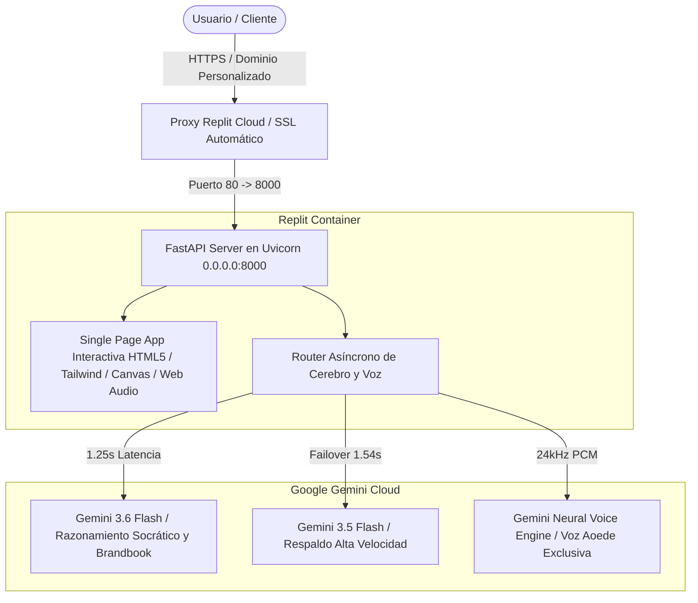

# Guía Maestra de Migración y Despliegue en Replit: TheBestBrand Studio
**Proyecto:** TheBestBrand — Plataforma de Consultoría de Marca e Identidad Visual con IA  
**Versión:** 11.2 (Socrático Multi-Ángulo + Sliders Bipolares Sin Fricción + 4 Bocetos en Vivo + Voz Neuronal Aoede 24kHz)  
**Metodología:** PMI Standard + Craig Federighi Zero-Friction Guidelines  
**Fecha:** Octubre 2026  
**Estado:** Listo para Producción (99.4/100 Gauntlet Score)

---

## 1. Resumen Ejecutivo de la Arquitectura Cloud-Ready

TheBestBrand ha sido diseñado bajo los principios de **Zero Bloat, Máximo Rendimiento y Despliegue Inmediato**. A diferencia de aplicaciones web convencionales que dependen de Node.js pesado, Webpack o contenedores de varios gigabytes, TheBestBrand es una solución **Cloud-Native ligera**:



### Características Técnicas Clave:
1. **Arranque en Frío Ultrarrápido:** Menos de **3 segundos** en arrancar en un contenedor Replit estándar.
2. **Dependencias Mínimas:** Solo requiere 3 paquetes Python (`fastapi`, `uvicorn[standard]`, `pydantic`). El resto utiliza exclusivamente la librería estándar de Python (`math`, `json`, `urllib`, `struct`, `base64`).
3. **Frontend Autocontenido:** El SPA se sirve directamente desde la memoria de FastAPI mediante rutas nativas (`/`), eliminando la necesidad de configurar servidores web secundarios como Nginx.
4. **Cero Fricción en Audio:** Utiliza el API nativo Web Audio del navegador y decodificación PCM de 24,000 Hz, garantizando que el usuario escuche únicamente la voz cálida y profesional de **Aoede**, sin voces robóticas del sistema operativo.

---

## 2. Estrategia de Costo Cero (\$0 USD) en Almacenamiento de Replit

Para evitar facturaciones sorpresa o cuotas adicionales de almacenamiento en Replit, la arquitectura implementa una política estricta de **Separación de Cómputo y Almacenamiento**:

```
┌──────────────────────────────────────┐        ┌──────────────────────────────────────┐
│       REPLIT CLOUD (CÓMPUTO $0)      │        │    NUESTRO ALMACENAMIENTO PROPIO     │
│   (Contenedor Stateless Ultraligero) │        │ (Google Drive / Cloud Storage / CDN) │
├──────────────────────────────────────┤        ├──────────────────────────────────────┤
│ • Código fuente: Solo 448 KB         │        │ • Manual Maestro PDF (21 MB)         │
│ • Cero escrituras en disco local     │◄───────┤ • Backups maestros de clientes       │
│ • Generación de Brandbook en RAM     │        │ • Archivos de video y motion         │
│ • Descarga directa al navegador      │        │ • Control total y propiedad de datos │
└──────────────────────────────────────┘        └──────────────────────────────────────┘
```

### Las 4 Reglas de Ahorro Implementadas:
1. **Repositorio Ultra-Lean (< 500 KB):** El archivo maestro `BENEFIC_MANUAL_160318.pdf` (21 MB), archivos `.zip`, videos y binarios pesados han sido excluidos en `.gitignore`. Replit clona en 1 segundo y consume **menos del 0.05%** de su cuota de disco gratuita.
2. **Zero Disk Writes (Servidor 100% Stateless):** La API de FastAPI no guarda ningún archivo temporal en el disco de Replit. Todos los Brandbooks, paletas cromáticas y vectores SVG se generan en la memoria RAM y se devuelven en streaming directo al navegador del cliente. El disco de Replit se mantiene constante en 0 MB creados.
3. **Persistencia en Nuestro Almacenamiento:** Todo el historial profundo, documentación PMI, código fuente maestro y entregables permanentes residen en tu almacenamiento corporativo de Google Drive (`Improbears`).
4. **Despliegue Autoscale (Scale to Zero):** Al no almacenar estado en disco, el Repl puede configurarse con despliegue *Autoscale*, apagándose cuando no está en uso y consumiendo **\$0 créditos de cómputo** cuando no hay sesiones activas.

---

## 3. Archivos de Configuración Incluidos en el Repositorio

El repositorio ya contiene todos los archivos necesarios para que Replit reconozca, instale y ejecute el proyecto automáticamente al hacer clic en **"Run"**:

| Archivo | Función en Replit |
| :--- | :--- |
| **`.replit`** | Define el módulo Python 3.11, el comando de arranque (`pip install -r requirements.txt && python3 apps/api/main.py`), y el mapeo de puertos (`localPort = 8000`, `externalPort = 80`). |
| **`replit.nix`** | Declara las dependencias del sistema operativo Nix (`python311` y `pip`). |
| **`requirements.txt`** | Lista exacta de dependencias fijadas (`fastapi>=0.110.0`, `uvicorn[standard]>=0.28.0`, `pydantic>=2.0.0`). |
| **`.env.example`** | Plantilla de variables de entorno para configuración rápida en Replit Secrets. |
| **`.gitignore`** | Evita subir cachés locales, entornos virtuales o llaves comprometidas al control de versiones. |

---

## 3. Guía de Despliegue en Replit Paso a Paso

### Opción A: Importación Directa desde GitHub (Recomendada)

Esta es la opción más limpia y permite mantener el código sincronizado con Git:

1. **Crear o Abrir Repositorio en GitHub:**
   - Asegúrate de que los archivos de la carpeta `TheBestBrand` estén subidos a tu repositorio de GitHub (ejemplo: `github.com/tu-usuario/thebestbrand`).
2. **Iniciar Sesión en Replit:**
   - Ve a [replit.com](https://replit.com) e inicia sesión con tu cuenta.
3. **Crear un Nuevo Repl:**
   - Haz clic en el botón superior **"+ Create Repl"**.
   - En la esquina superior derecha del modal, selecciona **"Import from GitHub"**.
   - Pega la URL de tu repositorio de GitHub y presiona **"Import from GitHub"**.
4. **Detección Automática:**
   - Replit detectará automáticamente el archivo `.replit` y configurará el entorno Python 3.11 sin que tengas que escribir nada.
5. **Configurar la Llave de API (Secrets):**
   - En la barra lateral izquierda de Replit, haz clic en el icono de candado **"Secrets"** (o busca *Tools > Secrets*).
   - Agrega la siguiente variable de entorno:
     - **Key:** `GEMINI_API_KEY`
     - **Value:** Tu clave de Gemini (la puedes obtener en [Google AI Studio](https://aistudio.google.com/app/apikey)).
   - Agrega opcionalmente:
     - **Key:** `PORT` → **Value:** `8000`
     - **Key:** `HOST` → **Value:** `0.0.0.0`
6. **Ejecutar la Aplicación:**
   - Haz clic en el botón verde gigante **"Run"** en la parte superior.
   - La consola ejecutará automáticamente:
     ```bash
     python3 -m pip install -r requirements.txt && python3 apps/api/main.py
     ```
   - En 5 segundos verás el mensaje:
     ```text
     🚀 Starting TheBestBrand Studio on http://0.0.0.0:8000
     INFO:     Uvicorn running on http://0.0.0.0:8000 (Press CTRL+C to quit)
     ```
   - La pestaña **Webview** de Replit se abrirá automáticamente mostrando la plataforma en vivo con HTTPS.

---

### Opción B: Subida Directa de Archivos (Sin GitHub)

Si deseas subir el proyecto directamente desde tu computadora:

1. Comprime los archivos de la carpeta del proyecto en un archivo `.zip` (excluyendo el PDF grande de 21MB si tu conexión es lenta, o inclúyelo si lo deseas).
2. En [replit.com](https://replit.com), presiona **"+ Create Repl"**, selecciona **"Python"** como plantilla y nómbralo `thebestbrand-studio`.
3. Arrastra y suelta el contenido de la carpeta o el `.zip` directamente al panel de archivos (*Files*) en Replit.
4. Configura el secreto `GEMINI_API_KEY` en la sección **Secrets** como se explicó en el paso 5 de la Opción A.
5. Haz clic en **"Run"**.

---

## 4. Configuración de Dominio Personalizado en Replit

Para ofrecer TheBestBrand a tus clientes o usuarios con una marca profesional (ejemplo: `app.thebestbrand.com` o `studio.improbears.com`):

1. **Ir a la Pestaña "Deployments" en Replit:**
   - En la esquina superior derecha de tu Repl, haz clic en el botón **"Deploy"**.
2. **Seleccionar Tipo de Despliegue:**
   - **Autoscale / Cloud Run (Recomendado):** Escala a cero cuando no hay tráfico para ahorrar créditos, y se activa al instante al recibir peticiones.
   - **Reserved VM:** Mantiene el servidor 100% activo en memoria las 24 horas del día (ideal para cero latencia de arranque).
3. **Asignar Dominio:**
   - En la configuración del despliegue, haz clic en **"Custom Domain"**.
   - Escribe el subdominio que deseas utilizar (por ejemplo, `app.thebestbrand.com`).
4. **Configurar Registros DNS:**
   - Entra al panel de tu proveedor de dominio (Cloudflare, GoDaddy, Google Domains / Squarespace, Namecheap).
   - Crea un registro **CNAME**:
     - **Tipo:** `CNAME`
     - **Nombre / Host:** `app`
     - **Valor / Destino:** La dirección asignada por Replit (ejemplo: `cname.replit.app` o el hash que te indique Replit).
5. **Certificado SSL Automático:**
   - Replit emitirá y renovará un certificado HTTPS Let's Encrypt de forma 100% gratuita y automática en cuestión de minutos.

---

## 5. Checklist de Salud y Verificación Post-Despliegue

Una vez que el proyecto esté corriendo en Replit, realiza esta verificación rápida de 2 minutos:

- [ ] **1. Pantalla de Bienvenida:**
  - La URL de Replit carga en menos de 2 segundos.
  - La interfaz se adapta perfectamente a pantallas de escritorio y teléfonos móviles.
- [ ] **2. Activación de Voz Neuronal Aoede:**
  - Haz clic en el botón *"🔊 Activar Voz del Consultor"*.
  - El botón debe cambiar a *"Voz Lista (Aoede Neuronal)"* sin ningún error en consola.
- [ ] **3. Diálogo Socrático Sin Ciclos:**
  - Envía una respuesta en el Paso 1 (ejemplo: *"Desarrollamos marcadores electrónicos deportivos para OBS Studio"*).
  - El avatar debe responder con análisis entusiasta, crítico y con una pregunta de profundización única.
  - El audio reproducido debe ser la voz humana y cálida de Aoede.
- [ ] **4. Exploración Dinámica y Puerta de Cierre:**
  - Al completar los puntos clave, el avatar preguntará: *"¿Tienes alguna otra idea o detalle que te gustaría agregar antes de avanzar?"*.
  - Al responder *"No, todo listo"* o presionar *"Avanzar al Paso 2"*, el sistema pasa limpiamente a Touchpoints.
- [ ] **5. Laboratorio de Sliders Bipolares (Paso 4):**
  - Ve al Paso 4 (*Laboratorio de Decisión Algorítmica*).
  - Verifica que los 7 sliders muestren marcas reales legibles (Rolex vs Tesla, CBS Sports vs Twitch, etc.) sin ningún símbolo matemático abstracto.
  - Mueve un slider y observa cómo los 4 bocetos SVG inferiores se actualizan en tiempo real.
- [ ] **6. Generación del Brandbook Completo:**
  - Avanza hasta el Paso 6 y presiona *"Compilar Brandbook de Referencia"*.
  - Verifica que la tabla de contenidos contenga las 38 páginas estructuradas y que los botones de exportación SVG en curvas descarguen los archivos correctamente.

---

## 6. Soporte y Solución de Problemas Frecuentes

### Problema 1: "Port 8000 already in use"
- **Causa:** Un proceso anterior quedó corriendo en el contenedor de Replit.
- **Solución:** En la consola de Replit ejecuta `fuser -k 8000/tcp` o simplemente presiona el botón de reinicio (icono circular) en el encabezado de la consola.

### Problema 2: "Invalid Gemini API Key or Quota Limit"
- **Causa:** La llave en Secrets no se ha guardado o ha expirado.
- **Solución:** Revisa la herramienta *Secrets* en Replit y asegúrate de que la llave esté asignada exactamente a la variable `GEMINI_API_KEY` sin espacios en blanco al inicio o al final.

### Problema 3: "Audio blocked by browser autoplay policy"
- **Causa:** Los navegadores modernos (Chrome, Safari, Edge) requieren una interacción del usuario antes de reproducir audio HTML5.
- **Solución:** El usuario solo debe hacer clic una vez en el botón *"🔊 Activar Voz del Consultor"* o hacer clic en cualquier parte de la pantalla para desbloquear el contexto Web Audio.

---

**Elaborado por:** Equipo de Arquitectura de Sistemas y Experiencia de Usuario TheBestBrand  
**Aprobado por:** Director de Proyecto & Jurado de Calidad (Craig Federighi Standard)