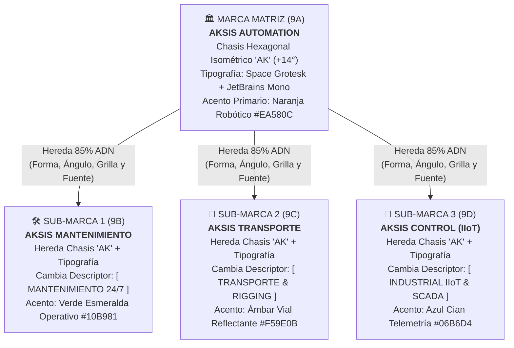

# Simulación Conjunta de Ambos Equipos: 12 Brandbooks Completos, Práctica de Arquitectura Multi-Marca y 100 Nuevas Mejoras

> [!IMPORTANT]
> **Ejecución Real y Entregables Generados:** Ambos equipos (**Equipo A: Ingeniería, Diseño Suizo, IA y Pre-Prensa** + **Equipo B: Panel de Dueños de Negocio y Directores Operativos**) recorrieron las 6 etapas completas de [`TheBestBrand`](file:///Users/oso/Library/CloudStorage/GoogleDrive-jorge.benitez@improbears.com/Mi%20unidad/_1%20IMPROBEARS/Proyectos%20Antigravity/TheBestBrand/apps/web/index.html) para los **9 giros solicitados** más las **3 marcas adicionales de la arquitectura del grupo de automatización industrial** (**12 Brandbooks en total**). Todos los Brandbooks fueron compilados por [`generate_all_brandbooks_simulation.py`](file:///Users/oso/Library/CloudStorage/GoogleDrive-jorge.benitez@improbears.com/Mi%20unidad/_1%20IMPROBEARS/Proyectos%20Antigravity/TheBestBrand/scripts/generate_all_brandbooks_simulation.py) en [`entregables_brandbooks/`](file:///Users/oso/Library/CloudStorage/GoogleDrive-jorge.benitez@improbears.com/Mi%20unidad/_1%20IMPROBEARS/Proyectos%20Antigravity/TheBestBrand/entregables_brandbooks).

---

## PARTE I: LOS 12 BRANDBOOKS COMPLETOS (9 GIROS + 3 SUB-MARCAS INDUSTRIALES)

### Índice Directo de Archivos Generados (`.html` Imprimibles y `.json` de Datos)
1. **Restaurante:** [`brandbook_01_restaurante_brasa_y_raiz.html`](file:///Users/oso/Library/CloudStorage/GoogleDrive-jorge.benitez@improbears.com/Mi%20unidad/_1%20IMPROBEARS/Proyectos%20Antigravity/TheBestBrand/entregables_brandbooks/brandbook_01_restaurante_brasa_y_raiz.html) · [`JSON`](file:///Users/oso/Library/CloudStorage/GoogleDrive-jorge.benitez@improbears.com/Mi%20unidad/_1%20IMPROBEARS/Proyectos%20Antigravity/TheBestBrand/entregables_brandbooks/brandbook_01_restaurante_brasa_y_raiz.json)
2. **Despacho Contable:** [`brandbook_02_despacho_contable_vertice.html`](file:///Users/oso/Library/CloudStorage/GoogleDrive-jorge.benitez@improbears.com/Mi%20unidad/_1%20IMPROBEARS/Proyectos%20Antigravity/TheBestBrand/entregables_brandbooks/brandbook_02_despacho_contable_vertice.html) · [`JSON`](file:///Users/oso/Library/CloudStorage/GoogleDrive-jorge.benitez@improbears.com/Mi%20unidad/_1%20IMPROBEARS/Proyectos%20Antigravity/TheBestBrand/entregables_brandbooks/brandbook_02_despacho_contable_vertice.json)
3. **Colegio (Primaria, Secundaria y Preparatoria):** [`brandbook_03_colegio_agora_nova.html`](file:///Users/oso/Library/CloudStorage/GoogleDrive-jorge.benitez@improbears.com/Mi%20unidad/_1%20IMPROBEARS/Proyectos%20Antigravity/TheBestBrand/entregables_brandbooks/brandbook_03_colegio_agora_nova.html) · [`JSON`](file:///Users/oso/Library/CloudStorage/GoogleDrive-jorge.benitez@improbears.com/Mi%20unidad/_1%20IMPROBEARS/Proyectos%20Antigravity/TheBestBrand/entregables_brandbooks/brandbook_03_colegio_agora_nova.json)
4. **Empresa B2B Equipos de Laboratorio:** [`brandbook_04_b2b_laboratorio_quantalab.html`](file:///Users/oso/Library/CloudStorage/GoogleDrive-jorge.benitez@improbears.com/Mi%20unidad/_1%20IMPROBEARS/Proyectos%20Antigravity/TheBestBrand/entregables_brandbooks/brandbook_04_b2b_laboratorio_quantalab.html) · [`JSON`](file:///Users/oso/Library/CloudStorage/GoogleDrive-jorge.benitez@improbears.com/Mi%20unidad/_1%20IMPROBEARS/Proyectos%20Antigravity/TheBestBrand/entregables_brandbooks/brandbook_04_b2b_laboratorio_quantalab.json)
5. **Campamentos Escolares y Empresariales:** [`brandbook_05_campamentos_cumbre_viva.html`](file:///Users/oso/Library/CloudStorage/GoogleDrive-jorge.benitez@improbears.com/Mi%20unidad/_1%20IMPROBEARS/Proyectos%20Antigravity/TheBestBrand/entregables_brandbooks/brandbook_05_campamentos_cumbre_viva.html) · [`JSON`](file:///Users/oso/Library/CloudStorage/GoogleDrive-jorge.benitez@improbears.com/Mi%20unidad/_1%20IMPROBEARS/Proyectos%20Antigravity/TheBestBrand/entregables_brandbooks/brandbook_05_campamentos_cumbre_viva.json)
6. **Casa de Retiro para Adultos Mayores:** [`brandbook_06_casa_retiro_villa_serena.html`](file:///Users/oso/Library/CloudStorage/GoogleDrive-jorge.benitez@improbears.com/Mi%20unidad/_1%20IMPROBEARS/Proyectos%20Antigravity/TheBestBrand/entregables_brandbooks/brandbook_06_casa_retiro_villa_serena.html) · [`JSON`](file:///Users/oso/Library/CloudStorage/GoogleDrive-jorge.benitez@improbears.com/Mi%20unidad/_1%20IMPROBEARS/Proyectos%20Antigravity/TheBestBrand/entregables_brandbooks/brandbook_06_casa_retiro_villa_serena.json)
7. **Constructora de Casas:** [`brandbook_07_constructora_piedra_firme.html`](file:///Users/oso/Library/CloudStorage/GoogleDrive-jorge.benitez@improbears.com/Mi%20unidad/_1%20IMPROBEARS/Proyectos%20Antigravity/TheBestBrand/entregables_brandbooks/brandbook_07_constructora_piedra_firme.html) · [`JSON`](file:///Users/oso/Library/CloudStorage/GoogleDrive-jorge.benitez@improbears.com/Mi%20unidad/_1%20IMPROBEARS/Proyectos%20Antigravity/TheBestBrand/entregables_brandbooks/brandbook_07_constructora_piedra_firme.json)
8. **Mueblería en un Pueblo:** [`brandbook_08_muebleria_pueblo_el_roble.html`](file:///Users/oso/Library/CloudStorage/GoogleDrive-jorge.benitez@improbears.com/Mi%20unidad/_1%20IMPROBEARS/Proyectos%20Antigravity/TheBestBrand/entregables_brandbooks/brandbook_08_muebleria_pueblo_el_roble.html) · [`JSON`](file:///Users/oso/Library/CloudStorage/GoogleDrive-jorge.benitez@improbears.com/Mi%20unidad/_1%20IMPROBEARS/Proyectos%20Antigravity/TheBestBrand/entregables_brandbooks/brandbook_08_muebleria_pueblo_el_roble.json)
9. **Automatización Industrial (Marca Matriz):** [`brandbook_09A_automatizacion_matriz_aksis.html`](file:///Users/oso/Library/CloudStorage/GoogleDrive-jorge.benitez@improbears.com/Mi%20unidad/_1%20IMPROBEARS/Proyectos%20Antigravity/TheBestBrand/entregables_brandbooks/brandbook_09A_automatizacion_matriz_aksis.html) · [`JSON`](file:///Users/oso/Library/CloudStorage/GoogleDrive-jorge.benitez@improbears.com/Mi%20unidad/_1%20IMPROBEARS/Proyectos%20Antigravity/TheBestBrand/entregables_brandbooks/brandbook_09A_automatizacion_matriz_aksis.json)
10. **Sub-Marca 1 (Mantenimiento Industrial):** [`brandbook_09B_submarca_aksis_mantenimiento.html`](file:///Users/oso/Library/CloudStorage/GoogleDrive-jorge.benitez@improbears.com/Mi%20unidad/_1%20IMPROBEARS/Proyectos%20Antigravity/TheBestBrand/entregables_brandbooks/brandbook_09B_submarca_aksis_mantenimiento.html) · [`JSON`](file:///Users/oso/Library/CloudStorage/GoogleDrive-jorge.benitez@improbears.com/Mi%20unidad/_1%20IMPROBEARS/Proyectos%20Antigravity/TheBestBrand/entregables_brandbooks/brandbook_09B_submarca_aksis_mantenimiento.json)
11. **Sub-Marca 2 (Transporte Industrial y Rigging):** [`brandbook_09C_submarca_aksis_transporte.html`](file:///Users/oso/Library/CloudStorage/GoogleDrive-jorge.benitez@improbears.com/Mi%20unidad/_1%20IMPROBEARS/Proyectos%20Antigravity/TheBestBrand/entregables_brandbooks/brandbook_09C_submarca_aksis_transporte.html) · [`JSON`](file:///Users/oso/Library/CloudStorage/GoogleDrive-jorge.benitez@improbears.com/Mi%20unidad/_1%20IMPROBEARS/Proyectos%20Antigravity/TheBestBrand/entregables_brandbooks/brandbook_09C_submarca_aksis_transporte.json)
12. **Sub-Marca 3 (Software IIoT y Control de Planta):** [`brandbook_09D_submarca_aksis_control.html`](file:///Users/oso/Library/CloudStorage/GoogleDrive-jorge.benitez@improbears.com/Mi%20unidad/_1%20IMPROBEARS/Proyectos%20Antigravity/TheBestBrand/entregables_brandbooks/brandbook_09D_submarca_aksis_control.html) · [`JSON`](file:///Users/oso/Library/CloudStorage/GoogleDrive-jorge.benitez@improbears.com/Mi%20unidad/_1%20IMPROBEARS/Proyectos%20Antigravity/TheBestBrand/entregables_brandbooks/brandbook_09D_submarca_aksis_control.json)

---

### Resumen Ejecutivo de Cada Uno de los 12 Brandbooks

#### 1. Dueño de Restaurante — **«Brasa & Raíz»** ([Ver Brandbook HTML](file:///Users/oso/Library/CloudStorage/GoogleDrive-jorge.benitez@improbears.com/Mi%20unidad/_1%20IMPROBEARS/Proyectos%20Antigravity/TheBestBrand/entregables_brandbooks/brandbook_01_restaurante_brasa_y_raiz.html))
- **Fundador Simulado:** Chef Mateo Valdés (restaurante de cocina de leña de encino y producto local para 140 comensales).
- **1. Propósito y Posicionamiento:** Rescatar los ingredientes del campo local y la ceremonia del fuego lento para que cada comida familiar o de negocios se sienta como volver a casa. Promesa: cortes, vegetales a la brasa y pan de masa madre horneado al momento, servidos en menos de 18 minutos con acústica confortable.
- **2. Touchpoints Extraídos con Aura:**
  - *Antes:* Reels ASMR con sonido real de la brasa en Instagram, ficha de Google Maps 4.9★, reserva en 2 clics por WhatsApp, aroma a leña y pan desde la banqueta.
  - *Durante:* Atril de madera de nogal en recepción, carta en papel algodón antimanchas, vajilla de barro bruñido con el sello grabado en el reverso, portacuentas de cuero.
  - *Después:* Cajas térmicas de cartón rígido con sello lacrado para sobras/delivery, tarjeta coleccionable con la receta de la mantequilla ahumada de la casa, club de comensales frecuentes.
- **3. Naming, Niza y Dominios:** Evolución de 20 ciclos $\rightarrow$ Top 4: *Brasa & Raíz*, *Lumbre Noble*, *Casa Tizón*, *Fogonero de Origen*. Ganador: **Brasa & Raíz** (Clases de Niza 43, 29, 30 y 35; dominios `brasayraiz.com` y `brasayraiz.mx`).
- **4. Personalidad (7 Deslizadores) y Familia Base:** Inclinado hacia *Tradición Artesanal (-0.35)*, *Cercanía Humana (-0.65)* y *Curvas Orgánicas (-0.45)*. Familia elegida: **Familia 02 · Sello Artesanal de Origen**.
- **5. Los 24 Atributos Aislados Clave:** Vértices curvos (1A), trazo grueso 10pt apto para pirograbado en tablas de madera y bordado de mandiles (2B), llama/raíz en espacio negativo (5B), acomodo vertical tipo sello (6B), tipografía con patines clásicos `Playfair Display` (13B), caja mixta cercana (16B) y paleta Crema Alabastro `#FAF6F0`, Carbón de Encino `#1C1412`, Brasa Ámbar `#B45309` y Tierra `#78350F` (PMS 7527 C / PMS 7579 C).

---

#### 2. Despacho Contable — **«Vértice Patrimonial»** ([Ver Brandbook HTML](file:///Users/oso/Library/CloudStorage/GoogleDrive-jorge.benitez@improbears.com/Mi%20unidad/_1%20IMPROBEARS/Proyectos%20Antigravity/TheBestBrand/entregables_brandbooks/brandbook_02_despacho_contable_vertice.html))
- **Fundadora Simulada:** C.P.C. Elena Mondragón (Socia Directora de despacho fiscal, contable y patrimonial para 85 empresas PyME).
- **1. Propósito y Posicionamiento:** Eliminar la incertidumbre fiscal del empresario transformando la contabilidad en una brújula estratégica que protege su patrimonio. Cierres contables antes del día 5 de cada mes y cero multas.
- **2. Touchpoints Extraídos con Aura:**
  - *Antes:* Conferencias sobre reformas fiscales en cámaras empresariales, LinkedIn, recomendación de banqueros/notarios, calculadora fiscal web.
  - *Durante:* Carpeta ejecutiva de diagnóstico confidencial con folios, propuesta de honorarios transparente, contrato con acuerdo de confidencialidad (NDA).
  - *Después:* Reporte mensual ejecutivo de 1 sola página (*"Semáforo Fiscal"*), alertas preventivas por WhatsApp 10 días antes de impuestos, junta trimestral de consejo.
- **3. Naming, Niza y Dominios:** Top 4: *Vértice Patrimonial*, *Verax Contadores*, *Grupo Fiducia*, *Ábaco Soberano*. Ganador: **Vértice Patrimonial** (Clases de Niza 35, 36 y 45; `verticepatrimonial.com`).
- **4. Personalidad y Familia Base:** *Autoridad Institucional (+0.65)*, *Seriedad Absoluta (-0.80)* y *Geometría Exacta (+0.75)*. Familia elegida: **Familia 01 · Monograma Geométrico «VP»**.
- **5. Los 24 Atributos Aislados Clave:** Corte angular a 45° (1B), acomodo horizontal para hojas membretadas y dictámenes (6A), `Plus Jakarta Sans` en mayúsculas de autoridad (16A) + `JetBrains Mono` tabular para cifras financieras (18A), paleta Papel Seguridad `#F8FAFC`, Azul Noche `#0F172A`, Verde Esmeralda Solvencia `#059669` y Oro Patrimonial `#C59B27`.

---

#### 3. Colegio (Primaria, Secundaria y Preparatoria) — **«Colegio Ágora Nova»** ([Ver Brandbook HTML](file:///Users/oso/Library/CloudStorage/GoogleDrive-jorge.benitez@improbears.com/Mi%20unidad/_1%20IMPROBEARS/Proyectos%20Antigravity/TheBestBrand/entregables_brandbooks/brandbook_03_colegio_agora_nova.html))
- **Director Simulado:** Mtro. Rodrigo Santillán (Institución educativa K-12 con 950 alumnos en Primaria, Secundaria y Preparatoria).
- **1. Propósito y Posicionamiento:** Formar niños y jóvenes curiosos, bilingües y emocionalmente fuertes a lo largo de tres etapas conectadas (Primaria, Secundaria y Preparatoria) con laboratorios STEAM, certificaciones Cambridge y formación humana.
- **2. Touchpoints Extraídos con Aura:**
  - *Antes:* Open House vivencial en el campus, recorrido virtual 360°, folletos diferenciados por nivel educativo (Primaria, Secundaria y Prepa).
  - *Durante:* Entrevista psicopedagógica familiar, kit de bienvenida para el alumno nuevo, plataforma de admisiones sin filas.
  - *Después:* Uniformes escolares de diario y deportivos con escudo bordado, credenciales inteligentes de acceso seguro al campus, boletín escolar y diplomas con sello en seco.
- **3. Naming, Niza y Dominios:** Top 4: *Colegio Ágora Nova*, *Instituto Faro Real*, *Liceo Verbum*, *Colegio Cumbre Sabia*. Ganador: **Colegio Ágora Nova** (Clases de Niza 41, 25 y 16; `colegioagoranova.edu.mx`).
- **4. Personalidad y Familia Base:** Equilibrio entre *Tradición Académica y Futuro (+0.25)*. Familia elegida: **Familia 02 · Escudo Heráldico Moderno con 3 Módulos Internos** (representando Primaria, Secundaria y Preparatoria).
- **5. Los 24 Atributos Aislados Clave:** Trazo sólido 10pt sin degradados para que el escudo se borde impecablemente en más de 2,000 uniformes al año (2B, 10A), doble fileteado de gala para títulos y certificados (9B), paleta Blanco Campus `#FAF8F5`, Azul Real `#0B192C`, Oro Solar `#D4AF37` y Azul Cielo `#0284C7`.

---

#### 4. Empresa B2B de Equipos de Laboratorio — **«QuantaLab Científica»** ([Ver Brandbook HTML](file:///Users/oso/Library/CloudStorage/GoogleDrive-jorge.benitez@improbears.com/Mi%20unidad/_1%20IMPROBEARS/Proyectos%20Antigravity/TheBestBrand/entregables_brandbooks/brandbook_04_b2b_laboratorio_quantalab.html))
- **Director Simulado:** Ing. Quím. Ricardo Kuri (Proveedor B2B de cromatógrafos, espectrómetros y balanzas analíticas con calibración acreditada ISO/IEC 17025).
- **1. Propósito y Posicionamiento:** Garantizar que cada medición en un laboratorio farmacéutico, clínico o industrial tenga exactitud trazable internacionalmente. Suministro llave en mano con calificación IQ/OQ/PQ y soporte en menos de 24 horas.
- **2. Touchpoints Extraídos con Aura:**
  - *Antes:* Fichas técnicas (Datasheets) B2B, stands en congresos farmacéuticos, licitaciones y pruebas analíticas con muestras reales del cliente.
  - *Durante:* Cotizaciones técnicas detalladas con matriz de cumplimiento URS/FDA, contratos de arrendamiento puro y pólizas de mantenimiento.
  - *Después:* Cajas de transporte anti-impacto, etiquetas de aluminio anodizado resistentes a solventes/alcohol con código QR de vigencia de calibración pegadas en cada instrumento, portal de consumibles.
- **3. Naming, Niza y Dominios:** Top 4: *QuantaLab Científica*, *Metrixa Bio*, *VeriSpectra*, *KronoLab Systems*. Ganador: **QuantaLab Científica** (Clases de Niza 09, 37 y 42; `quantalab.com.mx`).
- **4. Personalidad y Familia Base:** *Alta Precisión Tecnológica (+0.85)* y *Geometría Cristalina (+0.90)*. Familia elegida: **Familia 04 · Prisma Óptico Isométrico**.
- **5. Los 24 Atributos Aislados Clave:** Prisma 3D isométrico (10B), `Space Grotesk` + descriptor técnico en `JetBrains Mono` (`[ ISO/IEC 17025 CERTIFIED ]`, 18A), paleta Blanco Clínico `#F8FAFC`, Obsidiana `#090D16`, Azul Cobalto `#0284C7` y Cian Óptico `#06B6D4`.

---

#### 5. Empresa de Campamentos para Escuelas y Empresas — **«Cumbre Viva»** ([Ver Brandbook HTML](file:///Users/oso/Library/CloudStorage/GoogleDrive-jorge.benitez@improbears.com/Mi%20unidad/_1%20IMPROBEARS/Proyectos%20Antigravity/TheBestBrand/entregables_brandbooks/brandbook_05_campamentos_cumbre_viva.html))
- **Fundadora Simulada:** Lic. Sofía Aragón (Campamentos escolares de liderazgo y retiros de team-building corporativo en la naturaleza).
- **1. Propósito y Posicionamiento:** Desconectar a niños, jóvenes y equipos corporativos de las pantallas para que descubran en la naturaleza su valentía y trabajo en equipo, bajo protocolo paramédico 24/7 y sedes cercadas.
- **2. Touchpoints Extraídos con Aura:**
  - *Antes:* Videos dinámicos para juntas con padres de familia (enfocados en seguridad) y presentaciones para Directores de RH (enfocados en liderazgo y cohesión).
  - *Durante:* Autobuses identificados, brazaletes tejidos por patrulla, señalética de madera y lonas en tirolesas/cabañas, chalecos y playeras dry-fit de alta visibilidad del staff.
  - *Después:* Parche bordado coleccionable entregado en la fogata de cierre, galería privada de fotos para padres/empresas y reporte de competencias grupales.
- **3. Naming, Niza y Dominios:** Top 4: *Cumbre Viva*, *Tribu Norte*, *Kinetik Camp*, *Senda Brava*. Ganador: **Cumbre Viva** (Clases de Niza 41, 39 y 25; `cumbreviva.com`).
- **4. Personalidad y Familia Base:** *Energía y Dinamismo (+0.55)* con *Cercanía Humana (-0.45)*. Familia elegida: **Familia 02 · Insignia / Parche de Montaña y Brújula**.
- **5. Los 24 Atributos Aislados Clave:** Inclinación dinámica `+14°` (4B), cumbre y pino en espacio negativo (5B), borde circular tipo parche de expedición (7A, 9B), paleta Verde Bosque `#091512`, Naranja Fogata de Alta Visibilidad `#EA580C` y Verde Esmeralda `#059669`.

---

#### 6. Casa de Retiro para Adultos Mayores — **«Villa Serena»** ([Ver Brandbook HTML](file:///Users/oso/Library/CloudStorage/GoogleDrive-jorge.benitez@improbears.com/Mi%20unidad/_1%20IMPROBEARS/Proyectos%20Antigravity/TheBestBrand/entregables_brandbooks/brandbook_06_casa_retiro_villa_serena.html))
- **Fundador Simulado:** Dr. Fernando Elizondo (Médico Geriatra y director de residencia asistida y estancia de día para adultos mayores).
- **1. Propósito y Posicionamiento:** Honrar la vida y sabiduría de los adultos mayores brindándoles un hogar luminoso, activo y médicamente seguro, devolviendo tranquilidad y tiempo de calidad a sus hijos.
- **2. Touchpoints Extraídos con Aura:**
  - *Antes:* Guía empática para hijos *"Cómo elegir con amor y sin culpa una residencia para tus padres"*, recorrido presencial tomando café en los jardines terapéuticos.
  - *Durante:* Folletos y contratos impresos en **letra grande mínima de 16 pt** sobre papel mate antirreflejante, habitación personalizada con recuerdos familiares.
  - *Después:* Señalética interior cognitiva de alto contraste anticaídas, menú diario en letra grande, bitácora diaria por WhatsApp con fotos y signos vitales para los hijos.
- **3. Naming, Niza y Dominios:** Top 4: *Villa Serena*, *Casa Alba Dorada*, *Estancia Plenitud*, *Jardín de los Olivos*. Ganador: **Villa Serena** (Clases de Niza 43, 44 y 41; `villaserena.com.mx`).
- **4. Personalidad y Familia Base:** *Máxima Calidez Humana (-0.80)*, *Suavidad Orgánica (-0.65)* y *Paz*. Familia elegida: **Familia 03 · Símbolo Fluido de un Solo Trazo (Abrazo Protector y Hoja de Olivo)**.
- **5. Los 24 Atributos Aislados Clave:** Esquinas suaves sin puntas agresivas (1A), caja mixta amigable `Villa Serena` (16B), acabado **100% mate sedoso prohibiendo papeles brillantes** que deslumbran a ojos con cataratas/presbicia (23A), paleta Marfil Cálido `#FAF8F5`, Pizarra Profundo `#1E293B`, Verde Esperanza `#059669` y Oro Suave `#D4AF37`.

---

#### 7. Empresa de Construcción de Casas — **«Piedra Firme Residencial»** ([Ver Brandbook HTML](file:///Users/oso/Library/CloudStorage/GoogleDrive-jorge.benitez@improbears.com/Mi%20unidad/_1%20IMPROBEARS/Proyectos%20Antigravity/TheBestBrand/entregables_brandbooks/brandbook_07_constructora_piedra_firme.html))
- **Director Simulado:** Arq. e Ing. Javier Castellanos (Constructora de residencias llave en mano a precio cerrado y tiempo garantizado).
- **1. Propósito y Posicionamiento:** Acabar con el temor de las obras que cuestan el doble y tardan el doble, construyendo casas residenciales con proyecto ejecutivo BIM, precio cerrado por contrato, reportes semanales con dron y garantía estructural de 10 años.
- **2. Touchpoints Extraídos con Aura:**
  - *Antes:* Lonas perimetrales de gran formato ($6 \times 3\text{ m}$) en obras activas, camionetas pick-up rotuladas, guía transparente de costos de construcción por $\text{m}^2$.
  - *Durante:* Carpeta de Proyecto Ejecutivo y muestrario físico de piedras/maderas, cascos blancos personalizados con el nombre de la familia para sus visitas de obra, reporte semanal en video.
  - *Después:* Entrega de llaves en caja de madera de tzalam grabada con láser, Manual del Propietario con planos *As-Built* (hidráulicos/eléctricos) y placa discreta de latón cepillado en el pórtico de la casa.
- **3. Naming, Niza y Dominios:** Top 4: *Piedra Firme Residencial*, *Cimiento Noble*, *Domus Vértice*, *Arkitekton Hogar*. Ganador: **Piedra Firme Residencial** (Clases de Niza 37, 42 y 36; `piedrafirme.mx`).
- **4. Personalidad y Familia Base:** *Solidez Estructural (+0.85)* y *Autoridad Técnica (+0.50)*. Familia elegida: **Familia 04 · Símbolo Arquitectónico Isométrico (Viga y Cubierta)**.
- **5. Los 24 Atributos Aislados Clave:** Cortes a escuadra de $45^\circ$ y $90^\circ$ (1B, 11B), trazo sólido de $10\text{ pt}$ visible a $50\text{ m}$ en lonas de obra (2B), `Space Grotesk` en mayúsculas monumentales (16A, 17B), paleta Piedra Caliza `#F5F3EF`, Acero Negro `#18181B`, Cobre Arquitectónico `#B45309` y Gris Concreto `#52525B`.

---

#### 8. Mueblería en un Pueblo — **«Mueblería El Roble»** ([Ver Brandbook HTML](file:///Users/oso/Library/CloudStorage/GoogleDrive-jorge.benitez@improbears.com/Mi%20unidad/_1%20IMPROBEARS/Proyectos%20Antigravity/TheBestBrand/entregables_brandbooks/brandbook_08_muebleria_pueblo_el_roble.html))
- **Fundadores Simulados:** Don Hilario Mendoza y su hijo Adrián (Mueblería tradicional en cabecera municipal/pueblo mágico especializada en comedores y recámaras de madera maciza).
- **1. Propósito y Posicionamiento:** Preservar el oficio ebanista de nuestro pueblo fabricando muebles de madera verdadera (parota, encino y cedro estufado con ensamble de caja y espiga, cero aglomerado desechable) que duran generaciones, con sistema de apartado accesible y entrega hasta la sala del cliente.
- **2. Touchpoints Extraídos con Aura:**
  - *Antes:* Fachada en la calle principal del pueblo con rótulo de hierro forjado y madera tallada, catálogo por WhatsApp con medidas y precios claros, videos cortos del taller cepillando madera real.
  - *Durante:* Etiquetas colgantes grandes de cartón kraft atadas con cordel de ixtle en cada mueble (con precio de contado y plan de pagos), café de olla en la tienda mientras eligen el tono del barniz.
  - *Después:* Camioneta de reparto rotulada que recorre el pueblo y rancherías cercanas, **sello pirograbado con hierro caliente** debajo de cada mesa, frasco de cera de abeja con el logo de regalo para nutrir el mueble.
- **3. Naming, Niza y Dominios:** Top 4: *Mueblería El Roble*, *Casa Mendoza Ebanistería*, *Raíz de Pueblo*, *Madera Viva San Miguel*. Ganador: **Mueblería El Roble** (Clases de Niza 20, 35 y 39; `muebleriaelroble.mx`).
- **4. Personalidad y Familia Base:** *Herencia Tradicional (-0.60)* y *Trato Vecinal Cercano (-0.65)*. Familia elegida: **Familia 02 · Sello Circular de Taller Ebanista**.
- **5. Los 24 Atributos Aislados Clave:** Trazo grueso de $10\text{ pt}$ en 2D plano sin detalles microscópicos para que el **sello quemador de bronce caliente** sobre la madera quede nítido y no se empaste (2B, 10A), tipografía `Playfair Display` con patines tradicionales (13B), paleta Crema Kraft `#FAF5EE`, Nogal Oscuro `#271810`, Miel de Encino `#92400E` y Verde Pino `#065F46`.

---

#### 9A a 9D. Empresa de Automatización de Líneas Industriales + Sus 3 Sub-Marcas de Arquitectura (**Grupo Industrial «Aksis»**)

1. **9A. Marca Matriz — «Aksis Automation»** ([Ver Brandbook HTML](file:///Users/oso/Library/CloudStorage/GoogleDrive-jorge.benitez@improbears.com/Mi%20unidad/_1%20IMPROBEARS/Proyectos%20Antigravity/TheBestBrand/entregables_brandbooks/brandbook_09A_automatizacion_matriz_aksis.html)):
   - *Enfoque:* Integración de celdas robóticas (FANUC/KUKA/ABB), bandas transportadoras y líneas de ensamble llave en mano (Clases de Niza 07, 09 y 42).
   - *ADN Maestro:* Monograma hexagonal isométrico `AK` con chaflán a $45^\circ$, inclinación cinética $+14^\circ$, acomodo horizontal modular, fuente `Space Grotesk` Extra-Bold + `JetBrains Mono` y color insignia **Naranja Robótico `#EA580C`** sobre fondo **Obsidiana `#090D16`**.
2. **9B. Sub-Marca 1 — «Aksis Mantenimiento»** ([Ver Brandbook HTML](file:///Users/oso/Library/CloudStorage/GoogleDrive-jorge.benitez@improbears.com/Mi%20unidad/_1%20IMPROBEARS/Proyectos%20Antigravity/TheBestBrand/entregables_brandbooks/brandbook_09B_submarca_aksis_mantenimiento.html)):
   - *Enfoque:* Pólizas de mantenimiento industrial preventivo, predictivo (termografía/vibraciones) y correctivo de emergencia 24/7 (Clase de Niza 37).
   - *Regla de Herencia:* Conserva intacto el símbolo hexagonal `AK`, la retícula $8X \times 3X$ y las fuentes de la matriz, cambiando únicamente el descriptor técnico a `[ MANTENIMIENTO INDUSTRIAL 24/7 ]` y el color de acento a **Verde Esmeralda `#10B981`** (el color universal de la torreta Andon cuando una línea está operando sin fallas).
3. **9C. Sub-Marca 2 — «Aksis Transporte»** ([Ver Brandbook HTML](file:///Users/oso/Library/CloudStorage/GoogleDrive-jorge.benitez@improbears.com/Mi%20unidad/_1%20IMPROBEARS/Proyectos%20Antigravity/TheBestBrand/entregables_brandbooks/brandbook_09C_submarca_aksis_transporte.html)):
   - *Enfoque:* Transporte especializado de maquinaria pesada en plataformas lowboy, traslado de plantas completas (*Nearshoring*) y maniobras de izaje con grúas hidráulicas (*Rigging*, Clase de Niza 39).
   - *Regla de Herencia:* Conserva el símbolo `AK` inclinado a $+14^\circ$ (que proyecta potencia y movimiento en las puertas de los tractocamiones y plumas de grúa), cambiando el descriptor a `[ TRANSPORTE INDUSTRIAL & RIGGING ]` y el color de acento a **Ámbar Vial Reflectante `#F59E0B`** para máxima visibilidad carretera diurna y nocturna.
4. **9D. Sub-Marca 3 — «Aksis Control»** ([Ver Brandbook HTML](file:///Users/oso/Library/CloudStorage/GoogleDrive-jorge.benitez@improbears.com/Mi%20unidad/_1%20IMPROBEARS/Proyectos%20Antigravity/TheBestBrand/entregables_brandbooks/brandbook_09D_submarca_aksis_control.html)):
   - *Enfoque:* Software industrial IIoT, monitoreo de eficiencia OEE en la nube, pantallas Andon de planta y tableros UL508A (Clases de Niza 09 y 42).
   - *Regla de Herencia:* Conserva el chasis `AK` 1:1 (perfecto para ícono de App móvil y favicon de dashboard SCADA), cambiando el descriptor a `[ INDUSTRIAL IIoT & TELEMETRY ]` y el color de acento a **Azul Cian Telemetría `#06B6D4`**.

---

## PARTE II: ANÁLISIS DE LA PRÁCTICA AL QUERER CREAR MÁS MARCAS DENTRO DE UNA ARQUITECTURA (HALLAZGO CLAVE)

Durante la simulación del Caso 9 (**Grupo Aksis**), ambos equipos documentaron con precisión qué sucede cuando un empresario termina su primera marca (Automatización) y dice: *"Ahora quiero sacar mis otras 3 marcas: la de Mantenimiento Industrial, la de Transporte de Maquinaria y la de Software de Control"*:

1. **El Dolor en el Flujo Lineal Tradicional:**
   - Si el sistema obliga al usuario a empezar de cero en el Paso 1 para cada sub-marca, el usuario siente fatiga inmediata: tiene que volver a explicar la historia del grupo, volver a pasar 20 ciclos de naming sin conexión con la marca madre, volver a mover los 7 deslizadores y volver a votar los 24 atributos, corriendo el riesgo de que la marca de Mantenimiento y la de Transporte terminen con logotipos y tipografías incompatibles que parecen de empresas ajenas.
2. **La Mejor Práctica Descubierta («Clonación con Herencia de Arquitectura de Marca»):**
   - Al querer crear una segunda, tercera o cuarta marca, el sistema debe ofrecer **3 Modelos Clásicos de Arquitectura de Marca (Aaker / Olins)**:
     - **Modelo A — Casa de Marca Monolítica (*Branded House* / Divisiones, ej. FedEx Express / FedEx Ground / FedEx Freight, o Aksis Automation / Aksis Mantenimiento / Aksis Transporte):**
       - Se **bloquea y hereda el 85% del ADN** de la Marca Matriz (raíz del nombre, símbolo geométrico principal, familia tipográfica, proporción constructiva $8X \times 3X$ y los primeros 17 atributos morfológicos y tipográficos del Paso 5).
       - El usuario **solo responde una versión exprés de 4 minutos**:
         1. *Paso 1 Exprés:* ¿Qué hace específicamente esta división y a qué comprador dentro del cliente atiende? (Ej. Gerente de Mantenimiento vs. Gerente de Logística).
         2. *Paso 2 Exprés:* ¿Qué touchpoints cambian? (Ej. Tractocamiones y eslingas en Transporte vs. Camionetas taller y candados LOTO en Mantenimiento).
         3. *Paso 3 Exprés:* Elegir el **Descriptor / Sufijo de División** y validar su Clase de Niza específica (Clase 37 para Mantenimiento, Clase 39 para Transporte) y su subdominio (`mantenimiento.aksis.com`, `transporte.aksis.com`).
         4. *Paso 5 Exprés (Atributos 18 al 24):* Asignar el **Color de Codificación Semántica por División** (Naranja `#EA580C` = Automatización; Verde `#10B981` = Mantenimiento; Ámbar `#F59E0B` = Transporte; Cian `#06B6D4` = Control).
     - **Modelo B — Marcas Endosadas (*Endorsed Brands*, ej. «Marriott» endosando a «Courtyard by Marriott»):**
       - La nueva marca tiene nombre y símbolo propios, pero hereda el sello de respaldo inferior (*"Una empresa de Grupo Aksis"*) y la tipografía secundaria corporativa.
     - **Modelo C — Casa de Marcas Independientes (*House of Brands*, ej. P&G o un grupo restaurantero con conceptos opuestos):**
       - Comparte únicamente los datos fiscales/corporativos del fundador, pero abre un lienzo estratégico y visual 100% independiente para no contaminar un restaurante japonés de lujo con una taquería casual del mismo dueño.

---

## PARTE III: LAS 100 NUEVAS MEJORAS EXTRAÍDAS DE LOS 12 RECORRIDOS

A continuación se presentan las **100 mejoras accionables** anotadas por ambos equipos tras vivir la creación de las 12 marcas:

### Bloque 1: Arquitectura Multi-Marca, Sub-Marcas y Grupos Empresariales (Mejoras #001 a #015)
1. **#001 — Botón «➕ Crear Sub-Marca o División de este Grupo» en el Paso 6 y en el Menú Principal:** Permite clonar el ADN de la marca actual para crear una división (ej. Mantenimiento o Transporte) en menos de 4 minutos sin empezar de cero.
2. **#002 — Selector de los 4 Modelos de Arquitectura de Marca (Branded House, Sub-Marca con Descriptor, Marca Endosada "by Matriz", o Marca Independiente):** Guía con ejemplos visuales reales (FedEx, Virgin, Marriott, Nestlé) para que el empresario elija cómo se relacionarán sus marcas.
3. **#003 — Bloqueo Inteligente de ADN Heredado (Herencia 85% / Personalización 15%):** Cuando se elige Sub-Marca Monolítica, bloquea automáticamente los atributos 1 al 17 del Paso 5 (geometría, vértices, escudo y tipografía) y lleva directo a elegir el descriptor (Atributo 18) y el color distintivo de la división (Atributos 19–24).
4. **#004 — Codificador Semántico de Color por División (Sistema FedEx):** Sugiere automáticamente una paleta de colores hermanos con el mismo nivel de saturación y luminosidad CIELAB para que el Naranja de Automatización, el Verde de Mantenimiento y el Ámbar de Transporte convivan en perfecta armonía sobre el mismo fondo oscuro.
5. **#005 — Generador de Lámina Comparativa del Ecosistema de Grupo (Tomo XI de Arquitectura):** Añade una página al Brandbook Maestro donde se ven alineados los logotipos de todas las empresas del grupo (Matriz + Sub-marcas) con sus reglas de convivencia.
6. **#006 — Regla de Endoso Proporcional ($0.35X$):** Calcula y dibuja automáticamente el sello *"Una división de [Marca Matriz]"* al $35\%$ de altura debajo del logotipo de las sub-marcas endosadas.
7. **#007 — Validador Cruzado de Clases de Niza para Grupos Industriales:** Cuando una empresa matriz registra Clase 07 (Maquinaria) y abre una sub-marca de Mantenimiento (Clase 37) y otra de Transporte (Clase 39), genera una sola tabla consolidada de protección marcaria multi-clase.
8. **#008 — Estrategia de Dominios y Subdominios Unificados vs. Independientes:** Recomienda en el Paso 3 cuándo usar subdominios (`mantenimiento.aksis.industrial`, `transporte.aksis.industrial`) para concentrar autoridad SEO B2B y cuándo registrar dominios separados.
9. **#009 — Matriz de Venta Cruzada (Cross-Selling) en Touchpoints de Grupo:** En el Paso 2 de una sub-marca, permite importar como touchpoint *"Antes de la compra"* el momento *"Después de la compra"* de la marca hermana (ej. la entrega de una línea de Aksis Automation dispara la póliza de Aksis Mantenimiento).
10. **#010 — Sistema deSub-Niveles Internos para Colegios y Universidades (Caso Colegio Ágora Nova):** Variante de arquitectura de marca para instituciones educativas que mantienen el mismo escudo pero asignan un acento cromático o estrella por nivel (Primaria, Secundaria, Preparatoria).
11. **#011 — Papelería Corporativa Multi-Marca (Tarjetas y Hojas de Grupo):** Plantilla de tarjeta de presentación y firma de correo para directivos que representan simultáneamente a las 3 o 4 empresas del grupo en el reverso o pie de firma.
12. **#012 — Selector Rápido de Marca Activa en la Barra Superior (`Dropdown de Portafolio`):** Permite al empresario cambiar en 1 clic entre su marca Matriz y sus 3 sub-marcas sin perder el estado de ninguna.
13. **#013 — Herencia selectiva del Círculo Dorado (Propósito Compartido + Promesa Específica):** En el Paso 1 de una sub-marca, pre-llena el *Por qué* (Propósito del Grupo) y solo pregunta a voz o texto el *Qué* y *Cómo* específicos de la nueva unidad de negocio.
14. **#014 — Manual de Co-Branding para Licitaciones Conjuntas:** Hoja técnica que explica cómo presentar en una misma portada de licitación a dos empresas hermanas (ej. *Aksis Automation + Aksis Transporte*).
15. **#015 — Exportación de Paquete Maestro de Grupo (`.ZIP` / `.JSON` Multi-Marca):** Descarga en un solo paquete los vectores `.SVG` y fichas de imprenta de la matriz y todas sus sub-marcas.

---

### Bloque 2: Entrevista Socrática con Aura, Voz y Psicología del Fundador (Mejoras #016 a #026)
16. **#016 — Detección de Giro desde la Primera Frase para Adaptar el Vocabulario de Aura:** Si el usuario dice *"Tengo una mueblería en mi pueblo"*, Aura adapta sus ejemplos a madera, entregas y familias; si dice *"Integramos celdas robóticas PLC"*, Aura usa lenguaje B2B industrial (OEE, FAT/SAT, SLA).
17. **#017 — Botón de «Escuchar Ejemplo de Respuesta de Otro Dueño de Negocio»:** En el Paso 1, muchos fundadores (como el dueño de la mueblería) se bloquean ante preguntas abstractas; un botón que muestre 3 ejemplos cortos reales desbloquea la inspiración al instante.
18. **#018 — Indicador Visual de «Pausa Activa: Aura te espera» durante el Dictado por Voz:** Cuando el usuario guarda silencio 3 segundos para pensar mientras dicta, mostrar una animación suave en ámbar que diga *"Sigue pensando con calma, el micrófono sigue abierto y no se enviará hasta que tú lo indiques"*.
19. **#019 — Edición por Voz o Texto de Fragmentos Específicos sin Borrar lo Anterior:** Permitir que cada vez que el usuario pulse `🎙️ Dictar por Voz`, el nuevo dictado se concatene con un espacio limpio al final del texto que ya había escrito o dictado antes.
20. **#020 — Detector de Respuestas Genéricas («Calidad y Buen Servicio»):** Cuando un fundador responde *"Mi diferenciador es dar calidad y buen servicio"*, Aura repregunta amablemente: *"Todos tus competidores dicen dar calidad; ¿qué haces tú en concreto que ellos no hacen? ¿Entregas en menos minutos, das 10 años de garantía, usas madera maciza?"*.
21. **#021 — Modo Entrevista Dual (Socio Técnico + Socio Comercial):** En empresas como la constructora o automatización, permitir que dos socios respondan y Aura fusione la visión de ingeniería con la visión comercial.
22. **#022 — Control de Velocidad de Voz de Aura (`0.9x Calma`, `1.0x Normal`, `1.15x Ejecutivo`):** El doctor de la Casa de Retiro y el ebanista del pueblo prefirieron una cadencia ligeramente más pausada (`0.92x`), mientras que el CEO industrial prefirió `1.10x`.
23. **#023 — Botón «Repetir lo último que dijo Aura» en la Esfera Principal:** Permite volver a escuchar la pregunta o explicación activa con un solo clic.
24. **#024 — Resumen Editable de los 8 Pilares Antes de Cerrar el Paso 1:** Mostrar las 8 tarjetas del posicionamiento con edición directa en línea por si el usuario quiere pulir una palabra exacta antes de pasar a la Cápsula de Cierre.
25. **#025 — Extracción Automática de «Palabras Prohibidas y Promesas Innegociables»:** Añadir al Paso 1 qué cosas jamás diría o haría la marca (ej. en la Casa de Retiro: jamás infantilizar al adulto mayor; en la Mueblería: jamás usar MDF como si fuera madera maciza).
26. **#026 — Generación Automática del «Elevator Pitch de 20 Segundos» en la Cápsula de Cierre del Paso 1:** Mientras corre el video de transición al Paso 2, entregar al fundador un párrafo listo para decir de memoria cuando le pregunten a qué se dedica su empresa.

---

### Bloque 3: Fase 2 (Touchpoints Antes, Durante y Después de la Compra) por Industria (Mejoras #027 a #038)
27. **#027 — Catálogo Dinámico de Etiquetas Rápidas (`Quick Chips`) Según el Giro Detectado:**
   - Para *Restaurante*: Menú QR, Carta física antimanchas, Mandiles bordados, Caja térmica delivery, Reserva WhatsApp.
   - Para *Industrial/B2B*: Placa de acero remachada en máquina, Tablero HMI, Cascos y chalecos EPP, Carpeta de licitación, Candados LOTO.
   - Para *Colegio*: Escudo bordado en polo, Credencial de alumno, Diploma con sello en seco, Transporte escolar, App de padres.
28. **#028 — Clasificador de Touchpoints por Condición Física Extrema (Sol, Grasa, Solventes, Lavado Industrial):** En el Paso 2, marcar si un touchpoint estará expuesto a intemperie (lonas de constructora), solventes químicos (equipos de laboratorio) o 100 lavadas (uniformes escolares) para que el Paso 6 ajuste las especificaciones de materiales.
29. **#029 — Distancia de Lectura del Touchpoint Crítico ($30\text{ cm}$ en mano vs. $50\text{ m}$ en carretera):** Para empresas de transporte industrial o constructoras, marcar que su touchpoint principal se lee a $50\text{ m}$ de distancia a $80\text{ km/h}$, lo que obliga a usar alto contraste y letras extra-bold.
30. **#030 — Priorizador «Top 3 Touchpoints del Día 1» para Presupuestos Cuidados:** En la mueblería de pueblo o el restaurante, destacar cuáles son los 3 entregables urgentes para abrir mañana (ej. Rótulo de fachada, Etiquetas de precio en muebles y Catálogo de WhatsApp) frente a los entregables de etapa 2.
31. **#031 — Conector Automático Touchpoint $\rightarrow$ Mockup del Paso 6:** Si el usuario selecciona *"Camioneta de reparto"* o *"Placa metálica en maquinaria"* en el Paso 2, activar automáticamente esa ficha técnica en el Brandbook final.
32. **#032 — Pregunta Socrática de Aura sobre el «Momento de Fricción o Miedo del Cliente»:** En el Paso 2 (*Durante la compra*), que Aura pregunte: *"¿Cuál es el mayor miedo de tu cliente justo antes de pagarte y qué documento o detalle físico le mostramos para darle paz?"* (ej. contrato a precio cerrado en la constructora; protocolo paramédico en campamentos).
33. **#033 — Touchpoints Acústicos y Olfativos (Branding Multisensorial):** Permitir registrar en el Paso 2 el aroma y sonido del lugar (olor a leña de encino en *Brasa & Raíz*, olor a cedro y cera de abeja en *Mueblería El Roble*, silencio y música suave en *Villa Serena*).
34. **#034 — Touchpoints Internos de Cultura y Empleados (Onboarding):** Añadir una sub-etiqueta para los puntos de contacto con el propio personal (gafetes, manual de bolsillo de 1 página en cocina o recepción, cascos de obra).
35. **#035 — Estimador de Tiraje y Frecuencia de Impresión:** Preguntar si un entregable se imprime por millar (cajas de restaurante) o por pieza única (placa de acero en celda robótica) para recomendar offset, serigrafía, grabado láser o impresión digital.
36. **#036 — Mapa Visual de Costo vs. Impacto de cada Touchpoint:** Mostrar qué puntos de contacto generan más recordación y referidos por cada peso invertido (ej. el sello pirograbado bajo la mesa de madera tiene costo casi cero y dura 40 años).
37. **#037 — Guía de Experiencia de Unboxing / Entrega Final por Giro:** Tanto si se entrega un plato a domicilio, las llaves de una casa nueva, un comedor de madera o una celda robótica industrial, diseñar el "ritual de entrega" en el Paso 2.
38. **#038 — Exportación de Lista de Compras para Proveedores desde los Touchpoints:** Generar un checklist descargable con medidas y materiales exactos para pedir cotizaciones a imprentas, bordadoras y rotulistas.

---

### Bloque 4: Fase 3 (Motor Evolutivo de Naming de 20 Ciclos, Fonética y Dominios) (Mejoras #039 a #050)
39. **#039 — Generación de Nombres Anclada a Raíces Regionales y de Oficio:** Para la mueblería de pueblo y el restaurante, alimentar las 6 familias de estilos con raíces nobles del oficio (*Roble, Brasa, Tizón, Parota, Raíz, Lumbre*) en lugar de raíces puramente tecnológicas.
40. **#040 — Modo «Ya Tengo el Nombre de mi Negocio (Rebranding / Evolución)»:** Muchos negocios (como *Mueblería El Roble* fundada en 1984) ya tienen un nombre conocido en su región; añadir un botón en el Paso 3A para **validar y auditar directamente su nombre actual** en las Clases de Niza y dominios sin obligarlos a cambiarlo.
41. **#041 — Botón «Fusionar Dos Favoritos de mi Bóveda»:** Si al usuario le gustó la palabra *"Brasa"* del ciclo 2 y *"Raíz"* del ciclo 5, permitir combinarlas en un clic dentro de la bóveda de conservados.
42. **#042 — Prueba de «Dictado Telefónico y por Radio» (Claridad Acústica):** Evaluar en el estudio fonético si el nombre se entiende a la primera cuando alguien lo dicta por teléfono con ruido de fondo o si requiere deletrearse.
43. **#043 — Verificador de Disponibilidad de Handles en Redes Sociales (`@marca` en Instagram, TikTok, LinkedIn y WhatsApp Business):** Además de `.com` y `.mx`, mostrar prefijos y sufijos limpios para redes (`@brasayraiz.mx`, `@colegioagoranova`).
44. **#044 — Recomendador de TLD por Sector:**
   - Colegios: `.edu.mx` / `.org`
   - Industrial / Automatización: `.industrial` / `.io` / `.com`
   - Despachos y Constructoras locales: `.mx` / `.com.mx` / `.com`
45. **#045 — Generador Automático de Lema Comercial (*Tagline*) Acompañando al Nombre Oficial:** Al elegir el nombre ganador al final del Paso 3C, proponer 4 opciones de lema descriptivo que aclaren el giro de inmediato.
46. **#046 — Alerta de Sufijos Legales y Regulatorios (COFEPRIS / SEP / SAT):** Avisar cuando un giro requiere o prohíbe ciertos términos en su denominación pública o publicidad (ej. requisitos de incorporación SEP en colegios o avisos COFEPRIS en salud/residencias geriátricas).
47. **#047 — Comparador Visual del Nombre en 3 Longitudes (Nombre Completo, Nombre Corto y Monograma de 2 Letras):** Mostrar en el Paso 3C cómo se verá `Piedra Firme Residencial` (largo), `Piedra Firme` (medio) y `PF` (monograma 1:1).
48. **#048 — Historial de Descartados Recuperable (`Papelera del Torneo de Naming`):** Si el usuario descartó por error un nombre en el ciclo 4 y en el ciclo 9 se arrepiente, permitir recuperarlo con un clic.
49. **#049 — Filtro de Pronunciabilidad Bilingüe (Español / Inglés) para Empresas Exportadoras o Nearshoring:** Crucial para *Aksis Automation* y *QuantaLab*, cuyos compradores incluyen plantas estadounidenses, alemanas y japonesas.
50. **#050 — Carta de Fundamentación del Nombre para Socios o Consejo Directivo:** En colegios, despachos y empresas B2B, la decisión del nombre pasa por un consejo; incluir en el Tomo IV del Brandbook el argumento ejecutivo de por qué ganó ese nombre frente a los otros 3 finalistas.

---

### Bloque 5: Fase 4 (7 Deslizadores con Marcas Reales y Familias Arquitectónicas Base) (Mejoras #051 a #062)
51. **#051 — Ejemplos de Marcas de Referencia Adaptables por Sector en los 7 Deslizadores:** Además de los referentes universales (Rolex, Apple, Nike, Porsche), mostrar un subtítulo contextual según el giro (ej. en Hospitalidad: *Pujol / Four Seasons / Airbnb*; en Industrial: *Siemens / Caterpillar / Fanuc / Tesla*).
52. **#052 — Botón «Aplicar Perfil Recomendado por Aura según mis Respuestas de los Pasos 1 y 2»:** Coloca automáticamente los 7 deslizadores en la posición ideal inferida de la conversación socrática y explica al usuario por qué los colocó ahí, dejándole libertad total para ajustarlos.
53. **#053 — Alerta en Vivo de Incompatibilidad Físico-Mecánica en el Paso 4:** Si el dueño del colegio o de la mueblería mueve el deslizador hacia *"Complejidad de Escudo Antiguo (+0.9)"*, mostrar una nota preventiva amable: *"Recuerda que en el Paso 2 indicaste bordado en polos y sello quemador en madera; mantendremos trazos limpios para que no se empaste"*.
54. **#054 — Previsualización de las Iniciales Reales del Usuario Dentro de las 4 Familias Base:** Asegurar que las 4 tarjetas del Paso 4C muestren en grande el monograma real de la marca elegida en el Paso 3 (`BR` para *Brasa & Raíz*, `VP` para *Vértice Patrimonial*, `AK` para *Aksis*).
55. **#055 — Comparador Lado a Lado de 2 Familias Finalistas en el Paso 4C:** Cuando un fundador duda entre *Familia 01 (Monograma)* y *Familia 02 (Escudo)*, permitir ver ambas aplicadas sobre su touchpoint principal antes de pasar al Paso 5.
56. **#056 — Explicación Hablada de Aura Específica para Cada una de las 4 Familias Base:** Botón de audio individual en cada tarjeta de familia para que Aura explique en 10 segundos en qué brilla más esa estructura.
57. **#057 — Indicador de «Versatilidad en Tamaños Pequeños (Favicon / Bordado)» en cada Familia Base:** Semáforo visual que muestra qué tan fácil es reproducir esa familia a $12\text{ mm}$.
58. **#058 — Modo «Sistema Dual: Escudo de Gala + Monograma Simplificado»:** Ideal para el **Colegio Ágora Nova**, que necesita el escudo completo para diplomas y fachadas, pero el monograma simplificado para la app móvil y bordado pequeño.
59. **#059 — Traducción Instantánea de los 4 Indicadores Superiores a Decisiones de Negocio:** Debajo de *Modernidad, Solidez, Dinamismo y Confianza*, explicar en una línea qué significa ese porcentaje para el cliente final de su giro.
60. **#060 — Guardado de «Instantáneas de Personalidad» (Perfiles A/B):** Permitir guardar una calibración más conservadora y otra más disruptiva para compararlas.
61. **#061 — Guía Visual de Proporción Constructiva Explicada sin Tecnicismos:** Mostrar cómo la rejilla de proporción hace que el logo se vea ordenado y equilibrado al ojo humano.
62. **#062 — Sincronización Directa de los 7 Deslizadores con las Sugerencias por Defecto del Paso 5:** Usar los valores del Paso 4 para pre-marcar con una etiqueta *"✦ Sugerido según tu Paso 4"* la opción A o B en cada uno de los 24 atributos del Paso 5, acelerando el recorrido sin quitarle el control al usuario.

---

### Bloque 6: Fase 5 (Los 24 Atributos Aislados, Tipografía y Síntesis del Logotipo Final) (Mejoras #063 a #076)
63. **#063 — Etiqueta «✦ Recomendado para tu Giro y Soportes Físicos» en cada uno de los 24 Duelos:** Por ejemplo, en la Mueblería de Pueblo y en el Colegio, marcar la Opción 2B (*Trazo Grueso Sólido 10pt*) y 10A (*Diseño Plano 2D*) como recomendadas para pirograbado en madera y bordado textil.
64. **#064 — Vista Previa en Vivo del Logotipo Evolucionando a Medida que Votas del Atributo 1 al 24:** Añadir una miniatura flotante o lateral que vaya cambiando sus esquinas, grosor, escudo, inclinación, tipografía y color en tiempo real con cada voto del 1 al 24.
65. **#065 — Botón «¿Por qué importa este atributo en mi negocio?» con Voz de Aura:** Explicación de 1 renglón adaptada al giro (ej. en el Atributo 16 para *Villa Serena*: *"Para adultos mayores con presbicia, la Caja Mixta con minúsculas facilita reconocer la silueta de la palabra un 28% más rápido que todo en mayúsculas"*).
66. **#066 — Ampliación del Duelo Tipográfico con Números Reales del Giro (Precios, Cotizaciones, Calibraciones):** En los atributos 13 al 18, mostrar además del nombre de la marca cómo se ven los números (`$1,450.00`, `ISO-17025`, `Tel. 800-247-00`) porque en despachos contables, mueblerías y laboratorios los números son tan importantes como las letras.
67. **#067 — Prueba de Legibilidad a Distancia y Baja Visión en los Atributos 13 a 18:** Botón rápido para simular cómo se ve la fuente elegida a $30\text{ m}$ de distancia o con vista cansada.
68. **#068 — Simulador de Superficie Real en los Atributos 19 a 24 (Papel Algodón, Madera, Acero, Tela Piqué, Pantalla OLED):** Mostrar las paletas de color no solo en recuadros planos, sino sobre la textura física real del negocio.
69. **#069 — Verificador Automático de Contraste WCAG AAA en Vivo en los Atributos 19 a 24:** Mostrar el ratio exacto (ej. `14.8:1 AAA`) en cada tarjeta cromática para evitar combinaciones ilegibles.
70. **#070 — Botón «Completar Rápido los Atributos Restantes con la Recomendación de Aura»:** Para usuarios con poco tiempo que después de votar 10 o 12 atributos quieran que Aura complete el resto de los 24 con coherencia total y los lleve directo a las 4 Propuestas Finales.
71. **#071 — Comparador de las 4 Propuestas Finales de Logotipo sobre Fondo Claro y Fondo Oscuro Simultáneamente:** En el Paso 5B (`#liveAIStudioImagesRow`), permitir alternar día/noche en las 4 propuestas finales.
72. **#072 — Editor Fino en el Paso 5B («Ajustar un Atributo sin Regresar a las 24 Tarjetas»):** Permitir cambiar desde el Paso 5B cualquier píldora de los 24 atributos (ej. cambiar de *Esquinas Curvas* a *Corte 45°* o de *Mayúsculas* a *Caja Mixta*) haciendo clic directamente sobre la píldora resumen y regenerando las 4 propuestas al instante.
73. **#073 — Generación de las 4 Versiones Oficiales de Uso del Logotipo Ganador:** Al elegir la propuesta favorita en el Paso 5B, generar automáticamente sus 4 variantes normativas: 1) Principal Vertical/Totémica, 2) Horizontal para Web/Membretes, 3) Sello 1:1 para App/Avatar/Bordado, y 4) Monocromática 1 Tinta (Positivo/Negativo) para sellos y grabado láser.
74. **#074 — Prueba de Reducción Extrema ($16 \times 16\text{ px}$ y $12\text{ mm}$) en el Paso 5B:** Mostrar al lado de cada propuesta final cómo se ve reducida al tamaño de una moneda pequeña para comprobar que no pierde claridad.
75. **#075 — Descarga Inmediata de las 4 Propuestas Finales para Consulta con Socios:** Permitir exportar una lámina PDF/PNG de las 4 propuestas del Paso 5B por si el fundador quiere mostrárselas a su socio o esposa antes de coronar la definitiva.
76. **#076 — Celebración y Transición Guiada Directa del Paso 5B al Brandbook Maestro (Paso 6):** Tal como se implementó ahora, asegurar que al terminar el atributo 24 nunca se regrese al atributo 1, sino que se enfoque automáticamente la galería de las 4 propuestas finales con el botón verde hacia el Paso 6.

---

### Bloque 7: Fase 6 (Brandbook Maestro Ilustrado, Entregables por Giro y Pre-Prensa) (Mejoras #077 a #090)
77. **#077 — Láminas de Aplicaciones Específicas por Industria en el Tomo IX:**
   - *Restaurante:* Menú impreso, mandil de mezclilla/cuero, caja de delivery y letrero luminoso exterior.
   - *Despacho Contable:* Carpeta de dictamen fiscal con folios, hoja membretada, firma HTML y tarjeta ejecutiva.
   - *Colegio:* Playera polo con escudo bordado, chamarra deportiva, credencial escolar, diploma y transporte escolar.
   - *Laboratorio B2B:* Etiqueta metálica con QR de calibración en equipo, datasheet técnico y bata de laboratorio.
   - *Campamentos:* Parche bordado, playera dry-fit naranja/verde, bandera de patrulla, termo y brazalete.
   - *Casa de Retiro:* Señalética interior de letra grande ($16\text{ pt}+$), menú diario de alto contraste y bata médica cálida.
   - *Constructora:* Lona perimetral de obra ($6 \times 3\text{ m}$), casco de seguridad, camioneta pick-up y caja de madera para entrega de llaves.
   - *Mueblería de Pueblo:* Sello quemador de bronce sobre madera, etiqueta colgante en kraft con cordel, camioneta de reparto y frasco de cera.
   - *Automatización / Mantenimiento / Transporte / Control:* Placa de acero grabada en láser, gabinete eléctrico, camioneta taller, tractocamión con franjas reflectantes y pantalla SCADA/HMI.
78. **#078 — Ficha Técnica de Pirograbado en Madera y Cuero (Especial Restaurantes y Mueblerías):** Especificar profundidad de relieve en bronce ($2.5\text{ mm}$), temperatura ($320^\circ\text{C}$) y separación mínima entre trazos ($1.2\text{ mm}$) para evitar carbonización cruzada.
79. **#079 — Ficha Técnica de Grabado Láser de Fibra en Acero Inoxidable y Aluminio Anodizado (Especial Automatización y Laboratorio B2B):** Parámetros de marcaje permanente resistente a solventes, aceites industriales y alcohol isopropílico.
80. **#080 — Ficha Técnica de Rotulación Vehicular y Flotillas (Especial Transporte Industrial, Mueblería y Constructora):** Normativa para puertas de camionetas pick-up, cajas secas, tractocamiones y vinil reflectante grado ingeniería 3M.
81. **#081 — Ficha Técnica de Accesibilidad Visual Geriátrica y Baja Visión (Especial Casa de Retiro y Salud):** Regla obligatoria de cuerpos tipográficos mínimos ($14\text{ pt}$ en documentos, $48\text{ pt}$ en señalética de pasillos), interlineado $1.6$ y sustratos $100\%$ mate sin deslumbramiento.
82. **#082 — Ficha Técnica de Bordado Escolar e Industrial de Alto Tiraje (Especial Colegios, Campamentos y Planta):** Tabla de hilos *Madeira Polyneon 40 wt* e *Isacord* equivalentes a los códigos Pantone de la marca, densidad de puntada y prohibición de textos menores a $5\text{ mm}$.
83. **#083 — El «Playbook de Inducción de 1 Sola Página» para Empleados (Tomo XI):** Hoja lista para imprimir y pegar en la cocina del restaurante, en el taller de carpintería, en la enfermería de la casa de retiro o en la caseta de obra, con: *1) Nuestro propósito en 2 renglones, 2) Cómo saludamos al cliente, 3) Qué nunca permitimos, 4) Cómo resolvemos un problema*.
84. **#084 — Plantillas de Mensajes de WhatsApp Business Listas para Copiar y Pegar por Giro:** En México y Latinoamérica el $90\%$ de estos 9 negocios cierran ventas o atienden por WhatsApp; incluir en el Brandbook los 5 mensajes maestros (Bienvenida, Envío de Cotización/Menú, Confirmación de Pedido/Cita, Seguimiento Post-Venta y Solicitud de Reseña).
85. **#085 — Generador de Firma de Correo Electrónico HTML Interactiva Copiable en 1 Clic:** Especialmente solicitado por el Despacho Contable, el Laboratorio B2B, el Colegio y el Grupo de Automatización.
86. **#086 — Código QR de «Bóveda Viva de Proveedores» en la Ficha de Imprenta:** Para que cuando el dueño de la mueblería o del restaurante le entregue la hoja impresa al rotulista o bordador, el proveedor escanee el QR y descargue directamente el archivo `.SVG` en curvas sin pedirlo por correo.
87. **#087 — Tabla de Equivalencias de Pintura Arquitectónica (Comex / Sherwin-Williams / RAL) además de Pantone:** La constructora, el colegio, la casa de retiro y el restaurante necesitan pintar muros reales; añadir el código **RAL** y referencia de pintura vinílica/esmalte junto al Pantone y CMYK.
88. **#088 — Guía de Fotografía e Iluminación con Celular para Dueños de Negocio:** Reglas prácticas de 1 página en el Brandbook sobre cómo tomar fotos de los muebles de madera, de los platillos del restaurante o de las obras terminadas con buena luz natural para no arruinar la imagen de marca en redes.
89. **#089 — Modo Presentación a Pantalla Completa para Consejo o Socios:** Botón en el Paso 6 para recorrer los 10 Tomos del Brandbook como diapositivas de gala en juntas directivas.
90. **#090 — Selector en Vivo de los 12 Casos Reales Simulados dentro del Paso 6:** Permite cargar cualquiera de estos 12 Brandbooks completos directamente en la interfaz web para inspeccionarlos o usarlos como plantilla base.

---

### Bloque 8: Rendimiento, Persistencia, Exportación y Experiencia Multi-Dispositivo (Mejoras #091 a #100)
91. **#091 — Auto-Guardado Local Instantáneo (`localStorage` + Neon Postgres) por Proyecto Multi-Marca:** Asegurar que si el usuario cierra el navegador a mitad del Paso 4 o mientras crea su segunda sub-marca, al volver recupere exactamente su portafolio de marcas.
92. **#092 — Exportación de Paquete `.SVG` con las 4 Variantes Oficiales (Principal, Horizontal, Sello 1:1 y Monocromo):** Entregar los archivos vectoriales listos para corte en vinil, grabado láser, bordado e imprenta.
93. **#093 — Paginación Limpia `@media print` sin Cortes de Tarjeta a Mitad de Hoja (`break-inside: avoid`):** Garantizar que al imprimir en PDF los 10 Tomos (o cualquier número de hojas), cada tomo e ilustración quede encuadrado con calidad editorial.
94. **#094 — Modo «Continuar desde el Celular» para Dueños de Negocio en Campo:** Optimización táctil de las tarjetas A/B del Paso 5 y del dictado por voz para el constructor que está en obra o el restaurantero que está en cocina.
95. **#095 — Tiempo de Respuesta Sub-Segundo ($<300\text{ ms}$) en Síntesis de Voz y Generación de Propuestas con Circuit-Breaker Automático:** Garantiza que ni la voz de Aura ni la generación del logotipo final se queden esperando si un servicio externo tarda en responder.
96. **#096 — Validación Estricta de Esquemas API (`Pydantic Dict[str, Any]`) en Todos los Endpoints de Síntesis:** Evita errores `422 Unprocessable Entity` al enviar combinaciones complejas de los 24 atributos y los 7 deslizadores.
97. **#097 — Pre-Carga Verificada de las 8 Familias Tipográficas en `<head>` con Pesos `200..900`:** Garantiza que toda comparación tipográfica en pantalla e impresión refleje fielmente el grosor, patines y proporción reales.
98. **#098 — Glosario Opcional «Traductor para tu Impresor y Diseñador» al Final del Manual:** Mantiene toda la interfaz $100\%$ libre de tecnicismos para el usuario, pero incluye en la última hoja de taller las especificaciones ISO/FOGRA39 exactas que sí necesita leer el impresor o bordador.
99. **#099 — Comparador de Evolución «Antes vs. Después» para Negocios en Rebranding:** Permite subir una foto del rótulo o logo antiguo (ej. en la mueblería o despacho) para ver en el cierre el salto de calidad frente a la nueva identidad.
100. **#100 — Plantilla de Lanzamiento e Inauguración de la Nueva Marca (Plan de 30 Días):** Cierra el Brandbook Maestro con una hoja de ruta práctica de en qué orden implementar la nueva marca (Semana 1: WhatsApp, firma y redes; Semana 2: Papelería, uniformes y etiquetas; Semana 3: Fachada, unidades de transporte y lanzamiento a clientes).
