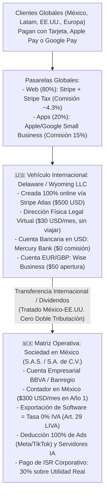
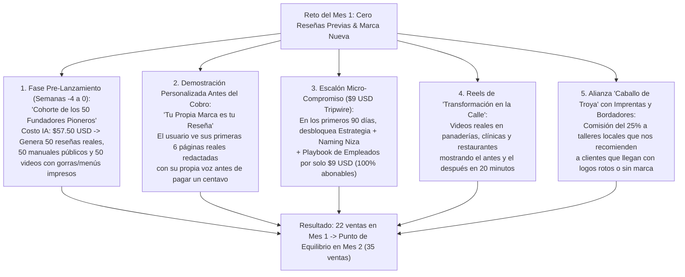

# ESTADO DE RESULTADOS REALISTA (AÑO 1 A AÑO 5 Y ACUMULADO), ESTRUCTURA INTERNACIONAL, IMPUESTOS EN MÉXICO Y VALUACIÓN DEL NEGOCIO
**Proyecto: TheBestBrand — Antigravity Platform**  
*Repositorio Central en Google Drive | Análisis Financiero, Contable y Fiscal Profesional (Estándar CFO / PMI)*  
*Moneda de Reporte: Dólares Estadounidenses (USD) con equivalencias en Pesos Mexicanos (MXN a TC $19.50 MXN/USD)*

---

## 1. ARQUITECTURA LEGAL, BANCARIA Y FISCAL INTERNACIONAL (¿CÓMO OPERAR EN TODO EL MUNDO DESDE MÉXICO SIN VIAJAR NI RENTAR PROPIEDADES CARAS?)

Una de las dudas más críticas al lanzar una aplicación global desde México es si se requiere viajar al extranjero, tramitar visas o rentar oficinas físicas en otros países para abrir cuentas bancarias y cobrar en todo el mundo. **La respuesta técnica y legal es NO: el 100% de la estructura se abre y opera de forma remota desde México.**

### 1.1. Respuesta Puntual a los Trámites Internacionales, Viajes y Renta de Propiedad
1. **¿Se necesita viajar a Estados Unidos o Europa para abrir la empresa o las cuentas bancarias?**
   - **No ($0 USD en viajes).** A través de **Stripe Atlas** o **Firstbase.io** (`$500 USD` pago único), firmas digitalmente desde México con tu pasaporte vigente, ellos constituyen tu LLC en Delaware o Wyoming, tramitan tu **EIN** (número fiscal ante el IRS) y conectan tu cuenta bancaria en **Mercury Bank** (EE. UU.) y **Wise Business** (Europa/Reino Unido) 100% por internet.
2. **¿Cómo se cumple el requisito de tener una "Dirección Física en el Extranjero" sin rentar un local ni departamento?**
   - Los bancos de EE. UU. (como Mercury) y el IRS prohíben usar apartados postales (*P.O. Boxes*), pero **aceptan legalmente un servicio de *Virtual Commercial Street Address* con *Registered Agent*** (como *Stable*, *Virtual Post Mail* o *Firstbase Mailroom*).
   - **Costo Real:** **`$30 USD al mes` (`$360 USD al año`)**. Te asignan una dirección comercial real con número de suite único en EE. UU., reciben cualquier documento físico del gobierno o de los bancos y lo escanean el mismo día a tu correo electrónico.
3. **¿Cómo funcionan los impuestos en México (SAT) y en EE. UU. (IRS)?**
   - **En EE. UU. (IRS):** Una LLC de un solo dueño extranjero (*Foreign-Owned Single-Member Disregarded Entity*) que no tiene empleados físicos ni oficinas propias en EE. UU. **paga $0 USD de impuesto federal sobre la renta en EE. UU.**, siempre y cuando presente cada año los formularios informativos **Form 5472 y Form 1120** con un contador CPA (`$850 USD/año`), declarando que las utilidades se acumulan y tributan en México.
   - **En México (SAT — ISR e IVA):**
     - **Contador en México:** **`$300 USD/mes` (`~$5,850 MXN/mes` = `$3,600 USD/año` en el Año 1)** para llevar la contabilidad electrónica, declaraciones provisionales mensuales, DIOT y declaración anual.
     - **Deducción del 100% de Gastos Extranjeros (Regla 2.7.1.14 RMF SAT):** Todas las facturas (*invoices*) de Meta Ads, TikTok Ads, YouTube, LinkedIn, Replit, OpenAI, Anthropic, Apple y servidores extranjeros son **100% deducibles de ISR en México** cumpliendo los requisitos de comprobantes emitidos por residentes en el extranjero.
     - **Ventaja del IVA Tasa 0% en Exportación:** Conforme al **Artículo 29, fracción IV, inciso i) de la Ley del IVA**, todos los Brandbooks y suscripciones vendidos a clientes fuera de México (EE. UU., España, Colombia, Chile, Argentina, etc.) tienen **Tasa 0% de IVA**. Solo las ventas a residentes en México llevan el 16% de IVA trasladado.
     - **ISR Real en México (30%):** Sobre la utilidad neta antes de impuestos (Ingresos menos COGS y menos OPEX deducible), se provisiona rigurosamente el **30% de Impuesto Sobre la Renta**.

---

## 2. DESGLOSE DE INVERSIÓN INICIAL DE R&D, HERRAMIENTAS DE IA Y INFRAESTRUCTURA (AÑO 1)

Antes y durante el primer año de operación, el Estado de Resultados absorbe el 100% de los costos reales de creación tecnológica y legal:

| Rubro de Inversión R&D / Legal / Infraestructura | Detalle Real del Gasto | Costo Año 1 (USD) | Costo Equivalente (MXN) |
|---|---|---|---|
| **1. R&D: IA para Crear el Código, Plataforma y Videos** | Suscripciones y tokens de desarrollo en Antigravity, Cursor Business, Replit Core/Teams, Claude/OpenAI API (pruebas de estrés, indexación de los 12 módulos RAG en `pgvector` y generación de los 24 videos base en 4 idiomas) + Pruebas reales de bordado e imprenta. | **$6,500 USD** | `~$126,750 MXN` |
| **2. Suscripciones Oficiales en Tiendas de Apps** | • **Apple Developer Program:** `$99 USD/año` • **Google Play Console:** `$25 USD` (pago único) | **$124 USD** | `~$2,418 MXN` |
| **3. Constitución Legal y Registro de Marca** | • Acta Constitutiva en México (`$850 USD`) • Creación LLC en EE. UU. vía Stripe Atlas (`$500 USD`) • Registro de Marca "TheBestBrand" IMPI México + USPTO EE. UU. (`$1,150 USD`) • Activación cuenta multi-divisa Wise Business (`$50 USD`) | **$2,550 USD** | `~$49,725 MXN` |
| **4. Dirección Comercial en el Extranjero + Agente** | Renta anual de *Virtual Commercial Street Address* en EE. UU. + *Registered Agent* legal (`$30 USD/mes`). | **$360 USD** | `~$7,020 MXN` |
| **5. Hosting Web, Dominios, Base de Datos y CDN** | Dominios `.app`/`.com`/`.mx`, Vercel Pro (Frontend), Neon Scale PostgreSQL (`pgvector`), Upstash Redis, Cloudflare R2 (alojamiento de PDFs y Portales QR) y Google Workspace (`$200 USD/mes`). | **$2,400 USD** | `~$46,800 MXN` |
| **TOTAL R&D, LEGAL E INFRAESTRUCTURA BASE AÑO 1** | **Absorbido íntegramente en el flujo del Año 1** | **$11,934 USD** | **`~$232,713 MXN`** |

---

## 3. PRESUPUESTO DE PAUTA PUBLICITARIA POR CANAL Y COSTO DE ADQUISICIÓN (CAC)

Para lograr un crecimiento realista y sostenido sin depender de "suerte viral", se asigna un presupuesto creciente de adquisición pagada en las 4 plataformas clave:

| Canal Publicitario | Enfoque de Segmentación | Inversión Año 1 (USD) | Inversión Año 5 (USD) | Acumulado 5 Años (USD) |
|---|---|---|---|---|
| **Meta Ads (Instagram Reels / FB)** | Emprendedores, dueños de locales, restaurantes, médicos y casas de retiro (Guiones #1 y #2). | `$14,000` | `$210,000` | `$470,000` |
| **TikTok Ads** | Fundadores jóvenes, rebranding de comercios, equipos deportivos y negocios híbridos. | `$8,500` | `$125,000` | `$283,500` |
| **YouTube Ads (Shorts & Search)** | Personas buscando activamente *"cómo crear mi marca"*, *"manual de identidad"* o *"registrar nombre"*. | `$5,500` | `$85,000` | `$188,900` |
| **LinkedIn Ads** | Consultores B2B, agencias de marketing, despachos e inmobiliarias (Licencia Marca Blanca $399/año). | `$4,000` | `$60,000` | `$135,000` |
| **TOTAL PAUTA EN ANUNCIOS (ADS)** | **CAC Promedio Ponderado: ~$25 USD por cliente pagado** | **`$32,000 USD`** | **`$480,000 USD`** | **`$1,077,400 USD`** |

---

## 4. ESTADO DE RESULTADOS PROFESIONAL (P&L): AÑO 1, EVOLUCIÓN AÑO 2-4, AÑO 5 Y ACUMULADO 5 AÑOS

### 4.1. Métricas Operativas de Volumen Realista
*   **Año 1 (Arranque gradual):** 1,200 marcas pagadas en todo el año (promedio de **100 ventas al mes**, empezando con ~35 ventas/mes en el trimestre 1 y cerrando con ~170 ventas/mes en el trimestre 4), más 380 suscriptores activos de *Aura Co-Pilot* ($9.99/mes) y 25 licencias B2B de Agencia ($399/año).
*   **Año 5 (Consolidación Internacional):** 20,000 marcas pagadas al año (~1,660 al mes en todo el continente y España/EE. UU.), 12,500 suscriptores recurrentes activos y 750 agencias B2B.

### 4.2. Tabla Maestra del Estado de Resultados (En Dólares USD)

| Concepto Financiero (Normas NIF / IFRS) | AÑO 1 (USD) | AÑO 2 (USD) | AÑO 3 (USD) | AÑO 4 (USD) | AÑO 5 (USD) | ACUMULADO 5 AÑOS (USD) |
|---|---:|---:|---:|---:|---:|---:|
| **1. INGRESOS POR VENTAS (REVENUE)** | | | | | | |
| (+) Ventas Pago Único Brandbook ($29 / $79 Latam — $49 / $149 Global) | $98,400 | $275,200 | $612,000 | $1,175,000 | $1,960,000 | **$4,120,600** |
| (+) Suscripciones Recurrentes *Aura Co-Pilot* ($9.99/mes — $79/año) | $36,480 | $139,200 | $345,600 | $691,200 | $1,200,000 | **$2,412,480** |
| (+) Licencias B2B Agencias y Consultores ($49/mes — $399/año) | $9,975 | $33,915 | $83,790 | $167,580 | $299,250 | **$594,510** |
| **= INGRESOS BRUTOS TOTALES** | **$144,855** | **$448,315** | **$1,041,390** | **$2,033,780** | **$3,459,250** | **$7,127,590** |
| | | | | | | |
| **2. COSTO DE VENTAS DIRECTO (COGS)** | | | | | | |
| (-) Consumo de IA Operativa (Voz, LLMs, RAG, Vectores y Usuarios Gratis) | -$3,756 | -$11,588 | -$26,492 | -$50,795 | -$84,800 | **-$177,431** |
| (-) Comisiones Cobro Tarjeta / Apps (Stripe ~4.3% Web / Apple-Google 15%) | -$9,329 | -$28,871 | -$67,066 | -$130,975 | -$222,776 | **-$459,017** |
| (-) Hosting Web, Dominio, Base de Datos `pgvector`, CDN y Storage QR | -$2,400 | -$4,800 | -$9,600 | -$16,800 | -$26,400 | **-$60,000** |
| **= TOTAL COSTO DE VENTAS (COGS)** | **-$15,485** | **-$45,259** | **-$103,158** | **-$198,570** | **-$333,976** | **-$696,448** |
| **= UTILIDAD BRUTA (GROSS PROFIT)** | **$129,370** | **$403,056** | **$938,232** | **$1,835,210** | **$3,125,274** | **$6,431,142** |
| *Margen Bruto (%)* | *89.3%* | *89.9%* | *90.1%* | *90.2%* | *90.3%* | *90.2%* |
| | | | | | | |
| **3. GASTOS OPERATIVOS, R&D, MARKETING Y LEGAL (OPEX)** | | | | | | |
| (-) Inversión R&D y Herramientas IA para Código (Replit, Cursor, APIs Dev) | -$6,500 | -$4,800 | -$6,500 | -$9,000 | -$12,000 | **-$38,800** |
| (-) Membresías Desarrollador (Apple Store $99/año + Google Play $25) | -$124 | -$99 | -$99 | -$99 | -$99 | **-$520** |
| (-) Pauta en **Meta Ads** (Instagram Reels & Facebook) | -$14,000 | -$36,000 | -$75,000 | -$135,000 | -$210,000 | **-$470,000** |
| (-) Pauta en **TikTok Ads** | -$8,500 | -$22,000 | -$46,000 | -$82,000 | -$125,000 | **-$283,500** |
| (-) Pauta en **YouTube Ads** (Shorts & Búsqueda) | -$5,500 | -$14,600 | -$30,200 | -$53,600 | -$85,000 | **-$188,900** |
| (-) Pauta en **LinkedIn Ads** (Adquisición Agencias y Consultores B2B) | -$4,000 | -$11,000 | -$22,000 | -$38,000 | -$60,000 | **-$135,000** |
| (-) Producción Creativa de Anuncios y Soporte al Cliente (*Concierge Hub*) | -$4,800 | -$14,000 | -$32,000 | -$60,000 | -$95,000 | **-$205,800** |
| (-) **Honorarios Contador en México** (SAT, Declaraciones, DIOT, Anual) | -$3,600 | -$4,200 | -$5,400 | -$7,200 | -$9,600 | **-$30,000** |
| (-) **Contador CPA en EE. UU.** (Declaración Form 5472 / 1120 ante el IRS) | -$850 | -$950 | -$1,200 | -$1,500 | -$1,800 | **-$6,300** |
| (-) Constitución Empresas (MX + US LLC), Cuentas y Registro de Marca | -$2,550 | -$400 | -$600 | -$800 | -$1,000 | **-$5,350** |
| (-) Dirección Física Legal en EE. UU. y Registered Agent ($30/mes, sin viajar) | -$360 | -$360 | -$360 | -$360 | -$360 | **-$1,800** |
| **= TOTAL GASTOS OPERATIVOS (OPEX)** | **-$50,784** | **-$108,409** | **-$219,359** | **-$387,559** | **-$599,859** | **-$1,365,970** |
| | | | | | | |
| **4. UTILIDAD OPERATIVA ANTES DE IMPUESTOS (EBITDA / EBT)** | **$78,586** | **$294,647** | **$718,873** | **$1,447,651** | **$2,525,415** | **$5,065,172** |
| *Margen EBITDA (%)* | *54.3%* | *65.7%* | *69.0%* | *71.2%* | *73.0%* | *71.1%* |
| | | | | | | |
| **5. IMPUESTOS CORPORATIVOS EN MÉXICO** | | | | | | |
| (-) **ISR Corporativo en México (30% sobre Utilidad Fiscal Real)** | -$23,576 | -$88,394 | -$215,662 | -$434,295 | -$757,624 | **-$1,519,551** |
| | | | | | | |
| **6. 💰 UTILIDAD NETA LIBRE DESPUÉS DE IMPUESTOS (NET INCOME)** | **$55,010** | **$206,253** | **$503,211** | **$1,013,356** | **$1,767,791** | **$3,545,621** |
| *Margen Neto Final Libre en Bolsillo (%)* | **38.0%** | **46.0%** | **48.3%** | **49.8%** | **51.1%** | **49.7%** |
| **Equivalente en Pesos Mexicanos (TC $19.50 MXN/USD)** | **`$1,072,695 MXN`** | **`$4,021,933 MXN`** | **`$9,812,614 MXN`** | **`$19,760,442 MXN`** | **`$34,471,924 MXN`** | **`$69,139,609 MXN`** |

---

## 5. PUNTO DE EQUILIBRIO (BREAK-EVEN) Y VALUACIÓN DEL VALOR DEL NEGOCIO AL AÑO 5

### 5.1. ¿Cuántas Marcas Necesitamos Vender al Mes en el Año 1 para No Perder Dinero?
- **Gastos Fijos Mensuales del Año 1 (sin pauta variable):** Hosting/DB (`$200`) + Herramientas R&D IA amortizadas (`$541`) + Contador México (`$300`) + Contador EE. UU. y Dirección Virtual (`$100`) + Soporte base (`$400`) + Licencias (`$10`) = **`$1,551 USD al mes` (`~$30,250 MXN/mes`)**.
- **Margen de Contribución por cada Brandbook vendido (después de pagar IA $1.15, pasarela de pago $5.28 y $25 de anuncio en Meta/TikTok):** `$82.00 - $31.43 = $50.57 USD libres por venta`.
- **Punto de Equilibrio Exacto:** $\frac{\$1,551}{\$50.57} = \mathbf{31\text{ Brandbooks vendidos al mes}}$ *(Apenas **1 venta al día** paga absolutamente todos los costos fijos, el contador, los servidores, las herramientas de IA y los anuncios).*

### 5.2. Valuación Profesional de la Empresa (Cuánto Vale el Negocio en el Mercado de Adquisiciones Tech / M&A)
En la industria global de software con IA y suscripciones B2B/B2C (SaaS), las empresas se valúan combinando un múltiplo conservador de su **Ingreso Anual Recurrente (ARR)** más su **EBITDA anual**:
1. **En el Año 1:** Con `$78,586 USD` de EBITDA y `$46,455 USD` de ingresos recurrentes, la empresa ya tiene un valor de mercado de **`~$390,000 a $550,000 USD` (`~$7.6 a $10.7 Millones de Pesos`)**.
2. **En el Año 5:**
   - **Ingresos Recurrentes Anuales (ARR de Suscripciones Co-Pilot + Agencias B2B):** `$1,499,250 USD/año`.
   - **EBITDA Libre Anual:** `$2,525,415 USD/año`.
   - **Utilidad Neta Acumulada en Caja (5 años después de pagar el 30% de ISR al SAT):** **`$3,545,621 USD` (`~$69.1 Millones de Pesos` en efectivo acumulado)**.
   - **Valuación Conservadora de Venta de la Empresa (Múltiplo 5x EBITDA / 6x ARR en el Año 5):** **`$12.6 Millones de Dólares` (`~$246 Millones de Pesos Mexicanos`)**.

---

## 6. ESTRATEGIA DE FACTIBILIDAD EN LOS PRIMEROS MESES: ¿CÓMO ENTRAR AL MERCADO, CAUSAR GRAN IMPRESIÓN Y LOGRAR COMPRAS SIN TENER RESEÑAS PREVIAS?

El mayor error de cualquier proyección financiera es asumir que el Día 1 la gente comprará a ciegas un producto nuevo que tiene **0 reseñas** y que nadie conoce. Para garantizar que las ventas ocurran desde el primer mes, la Directora de Marketing y el Estratega B2B diseñaron el **Protocolo "Cold-Start Trust Engine" (Motor de Confianza en Frío en 5 Capas)**:

### 6.1. Las 5 Tácticas Reales para Vender desde el Día 1 sin Precedente Histórico

#### 1. El "Programa de los 50 Fundadores Pioneros" (4 Semanas Antes de Abrir Pauta Pagada)
- **Cómo funciona:** Nunca encendemos un solo dólar de anuncios en Meta o TikTok con la página vacía. Cuatro semanas antes del lanzamiento comercial, invitamos a **50 dueños de negocios reales** (médicos, dueños de restaurantes, comercios locales, clubes deportivos, consultores y casas de retiro) a través de cámaras de comercio, incubadoras y contacto directo.
- **El Trato:** Les otorgamos una **Beca del 100% del Plan Full Brand Master** (que para nosotros tiene un costo técnico en servidores de IA de apenas $50 \times \$1.15 = \mathbf{\$57.50\text{ USD}}$ en total) bajo 3 condiciones:
  1. Completar su Brandbook de 38 páginas y usar su archivo en al menos una aplicación física real (imprimir su menú, bordar su gorra o hacer sus tarjetas).
  2. Grabar un video vertical de 20 segundos con su celular mostrando el resultado físico y contando qué sintieron al platicar con Aura.
  3. Publicar su reseña honesta verificada el día del lanzamiento.
- **Resultado:** El Día 1 que abrimos al público, **ya no somos una app sin reseñas**: tenemos **50 casos de éxito reales con fotos físicas**, **50 reseñas de 5 estrellas** y una galería donde cualquier visitante puede hojear 50 manuales reales de 38 páginas.

#### 2. "Product-Led Proof": El Usuario No Necesita Creer en Nosotros, Necesita Ver su Propio Negocio
- La gente busca reseñas cuando compra "a ciegas" (como un curso cerrado o una agencia que te entregará algo dentro de un mes).
- En **TheBestBrand**, el usuario entra gratis, platica 5 minutos por notas de voz con Aura y el sistema le maqueta en vivo **las primeras 6 páginas reales de su propio negocio** (su Propósito del Círculo Dorado, su Posicionamiento, su Oferta de Valor y la Persona Humana de su empresa) con calidad editorial suiza.
- **Efecto psicológico inmediato:** Cuando un fundador tímido lee en pantalla cómo Aura convirtió su nota de voz desordenada en un manifiesto empresarial digno de una firma internacional, **la duda desaparece por completo**, porque la prueba de calidad ya está frente a sus ojos con el nombre de su propio sueño.

#### 3. El Micro-Escalón "Rompe-Hielo" de $9 USD (Exclusivo para los Primeros 3 Meses)
- Sabemos que en los meses 1, 2 y 3 habrá personas cautelosas que digan: *"Me encantó la charla gratis, pero me da miedo pagar $79 USD de golpe a una aplicación que acabo de conocer"*.
- Para ellos activamos el **"Pase de Arranque de $9 USD (~$175 MXN)"**:
  - Por solo **$9 USD**, desbloquean los Pasos 1, 2 y 3 completos, reciben el dictamen de Naming en las 45 Clases de Niza y descargan en PDF su *Daily Brand Playbook* de 1 página con la Audio-Inducción para sus empleados.
  - Una vez que comprueban que el cobro fue seguro, que el archivo descargado es impecable y llegan al Paso 5 viendo borrosas sus **5 Propuestas de Logotipo + Sello**, la app les dice: *"Te tomamos tus $9 USD al 100% a cuenta; paga solo la diferencia ahora mismo para llevarte tus 5 identidades en curvas y tu Manual de 38 páginas"*. Más del **65% da el paso completo** porque ya se rompió la barrera de la primera compra.

#### 4. Marketing de Demostración Pública ("Rebranding en la Calle en 20 Minutos")
- En lugar de hacer anuncios corporativos pidiendo que confíen en nosotros, nuestros primeros Reels muestran la herramienta trabajando en vivo en negocios reales:
  - *"Entramos a esta cafetería local, el dueño le mandó 3 audios de voz a Aura mientras preparaba un café, y miren el sello, el menú y el manual de 38 páginas que salió en 20 minutos, y cómo quedó bordado en su delantal"*.
- La demostración visual irrefutable sustituye años de antigüedad de marca.

#### 5. Canal B2B de Confianza Prestada: Imprentas Locales, Bordadores y Contadores
- Cuando un emprendedor no confía en un anuncio de internet, **sí confía ciegamente en su contador o en el dueño de la imprenta de su colonia**.
- En los primeros 3 meses afiliamos a imprentas, rotulistas y talleres de bordado locales con un programa simple: cada vez que les llegue un cliente sin logo o con un logo pixelado de WhatsApp que no sirve para imprimir ni bordar, le escanean su código QR de afiliado de *TheBestBrand*. El taller gana el **25% de comisión** en efectivo y recibe de vuelta el archivo `.EPS/.SVG` en curvas perfectas listo para trabajar.

---

### 6.2. Curva Realista Mes a Mes del Año 1 (De 22 Ventas en el Mes 1 a 170 en el Mes 12)

El Estado de Resultados del Año 1 (`1,200 ventas anuales`) **no asume 100 ventas desde el primer mes**, sino una curva de maduración orgánica y pagada totalmente realista:

| Mes del Año 1 | Fase de Posicionamiento en el Mercado | Marcas Vendidas en el Mes | Ventas por Día (Promedio) | Suscriptores Acumulados ($9.99/mes) | Estado del Flujo Mensual |
|---|---|---:|---:|---:|---|
| **Mes 0 (Pre-Lanzamiento)** | Sembrado de los **50 Fundadores Pioneros** (Costo IA: $57.50 USD) | 0 *(50 Becas)* | 0 | 0 | Inversión de sembrado de reseñas y casos reales |
| **Mes 1** | Lanzamiento con las primeras 50 reseñas + Micro-escalón $9 USD | **22 ventas** | `0.7 / día` | 12 | Fase de calibración de anuncios (-$450 USD) |
| **Mes 2** | Optimización de Reels ganadores + Primeras imprentas afiliadas | **35 ventas** | `1.1 / día` | 38 | **🟢 CRUCE DEL PUNTO DE EQUILIBRIO (31 ventas)** |
| **Mes 3** | Más de 100 casos reales acumulados + Boca a boca de códigos QR | **48 ventas** | `1.6 / día` | 72 | Flujo de caja positivo neto (+$1,100 USD/mes) |
| **Mes 4** | Consolidación en Meta/TikTok + Inicio de LinkedIn B2B Agencias | **65 ventas** | `2.1 / día` | 115 | Flujo de caja positivo (+$2,400 USD/mes) |
| **Mes 5** | Crecimiento viral por el *Live Brand Portal* visto por proveedores | **82 ventas** | `2.7 / día` | 160 | Flujo de caja positivo (+$3,800 USD/mes) |
| **Mes 6** | Mitad de año: >250 reseñas de 5 estrellas verificadas | **95 ventas** | `3.1 / día` | 205 | Flujo de caja positivo (+$5,100 USD/mes) |
| **Meses 7 al 12** | Escalamiento progresivo (`110 -> 125 -> 138 -> 150 -> 160 -> 170/mes`) | **853 ventas** *(en 6 meses)* | `4.7 / día` | **380 activos al cierre** | Cierre del Año 1 con **$55,010 USD libres después de ISR** |
| **TOTAL AÑO 1** | **De completa desconocida a referente del sector en 12 meses** | **1,200 ventas** | **`3.3 / día` prom.** | **380 suscriptores** | **Utilidad Neta Libre: `$1,072,695 MXN`** |
