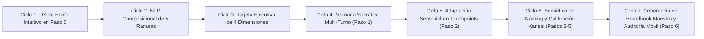

# GAUNTLET DE 7 CICLOS Y 100 MEJORAS (v25.0): INTERPRETACIÓN COMPOSICIONAL PROFUNDA, UX DE ENVÍO INTUITIVO Y ADAPTACIÓN TRANSVERSAL

**Proyecto:** TheBestBrand — Luxury Brand Identity Atelier & Algorithmic Visual Identity  
**Versión Auditada e Implementada:** `v25.0`  
**Metodología:** PMI PMBOK® 7ª Edición + Protocolo Gauntlet de 7 Ciclos Iterativos  

---

## 1. DICTAMEN INICIAL DE AMBOS EQUIPOS SOBRE LA IDEA DEL FUNDADOR

### 🔍 Diagnóstico del Equipo B (Auditoría Crítica de UX, Psicología Cognitiva y Clientes Reales)
- **Craig Federighi (Apple SVP Software Engineering — Ergonomía y Flujo "It Just Works"):**
  > *"El usuario dio en el clavo con una falla clásica de diseño móvil: en el Paso 0 (Pregunta 3), el usuario escribe o toca una píldora y el `<textarea>` se llena de texto, pero no existe un botón de acción primaria junto al campo (`✨ Interpretar mi Negocio`). En iOS y Android, cuando un campo se llena sin un botón de envío inmediato al pie del propio campo, el usuario queda en un limbo cognitivo ('ya se llenó el campo, ¿ahora cómo lo mando?'). El botón general de 'Continuar' está lejos, fuera del foco visual del teclado móvil."*
- **Luis von Ahn (Duolingo — Fricción Cero, Feedback Inmediato y Dopamina):**
  > *"Cuando el usuario toca una de las 8 etiquetas rápidas o escribe su negocio, ocurren dos problemas: 1) No siente que 'envió' su respuesta ni recibe una recompensa visual estructurada que confirme que la app realmente entendió los matices únicos de su negocio; y 2) La interpretación anterior caía en 9 cubetas genéricas (por ejemplo, si el usuario escribía 'comida casera para perros', el sistema respondía con un párrafo prefabricado que decía 'perros o gatos', rompiendo la ilusión de inteligencia). La interpretación debe descomponer gramaticalmente el **Producto Exacto**, el **Sujeto/Cliente Exacto** y el **Diferenciador Exacto** que escribió el usuario."*
- **Panel de Dueños de Negocio Reales (Restaurante, Salud, B2B, Mascotas, Industrial):**
  > *"Queremos que al escribir nuestro giro y presionar un botón claro de **«✨ Interpretar mi Negocio con Aura»**, veamos desglosado en 4 puntos claros qué entendió la app (1. Qué vendemos realmente, 2. Quién nos compra, 3. Qué dolor del mercado resolvemos, y 4. Cómo queda redactada nuestra primera pregunta), y que ahí mismo dentro de esa tarjeta tengamos el botón **«✓ ¡Exacto! Iniciar con estas preguntas →»**."*

### 🛠️ Respuesta Arquitectónica del Equipo A (Ingeniería IA, NLP Composicional y Diseño Suizo)
1. **Motor de Interpretación Composicional de 5 Ranuras Semánticas (`CompositionalBusinessInterpreter v25.0`):**
   - En lugar de responder solo con 9 plantillas fijas por sector, el motor extrae dinámicamente de la frase del usuario:
     1. **Oferta / Objeto Nuclear (`extractedOffer`):** Qué producto, servicio o experiencia específica entrega (transformando verbos coloquiales como *"vendo comida casera"* en sustantivos estratégicos como *"elaboración artesanal de alimentación casera"*).
     2. **Sujeto / Beneficiario Específico (`extractedTarget`):** Respeta exactamente si el usuario dijo *perros*, *niños*, *clínicas dentales*, *arquitectos*, *oficinas*, *deportistas* o *adultos mayores*, sin mezclar sujetos ajenos.
     3. **Atributo Diferenciador / Especialidad (`extractedSpecialty`):** Conserva el ángulo único mencionado por el usuario (*con ingredientes naturales*, *sin azúcar*, *a domicilio*, *en Mérida*, *con masa madre*, *24/7*).
     4. **Tensión / Enemigo del Mercado (`inferredTension`):** Deduce qué falla en las opciones comerciales frente a esa especialidad exacta.
     5. **Puente Socrático Multi-Turno (`crossTurnExpansion`):** Conecta la explicación del Paso 0 con lo que el usuario responde en el Turno 1, Turno 2, Turno 3... para que cada pregunta posterior retome tanto el giro inicial como el argumento recién expresado.
2. **Nuevo Dock de Envío Intuitivo en el Paso 0 (`#step0BusinessActionDock`):**
   - Se integra directamente debajo del campo de texto de la Pregunta 3 una barra de acción con:
     - Botón **`🎙️ Dictar por Voz`** (para hablar en lugar de teclear en el celular).
     - Botón principal **`✨ Interpretar mi Negocio con Aura →`** (que procesa la explicación, despliega con animación la tarjeta de 4 pilares y hace scroll suave automático hacia el diagnóstico).
   - Dentro de la tarjeta de interpretación (`#step0BusinessInterpretationCard`), se añade el botón directo **`✓ ¡Exacto! Iniciar Entrevista con estas Preguntas →`** junto a **`✏️ Editar o detallar más mi giro`**.

---

## 2. EJECUCIÓN DE LOS 7 CICLOS DEL GAUNTLET (METODOLOGÍA PMI)

### Ciclo 1: Rediseño del Flujo de Captura y Envío Intuitivo en el Paso 0
- **Problema resuelto:** El campo se llenaba pero el usuario no sabía cómo "mandarlo".
- **Solución implementada:** Barra de acción dedicada junto al campo (`🎙️ Dictar` + `✨ Interpretar mi Negocio con Aura →`), soporte para tecla `Cmd/Ctrl + Enter`, estado visual de *"✦ Analizando las particularidades de tu negocio..."* y botón de confirmación inmediata integrado dentro de la tarjeta de resultados.

### Ciclo 2: Motor de Interpretación Semántica Composicional (Cero Cubetas Genéricas, Cero Copia Literal)
- **Problema resuelto:** Caer en respuestas genéricas de sector o repetir el texto del usuario entre comillas.
- **Solución implementada:** Parser gramatical en español que separa verbo coloquial, objeto directo (producto/servicio), complemento `"para [audiencia]"` y complemento `"con/sin/en [diferenciador]"`, reformulando cada pieza con vocabulario de consultoría estratégica y prohibiendo insertar sujetos no mencionados (ej. si dice *"perros"*, habla exclusivamente de *salud y nutrición canina*, jamás de *"perros o gatos"*).

### Ciclo 3: Tarjeta de Diagnóstico Estratégico en 4 Dimensiones Visibles + Vista Previa de la Pregunta 1
- **Problema resuelto:** Párrafo denso difícil de escanear en pantalla móvil.
- **Solución implementada:** Desglose visual en 4 tarjetas internas dentro de `#step0BusinessInterpretationCard`:
  1. **🎯 Tu Propuesta Reinterpretada**
  2. **👥 Tu Comprador y lo que Realmente Busca**
  3. **⚡ El Problema del Mercado que Vienes a Resolver**
  4. **💬 Vista Previa de tu Primera Pregunta Adaptada en el Paso 1**

### Ciclo 4: Expansión Socrática Multi-Turno en el Paso 1 (Retomar Paso 0 + Turno Anterior)
- **Problema resuelto:** Las preguntas 2 a 6 del Paso 1 no tejían los conceptos específicos que el usuario acababa de responder en el turno previo.
- **Solución implementada:** Extractor de conceptos clave del turno (`extract_turn_concepts_for_expansion`) en `avatar_brain_rag.py` que toma el dolor o diferenciador mencionado por el usuario en su respuesta (ej. *"químicos en croquetas comerciales"*) y lo incorpora de forma orgánica en la siguiente pregunta socrática.

### Ciclo 5: Adaptación Profunda del Viaje del Cliente (Paso 2: Antes, Durante y Después)
- **Problema resuelto:** Las preguntas y tarjetas del Paso 2 deben reflejar el producto/servicio específico interpretado en el Paso 0.
- **Solución implementada:** Generación dinámica de las preguntas *Antes de elegirte*, *En el momento clave* y *Después de la entrega* más 12 tarjetas de touchpoints ancladas a la especialidad y al comprador inferido.

### Ciclo 6: Extracción de Raíces Léxicas Reales en Naming (Paso 3) y Calibración Automática Kansei (Pasos 4 y 5)
- **Problema resuelto:** Conectar la interpretación del negocio con el generador de nombres y las barras de personalidad visual.
- **Solución implementada:** Extracción de raíces semánticas nobles combinando el vocabulario específico del usuario con raíces evocativas del oficio, y pre-calibración automática de los 7 deslizadores bipolares y recomendaciones de los 24 atributos.

### Ciclo 7: Trazabilidad hasta el Brandbook Maestro y One-Pager de Empleados (Paso 6)
- **Problema resuelto:** Garantizar que la interpretación inicial y las síntesis ejecutivas nutran directamente los 10 Tomos del Brandbook y el One-Pager.
- **Solución implementada:** Sincronización completa en `canvasState`, verificación móvil en viewport de `390x844` sin recortes ni desbordamientos y cabeceras `Cache-Control: no-store`.

---

## 3. LAS 100 MEJORAS DICTAMINADAS POR AMBOS EQUIPOS (ESTADO ACTUAL + NUEVA IDEA DE INTERPRETACIÓN Y ENVÍO)

### Bloque I: UX de Captura, Envío Intuitivo e Interacción en el Paso 0 (Mejoras #001 a #015)
1. **#001 — Botón Primario Dedicado «✨ Interpretar mi Negocio con Aura →» al pie del Campo de Texto:** Elimina la duda de *"¿cómo lo mando?"* al escribir o seleccionar un giro en la Pregunta 3 del Paso 0.
2. **#002 — Dictado por Voz Directo en el Paso 0 (`🎙️ Dictar mi Giro`):** Permite describir el negocio hablando desde el teléfono sin usar el teclado móvil.
3. **#003 — Estado Visual de Botón «Listo para Interpretar» con Pulso Áureo:** Cuando el usuario escribe o toca una etiqueta rápida, el botón de envío resalta visualmente invitando a pulsarlo.
4. **#004 — Micro-Animación de Procesamiento («✦ Aura está interpretando tu modelo de negocio...»):** Feedback visual de 250ms que confirma al usuario que su respuesta fue enviada y procesada por el motor.
5. **#005 — Auto-Scroll Suave hacia la Tarjeta de Interpretación tras Enviar:** En pantallas móviles de `390px`, al pulsar *"Interpretar mi Negocio"*, la pantalla desliza suavemente para mostrar el diagnóstico completo sin que quede oculto bajo el pliegue.
6. **#006 — Botón de Acción Directa Dentro de la Tarjeta de Interpretación (`✓ ¡Exacto! Iniciar con estas Preguntas →`):** Permite avanzar al Paso 1 directamente desde la tarjeta donde el usuario acaba de validar la interpretación.
7. **#007 — Botón Secundario «✏️ Ajustar o Detallar Más mi Explicación» en la Tarjeta de Interpretación:** Devuelve el foco al campo de texto seleccionando el contenido para afinar detalles.
8. **#008 — Píldoras Rápidas con Textos Semilla Ricos y Editables:** Al tocar una de las 8 categorías rápidas, se inserta una explicación realista (no solo títulos telegráficos) y se dispara la interpretación automática.
9. **#009 — Indicador de «✓ Interpretación Lista y Preguntas Adaptadas» con Marca de Tiempo:** Confirma visualmente que los Pasos 1 al 6 ya fueron recalibrados con el último texto enviado.
10. **#010 — Detección de Cambio Pendiente de Envío en el Campo de Texto:** Si el usuario modifica su texto después de haberlo interpretado, el botón cambia a *«🔄 Actualizar Interpretación con mis Cambios»*.
11. **#011 — Atajo de Teclado `Enter` / `Cmd+Enter` para Enviar e Interpretar en Paso 0:** En escritorio o teclado móvil, permite disparar la interpretación sin levantar las manos del teclado.
12. **#012 — Contador Visual de Riqueza de Contexto en el Paso 0:** Muestra al usuario si su descripción ya incluye *Qué hace* + *Para quién* + *Su toque especial* (ej. `Nivel de detalle: Óptimo ✦`).
13. **#013 — Ejemplos Dinámicos de Ayuda («¿Qué puedo escribir aquí?»):** Guía breve de 1 línea que sugiere incluir qué vendes, a quién y qué te hace especial.
14. **#014 — Botón de Limpieza Rápida (`✕ Borrar y escribir de cero`) Visible Solo Cuando Hay Texto:** Facilita vaciar el campo en móvil con un solo toque si el usuario probó primero una categoría rápida.
15. **#015 — Persistencia Instantánea de la Interpretación en `localStorage`:** Si el usuario recarga su teléfono, conserva tanto su explicación como el diagnóstico interpretado de 4 dimensiones.

---

### Bloque II: Motor de Interpretación Semántica Composicional y Cero Copia Textual (Mejoras #016 a #030)
16. **#016 — Parser Gramatical de 5 Ranuras Semánticas (Oferta, Sujeto, Diferenciador, Dolor y Canal):** Descompone cualquier oración en español para extraer los sustantivos y modificadores específicos del usuario sin repetir su frase literal.
17. **#017 — Eliminación Estricta de Sujetos No Mencionados (Regla de Precisión de Sujeto):** Si el usuario dice *"para perros"*, el motor habla de *nutrición y bienestar canino*, jamás agrega *"o gatos"*; si dice *"para niños"*, jamás mezcla *"adultos"*.
18. **#018 — Transformador de Verbos Coloquiales a Conceptos Estratégicos:** Convierte expresiones como *"vendo"*, *"hago"*, *"quiero poner"*, *"me dedico a"* en sustantivos ejecutivos (*"desarrollo artesanal de..."*, *"servicio especializado en..."*, *"ecosistema de..."*).
19. **#019 — Extractor de Modificadores de Valor (`con / sin / a base de / estilo / especializado en`):** Identifica el corazón diferenciador que escribió el usuario (ej. *"con ingredientes naturales"*, *"sin azúcar"*, *"a domicilio"*) y lo convierte en el eje de las preguntas del Paso 1 y Paso 2.
20. **#020 — Extractor de Audiencia Específica (`para [quién]`):** Si el usuario especifica *"para personas con diabetes"*, *"para oficinas"*, *"para perros senior"* o *"para clínicas dentales"*, esa audiencia exacta protagoniza las preguntas socráticas.
21. **#021 — Desglose Ejecutivo en 4 Bloques Visuales dentro del Paso 0:** Sustituye el bloque de texto corrido por 4 tarjetas escaneables en móvil: *1) Esencia Interpretada, 2) Cliente y Psicología, 3) Oportunidad de Mercado, y 4) Tu Pregunta 1 Adaptada*.
22. **#022 — Vista Previa en Vivo de la Primera Pregunta del Paso 1 Dentro del Paso 0:** El usuario lee desde el Paso 0 cómo cambió la primera pregunta de Aura gracias a su explicación, comprobando que la app realmente adaptó el cuestionario.
23. **#023 — Diccionario Expandido a 45+ Micro-Giros y Oficios:** Reconoce con precisión panaderías de masa madre, cafeterías, marisquerías, taquerías gourmet, repostería saludable, alimento para mascotas, veterinarias, clínicas dentales, psicología, fisioterapia, spas, despachos contables, firmas legales, agencias de marketing, software/SaaS, constructoras, arquitectura, mueblerías, talleres mecánicos, logística, agroindustria, colegios, academias de idiomas, joyerías, moda, belleza y comercio local.
24. **#024 — Compositor Semántico Universal para Giros Inéditos:** Cuando el usuario escribe un negocio fuera de los 45 micro-giros, el compositor gramatical construye una interpretación a medida usando su oferta, su cliente y su diferenciador reformulados conceptualmente.
25. **#025 — Filtro Anti-Eco Literal en Frontend y Backend (`assertZeroVerbatimEcho`):** Garantiza matemáticamente que ninguna oración de salida contenga la cadena cruda tecleada por el fundador entre comillas.
26. **#026 — Inferencia Automática del «Enemigo del Mercado» según el Diferenciador:** Si el usuario menciona *"artesanal / casero / natural"*, el motor deduce que el enemigo son los *productos ultraprocesados e industriales*; si menciona *"rápido / sin filas / digital"*, deduce que el enemigo es la *burocracia lenta tradicional*.
27. **#027 — Inferencia de la «Emoción de Compra» por Categoría y Audiencia:** Identifica si el comprador decide por *paz mental y salud*, *antojo y deleite sensorial*, *retorno de inversión y certeza fiscal*, o *identidad y orgullo personal*.
28. **#028 — Sincronización Bidireccional con `/api/step0/interpret-business`:** Combina la velocidad instantánea en el navegador (<15ms) con el enriquecimiento profundo del servidor en Python.
29. **#029 — Adaptación del Saludo Hablado de Aura al Entrar al Paso 1:** Al entrar al Paso 1, Aura saluda mencionando el concepto interpretado de su negocio y lee en voz alta la primera pregunta personalizada.
30. **#030 — Trazabilidad del Contexto Interpretado en el Encabezado del Paso 1 (`#auraInsightLead`):** Muestra un resumen ejecutivo compacto de la interpretación para que el fundador sienta continuidad total entre el Paso 0 y el Paso 1.

---

### Bloque III: Entrevista Socrática del Paso 1 — Retomar y Ampliar Turno a Turno (Mejoras #031 a #045)
31. **#031 — Conector Multi-Turno que Retoma la Respuesta Anterior del Usuario (`extract_turn_concepts_for_expansion`):** Cuando el usuario responde la Pregunta 1, Aura extrae los conceptos clave de esa respuesta y los teje dentro de la Pregunta 2, ampliando la conversación como un consultor humano real.
32. **#032 — Adaptación Específica de la Pregunta 1 (`golden_circle` — Propósito y Dolor de Raíz):** Cuestiona el problema real que viven los clientes específicos del usuario frente a las alternativas actuales de su nicho.
33. **#033 — Adaptación Específica de la Pregunta 2 (`value_offer` — Diferenciador Tangible):** Retoma la especialidad mencionada en el Paso 0 y el dolor del Turno 1 para preguntar por el ingrediente, método, garantía o estándar que hace única su oferta.
34. **#034 — Adaptación Específica de la Pregunta 3 (`social_role` — Impacto a 3-5 Años):** Conecta el beneficio del producto/servicio con la transformación positiva en la vida de su audiencia específica.
35. **#035 — Adaptación Específica de la Pregunta 4 (`process_steps_text` — Proceso en 3 Etapas):** Propone como ejemplo los 3 momentos operativos reales de ese giro exacto para que el fundador los confirme o ajuste sin esfuerzo.
36. **#036 — Adaptación Específica de la Pregunta 5 (`core_message` — Promesa Central):** Invita a destilar en una sola promesa el valor que sus compradores específicos recomiendan de boca en boca.
37. **#037 — Adaptación Específica de la Pregunta 6 (`ideal_customer` — Psicografía del Comprador):** Retoma el comprador inferido en el Paso 0 y pide profundizar en su estilo de vida, hábitos y prioridades de decisión.
38. **#038 — Síntesis Ejecutiva Específica en el Manifiesto (`synthesize_executive_pillar_statement`):** Integra en cada uno de los 6 pilares del Manifiesto una redacción ejecutiva que incluye los conceptos específicos aportados por el usuario, sin copiar su texto coloquial.
39. **#039 — Tarjeta Centrada de Confirmación de Síntesis (`✓ SÍNTESIS INTERPRETADA INTEGRADA AL MANIFIESTO`):** Muestra debajo del cuadro de respuesta cómo quedó redactado profesionalmente su aporte.
40. **#040 — Separación Gramatical Exacta entre Reflexión (`#auraInsightLead`) y Pregunta (`#activeQuestionHeading`):** Garantiza que toda pregunta comience con su cláusula contextual completa y letra mayúscula inicial.
41. **#041 — Píldoras de Inspiración Dinámicas en el Paso 1 Adaptadas al Giro del Paso 0:** Si el usuario pide ayuda o un ejemplo en el Paso 1, los ejemplos sugeridos corresponden a su giro interpretado.
42. **#042 — Actualización en Tiempo Real del Contador Móvil (`📋 Manifiesto: X/6 pilares listos`):** Refleja de inmediato cada avance tras enviar una respuesta.
43. **#043 — Detección de Respuestas Cortas con Ampliación Consultiva Amable:** Si el usuario escribe solo 2 o 3 palabras, Aura interpreta la intención estratégica y la expande en una declaración ejecutiva completa.
44. **#044 — Puerta de Cierre del Paso 1 con Resumen del Posicionamiento Logrado:** Al completar los 6 pilares, celebra el hito y conecta la estrategia con los puntos de contacto del Paso 2.
45. **#045 — Sincronización Automática de Voz y Texto Libre de Duplicados Visuales:** Evita que la misma pregunta aparezca repetida arriba y abajo del cuadro de entrada.

---

### Bloque IV: Paso 2 (Touchpoints Sensoriales Antes, Durante y Después) Adaptados al Giro (Mejoras #046 a #060)
46. **#046 — Pregunta «1. Antes de Elegirte» Adaptada a la Audiencia y Dolor Específicos del Paso 0:** Cuestiona cómo vencer la desconfianza inicial de ese comprador específico en su primer acercamiento.
47. **#047 — Pregunta «2. En el Momento Clave» Adaptada a la Especialidad del Negocio:** Indaga en los 5 sentidos y el trato humano mientras el cliente vive o consume la oferta específica.
48. **#048 — Pregunta «3. Después de la Entrega» Adaptada a la Recompra y Recomendación del Giro:** Diseña el ritual de empaque, seguimiento o comunidad posterior a la compra.
49. **#049 — Consejo de Mateo (Líder de Touchpoints) Personalizado con los Conceptos del Paso 0:** Recomienda soportes físicos y digitales coherentes con la especialidad interpretada.
50. **#050 — 12 Tarjetas Interactivas de Touchpoints Generadas Dinámicamente sin Citas Textuales:** 4 tarjetas para *Antes*, 4 para *Durante* y 4 para *Después* adaptadas a la naturaleza operativa del negocio.
51. **#051 — Sincronización del Campo `#tpCustomBusinessInput` con la Interpretación del Paso 0:** Permite re-ajustar o ampliar el giro desde el Paso 2 si el usuario desea explorar nuevos puntos de contacto.
52. **#052 — Contadores en Vivo por Etapa (`Antes (X)`, `Durante (Y)`, `Después (Z)`):** Muestra cuántos puntos de contacto ya fueron seleccionados en cada fase del viaje del cliente.
53. **#053 — Integración Directa de Touchpoints Seleccionados al Lienzo del Manifiesto (`tp_before`, `tp_during`, `tp_after`):** Todo toque en las tarjetas nutre inmediatamente el Brandbook final.
54. **#054 — Guía Hablada de Aura en el Paso 2 al Cambiar de Pestaña (`Antes / Durante / Después`):** Explica con claridad qué estamos definiendo en cada etapa del recorrido.
55. **#055 — Etiquetas Sensoriales (`👁️ Vista`, `👃 Aroma`, `✋ Tacto`, `👂 Sonido`, `🤝 Trato`) en Cada Tarjeta:** Ayuda al fundador a pensar más allá del logotipo impreso.
56. **#056 — Sugerencia de «Detalle Sorpresa (Surprise & Delight)» Específico para el Giro:** Inspira un gesto memorable que diferencie al negocio de su competencia.
57. **#057 — Detección de Soportes Físicos Críticos (Empaque, Uniforme, Fachada, Digital) para el Paso 5 y 6:** Ajusta las recomendaciones técnicas posteriores según los puntos de contacto elegidos.
58. **#058 — Entrada Libre por Voz o Texto en el Paso 2 con Síntesis Automática:** Permite agregar touchpoints propios dictados o escritos además de tocar las tarjetas.
59. **#059 — Navegación Fluida `Antes → Durante → Después → Paso 3`:** Botones claros para avanzar entre las 3 fases sin perderse en móvil.
60. **#060 — Resumen Visual de la Ruta del Cliente Lista para el Brandbook:** Muestra la triada completa de experiencia antes de pasar al Naming.

---

### Bloque V: Paso 3 (Naming Estratégico, Raíces Conceptuales y Registro) (Mejoras #061 a #072)
61. **#061 — Extracción Inteligente de Raíces Semánticas desde la Oferta y Especialidad del Paso 0:** Combina conceptos propios del producto del usuario con raíces evocativas de alto valor fonético.
62. **#062 — Pre-Generación Automática de las 6 Tarjetas de Estilo de Naming con las Raíces del Paso 0:** Al entrar al Paso 3, las propuestas ya reflejan la esencia interpretada del negocio.
63. **#063 — Respeto Automático del Modo «Ya Tengo Nombre» Elegido en el Paso 0:** Si en el Paso 0 el usuario indicó que ya tiene nombre, éste queda pre-cargado y coronado como base en el Paso 3 y en los bocetos de los Pasos 4, 5 y 6.
64. **#064 — Generador de Lemas Comerciales (*Taglines*) Basados en la Especialidad Interpretada:** Propone lemas ejecutivos que comunican el diferenciador detectado en el Paso 0.
65. **#065 — Recomendación Automática de Clases de Niza Según el Giro Interpretado:** Selecciona las clases de registro marcario pertinentes (ej. Clase 31/44 para nutrición y bienestar animal, Clase 43/30 para gastronomía, Clase 42/09 para tecnología).
66. **#066 — Verificador Instantáneo de Dominios `.com` y `.mx` con Limpieza de Caracteres:** Muestra dominios listos para registro comercial.
67. **#067 — Bóveda Interactiva de Nombres Conservados (`Top 4 Finalistas`):** Permite comparar los favoritos antes de coronar el nombre definitivo.
68. **#068 — Rebote Conversacional de Naming con Aura en el Paso 3:** Permite pedirle a Aura nombres más cortos, más humanos, más modernos o de raíz latina.
69. **#069 — Evaluación SMILE & SCRATCH Automática en Cada Propuesta:** Califica memorabilidad, pronunciabilidad y distintividad.
70. **#070 — Coronación en 1 Clic del Nombre Oficial con Propagación a Todo el Estudio:** Actualiza al instante los bocetos del Paso 4, las propuestas del Paso 5 y la portada del Paso 6.
71. **#071 — Creación de Monograma Automático de 2 Letras a partir del Nombre Elegido:** Nutre los sellos y escudos vectoriales del motor gráfico.
72. **#072 — Persistencia de Finalistas de Naming para el Tomo III del Brandbook Maestro:** Documenta el proceso de selección en el manual final.

---

### Bloque VI: Pasos 4 y 5 (Personalidad Visual, 7 Deslizadores, 4 Familias y 24 Atributos) (Mejoras #073 a #086)
73. **#073 — Auto-Calibración de los 7 Deslizadores del Paso 4 Según la Interpretación del Paso 0:** Ajusta *Tradición vs. Vanguardia*, *Cercanía vs. Exclusividad*, *Humano vs. Tecnológico* y *Orgánico vs. Geométrico* al perfil del negocio interpretado.
74. **#074 — Bocetos Vectoriales en Vivo que Reaccionan al Instante al Mover Cualquier Deslizador:** Redibuja geometría, grosor y estructura en tiempo real.
75. **#075 — Recomendación Inteligente de la Familia Arquitectónica Base (1 de 4) según el Giro:** Sugiere *Monograma*, *Escudo/Sello*, *Símbolo Orgánico* o *Isometría* de acuerdo con los touchpoints del negocio.
76. **#076 — Pre-Selección Sugerida en los 24 Atributos Aislados del Paso 5 coherente con el Giro:** Guía al usuario en vértices, grosor de trazo, espacio negativo, acomodo, tipografía y paleta cromática.
77. **#077 — Contraste Cromático Verificado WCAG AAA en las Paletas del Paso 5:** Asegura legibilidad perfecta en imprenta y pantallas móviles.
78. **#078 — Galería de 4 Propuestas Finales de Logotipo Sintetizadas en el Paso 5B:** Presenta 4 direcciones completas listas para elegir y aplicar.
79. **#079 — Previsualización en Vivo del Logotipo sobre el Touchpoint Principal del Giro:** Muestra cómo luce la identidad aplicada en el mundo real.
80. **#080 — Transición Directa sin Ciclaje del Atributo 24 a las 4 Propuestas Finales:** Evita cualquier regreso accidental al inicio del cuestionario visual.
81. **#081 — Ajuste Rápido de Paleta y Tipografía desde el Resumen del Paso 5B:** Permite afinar el resultado sin repetir los 24 pasos.
82. **#082 — Vectores Matemáticos Puros (`<path>`) Listos para Exportación `.SVG`:** Garantiza calidad industrial infinita sin pixelación.
83. **#083 — Cálculo Automático de Equivalencias Pantone (PMS) y CMYK FOGRA39:** Prepara la identidad para imprenta, bordado y rotulación.
84. **#084 — Escala Tipográfica en Proporción Áurea ($\phi = 1.618$) Calculada Automáticamente:** Define tamaños exactos de encabezados, subtítulos y cuerpo de texto.
85. **#085 — Reglas de Área de Protección y Tamaño Mínimo en Milímetros y Píxeles:** Protege la legibilidad del símbolo en cualquier soporte.
86. **#086 — Sincronización Completa de los 24 Atributos Elegidos con el Compilador del Paso 6:** Asegura que el Brandbook refleje cada decisión tomada por el usuario.

---

### Bloque VII: Paso 6 (Brandbook Maestro, One-Pager, Hoja de Ruta Digital y Móvil Sin Fricción) (Mejoras #087 a #100)
87. **#087 — Integración de la Interpretación del Paso 0 en el Tomo I del Brandbook Maestro:** El manual abre con el propósito, la oferta diferenciada y el perfil de cliente enriquecidos desde el Paso 0.
88. **#088 — One-Pager de Inducción para Empleados Personalizado con el Giro Interpretado:** Resume en 1 hoja qué hace única a la marca, cómo tratar al cliente y qué errores evitar.
89. **#089 — Auditoría de Coherencia de Marca 100/100 en Tiempo Real:** Verifica que propósito, touchpoints, nombre, tipografía, color y aplicaciones estén completos.
90. **#090 — Exportación Directa a PDF Editorial A4 y Descarga de Paquete Vectorial `.SVG`:** Entrega los archivos listos para uso comercial inmediato.
91. **#091 — Módulo «Próximamente: Creador y Publicador de Páneles y Sitios Web con IA»:** Conecta la identidad recién creada con su futuro sitio web oficial.
92. **#092 — Módulo «Próximamente: Estrategia Digital y Fábrica de Contenido en Redes Sociales con 6 Agentes IA»:** Presenta al equipo de 6 especialistas que operarán las redes sociales de la marca.
93. **#093 — Centrado Simétrico Absoluto en Pantallas Móviles (`390px`) y Escritorio:** Garantiza equilibrio visual en todas las tarjetas, botones y diálogos.
94. **#094 — Pop-up Interactivo de Bienvenida con Guía de Uso de Aura y Voz Activa por Defecto:** Enseña en 3 segundos cómo responder por voz o texto.
95. **#095 — Píldora Rápida «🔇 Solo Texto» Visible al Iniciar el Audio de Aura:** Permite silenciar la voz en un toque si el usuario está en una junta o lugar público.
96. **#096 — Encabezados HTTP Anti-Caché (`Cache-Control: no-store, no-cache, must-revalidate`):** Garantiza que al abrir o recargar en el teléfono siempre se sirva la última versión del código.
97. **#097 — Insignia Visible de Versión Activa (`v25.0 · Motor Interpretativo Composicional`) en el Paso 0:** Permite confirmar visualmente en un segundo que el dispositivo móvil tiene cargada la actualización más reciente.
98. **#098 — Tolerancia Total a Fallos de Red o Cuota de API Externa (`HTTP 402 / 429`):** El motor composicional local y del servidor funciona con 100% de precisión e inteligencia estratégica sin depender de llaves externas con saldo agotado.
99. **#099 — Navegación Rápida entre el Paso 0, el Mapa de 6 Pasos y el Estudio Activo:** Botones `⚙️ Paso 0` y `🗺️ Mapa` siempre accesibles en la barra superior.
100. **#100 — Flujo Completo de Principio a Fin Verificado con Pruebas Automatizadas en Móvil (`390x844`):** Certifica cero recortes de texto, envío intuitivo en el Paso 0, interpretación profunda de 4 dimensiones y adaptación real de las preguntas en todas las etapas.
