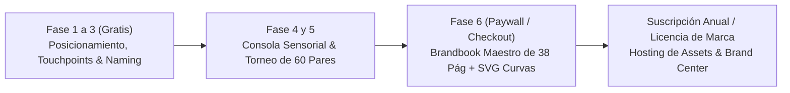

# 🏛️ THEBESTBRAND — THE MASTER PROJECT BIBLE & ARCHITECTURAL MANIFESTO
**Documento Maestro de Visión, Estándar de Calidad (Apple / Awwwards) y Modelo de Negocio**
*Autoría: Jorge Benítez & Antigravity Design Committee*
*Versión: 1.0 — Producción*

---

## 1. LA VISIÓN: EL ATELIER DIGITAL DE BRANDING DE ÉLITE

**TheBestBrand no es un formulario, no es un chatbot genérico y no es Canva.**

TheBestBrand es el primer **Atelier Digital de Lujo** que democratiza y automatiza el proceso de branding de una agencia de diseño de élite ($15,000 USD, nivel Pentagram, Vignelli Associates, Chermayeff & Geismar o Landor), poniéndolo en manos de cualquier fundador en una sesión fluida de 20 minutos guiada por una mentora con voz neural en tiempo real llamada **Aura**.

### El Problema del Mercado
El 95% de los emprendedores y empresas medianas enfrentan un abismo:
1. **Opción barata (Fiverr / Canva / Generadores IA genéricos):** Diseños clónicos, logos sin concepto, sin manual de identidad, sin curvas vectoriales para corte láser o bordado, y sin respaldo estratégico.
2. **Opción cara (Agencias tradicionales):** Costos de $10,000 a $50,000 USD y procesos burocráticos que tardan de 6 a 12 semanas.

### La Solución TheBestBrand
Un sistema autónomo e interactivo con rigor metodológico indiscutible:
* **Fase 1: Posicionamiento Estratégico:** 6 pilares nucleares basados en el Círculo Dorado de Simon Sinek y marcos de consultoría McKinsey.
* **Fase 2: Customer Journey & Touchpoints:** Mapeo de momentos de verdad (Antes, Durante y Después de la compra).
* **Fase 3: Naming de Autor:** Evaluación psicométrica SMILE & SCRATCH y Clasificación Internacional de Niza (45 clases oficiales).
* **Fase 4: Consola Bipolar de Identidad (Osgood EPA):** 7 deslizadores sensoriales que esculpen la dirección visual con benchmarks del mundo real.
* **Fase 5: Torneo Sensorial de 60 Pares Polarizados:** Duelos directos con modelo Bradley-Terry evaluando 50 logotipos vectoriales únicos en blanco y negro, especímenes tipográficos y paletas de color con contraste AAA.
* **Fase 6: Brandbook Maestro de 38 Páginas (Estándar Bënefic):** Compilación editorial suiza con cotas de retícula constructiva, zona de reserva 1X, pre-prensa ISO 15930 PDF/X-1a CMYK FOGRA39, bordado textil $\ge 1.2$ mm y 8 aplicaciones de marca en curvas SVG puras.

---

## 2. EL ESTÁNDAR DE CALIDAD (AWWWARDS / CRAIG FEDERIGHI / APPLE DESIGN AWARD)

Para que TheBestBrand sea una plataforma ganadora de premios de diseño, cada pantalla debe regirse bajo 5 leyes inquebrantables:

### Ley I: Cero Fricción ("Zero-Scroll Interaction")
* La pregunta estratégica activa aparece siempre arriba en tipografía display monumental (`Syne`, 2.1rem).
* **El dock de respuesta (micrófono + input + botón enviar) está posicionado inmediatamente debajo de la pregunta.**
* El usuario jamás tiene que desplazarse hacia abajo para contestar. La conversación ocurre en su campo visual inmediato.

### Ley II: La Presencia Viva de Aura (60fps Canvas & Voz Neural)
* Aura no es una imagen estática. Es un orbe cuántico viviente renderizado en HTML5 Canvas a 60 cuadros por segundo, con osciladores sinusoidales que reaccionan a su estado (escuchando, reflexionando, hablando).
* Voz neural sin silencios: Síntesis de voz de ultra-alta fidelidad (Gemini Aoede 24kHz) con conmutación en 0 ms a la Web Speech API en español si la red o la cuota fallan.

### Ley III: Rigor Editorial Suizo
* Jerarquía tipográfica de clase mundial:
  * Titulares y Display: `Syne` (Bold / ExtraBold).
  * Lectura y Prosa: `Plus Jakarta Sans` y `Space Grotesk`.
  * Metadatos técnicos, porcentajes y cotas: `JetBrains Mono` / Monospace.
* Atmósfera: Paleta nocturna de lujo (`#07080B`, `#0E1118`, `#121622`) con acentos en violeta índigo (`#6366F1`) y cian eléctrico (`#06B6D4`), tarjetas de cristal con desenfoque de 24px (`backdrop-filter: blur(24px)`).

### Ley IV: Entregables Vectoriales Reales (Cero PNGs Pixelados)
* Todos los isotipos y logotipos se renderizan con trazados matemáticos `<path>`, `<polygon>`, `<circle>` en curvas puras.
* Cada logotipo cuenta con versión 1:1 para avatar circular (Instagram, WhatsApp, TikTok), placa apilada y variante panorámica broadcast.

### Ley V: Acompañamiento Empático sin Burocracia
* Aura celebra las ideas del fundador, cita sus palabras textuales, introduce insights reales de marcas globales (Shopify, TeamSnap, Stripe, DuPont) y avanza pilar por pilar sin ciclarse jamás.

---

## 3. EL MODELO DE NEGOCIO

TheBestBrand opera bajo un modelo **Product-Led Growth (PLG) Freemium de Alto Valor**:

### 1. Nivel Explorador (Gratuito / Hook)
* Diagnóstico socrático completo con Aura (6 pilares del Círculo Dorado).
* Mapa de Touchpoints (Antes, Durante y Después).
* Naming Studio: Propuestas creativas y verificación en Clases de Niza.
* **Objetivo:** Generar "efecto asombro" instantáneo y captar al usuario.

### 2. Nivel Master Brand ($99 a $299 USD por Proyecto)
* Desbloqueo de la Arena de 60 Pares Polarizados.
* Generación del Master Pack de Logotipos en Curvas (`.SVG`) listos para corte láser y bordado.
* Compilación y descarga del **Brandbook Maestro Ilustrado de 38 Páginas** en PDF de alta resolución.
* Ficha de imprenta profesional (Pantone, CMYK FOGRA39, RGB, HEX).
* Suite de 8 aplicaciones de marca en vectores.

### 3. Nivel Brand Operations / Enterprise ($49 USD/mes)
* Alojamiento de los activos de marca en la nube (Brand Center interactivo para compartir con diseñadores, proveedores y colaboradores).
* Generador de nuevas aplicaciones y piezas de marketing con la identidad oficial.

---

## 4. ARQUITECTURA TÉCNICA & INFRAESTRUCTURA

### Frontend
* **Atelier Interface:** Single-Page Application (SPA) pura en HTML5, CSS3 moderno con CSS Custom Properties, y JavaScript modular ES6+.
* **Audio Engine:** Conector híbrido Web Audio API + Gemini 24kHz Neural TTS + Web Speech API fallback.
* **Canvas Engine:** Renderizador de partículas y oscilaciones a 60fps con cálculo trigonométrico en tiempo real.

### Backend (FastAPI / Python)
* **API Endpoints:**
  * `POST /api/chat/turn`: Motor socrático de indagación y síntesis de pilares.
  * `POST /api/tts/gemini`: Síntesis de voz neural Aoede.
  * `POST /api/step3/naming-filter`: Motor de naming con SMILE & SCRATCH y Clases de Niza.
  * `POST /api/step6/compile-master-brandbook`: Compilador editorial del Brandbook de 38 láminas.
* **LLM Engine:** Cascada de modelos de ultra-baja latencia (`gemini-flash-lite-latest`, `gemini-3.1-flash-lite-preview`).

### Base de Datos & Persistencia (Neon Postgres)
* **Motor:** Neon Serverless Postgres (`pg_version: 18/19`) alojado en la organización del usuario (`org-divine-hall-84729396`).
* **Tablas Principales:**
  * `users`: Cuentas de usuario y suscripciones.
  * `projects`: Proyectos de marca activos.
  * `brand_manifestos`: Estado acumulado de los 6 pilares estratégicos y touchpoints.
  * `naming_candidates`: Nombres generados, evaluados y nombre oficial seleccionado.
  * `sensory_preferences`: Resultados de los faders de Osgood y votos del torneo de 60 pares.
  * `compiled_brandbooks`: JSON maestro del manual de 38 páginas y activos vectoriales.
