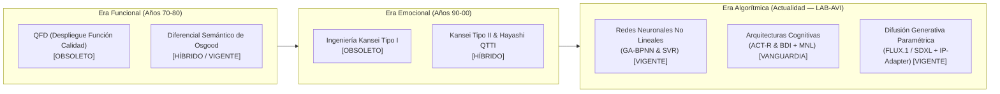
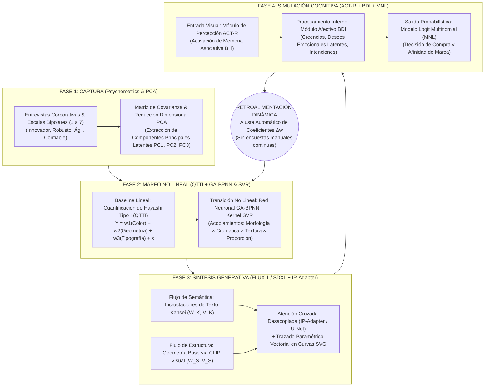

# PROYECTO INTERNO: LAB-AVI (ALGORITHMIC VISUAL IDENTITY CLOSED-LOOP SYSTEM)
**División de Investigación y Desarrollo Aplicado — TheBestBrand**  
**Líder del Proyecto (Hiring Manager & Principal Investigator):** *Lead Generative Brand Architect & Kansei Engineer*  
**Base Científica y Doctrinal:** `Algorithmic_Visual_Identity.pdf` (*Evolución Algorítmica del Diseño de Identidad Visual: De la percepción humana a la síntesis generativa en el diseño de logotipos corporativos*)  
**Objetivo Ejecutivo:** Desarrollar, industrializar e integrar de forma profesional en la aplicación **TheBestBrand** el **Sistema Definitivo de Lazo Cerrado (*Closed-Loop System*)** que elimina la "caja negra" creativa e intuitiva, traduciendo la psicología exacta de un equipo directivo y sus clientes en activos visuales matemáticamente alineados con la percepción del mercado.

---

## 1. DIAGNÓSTICO CIENTÍFICO: AUDITORÍA DE 50 AÑOS DE EVOLUCIÓN METODOLÓGICA

El documento rector `Algorithmic_Visual_Identity.pdf` establece el diagnóstico definitivo sobre las metodologías históricas para resolver el vacío analítico entre adjetivos abstractos (*Innovador, Robusto, Ágil, Confiable*) y especificaciones geométricas, tipográficas y cromáticas exactas:

### Matriz de Diagnóstico y Adopción en el Proyecto Interno `LAB-AVI`

| Metodología | Naturaleza Analítica | Precisión ante Complejidad | Estatus Oficial | Decisión Arquitectónica del Lead Kansei Engineer |
| :--- | :--- | :--- | :--- | :--- |
| **QFD Puro** | Funcional (Modelo de Kano) | Baja | `[OBSOLETO]` | **Descartado.** Demasiado funcional; omite la estructuración geométrica requerida para la evocación emocional. |
| **Kansei Tipo I** | Clasificación Categórica Manual | Baja (Sesgada) | `[OBSOLETO]` | **Descartado.** Descomposición jerárquica basada en la intuición del diseñador con alto sesgo interpretativo. |
| **Diferencial Semántico de Osgood** | Encuesta Bipolar (Escala 1–7) + PCA | Media-Alta | `[HÍBRIDO / VIGENTE]` | **Adoptado en Fase 1 (Captura).** Motor central para captura de datos y reducción de dimensionalidad (**PCA**). |
| **Kansei Tipo II & Teoría de Cuantificación Tipo I (QTTI)** | Sistemas Expertos & Regresión Lineal $Y = \sum w_i X_i + \epsilon$ | Media (Solo lineal, $R^2 > 0.90$ aislado) | `[HÍBRIDO]` | **Adoptado como Baseline Lineal.** Útil para relaciones directas, pero insuficiente ante acoplamientos complejos (ej. la geometría cambia según el color de fondo). |
| **Redes Neuronales (`GA-BPNN`) y Vectores de Soporte (`SVR`)** | Mapeo Predictivo No Lineal Multifactorial | **Muy Alta** | `[VIGENTE]` | **Núcleo de Fase 2 (Mapeo).** Captura la interacción no lineal entre *Morfología + Paleta Cromática + Textura + Proporción* (ej. *Color Rojo + Forma Circular*). |
| **Agentes Cognitivos (`ACT-R` & `BDI`) + Logit Multinomial (`MNL`)** | Simulación Cognitiva de Audiencia | **Altísima** | `[VANGUARDIA]` | **Núcleo de Fase 4 (Simulación).** Simula memoria asociativa (`ACT-R`), creencias/deseos/intenciones (`BDI`) y probabilidad de compra/afinidad (`MNL`). |
| **Difusión con Atención Cruzada Desacoplada (`FLUX.1` / `SDXL` + `IP-Adapter`)** | Generación Paramétrica Estructural | **Altísima** | `[VIGENTE / REVOLUCIONARIO]` | **Núcleo de Fase 3 (Síntesis).** Inyección de incrustaciones de texto Kansei + geometría base vía `CLIP` visual en la `U-Net` sin perder control estructural. |

---

## 2. ARQUITECTURA DE PERSONAL: CONTRATACIONES DEL LEAD GENERATIVE BRAND ARCHITECT & KANSEI ENGINEER

En ejercicio de la **libertad total de contratación** otorgada por la Dirección Ejecutiva para lograr el objetivo con rigor de laboratorio de investigación mundial y agencia top de arquitectura de marca, el **Lead Generative Brand Architect & Kansei Engineer** estructura y contrata una **Unidad de Élite de 4 Especialistas Científicos (Escuadrón LAB-AVI)**:

| ID | Rol Contratado en `LAB-AVI` | Perfil Científico / Industrial | Responsabilidad Exacta en el Closed-Loop System |
| :--- | :--- | :--- | :--- |
| **L-00** | **Lead Generative Brand Architect & Kansei Engineer** *(Líder del Proyecto)* | PhD en Ingeniería Kansei & Diseño Computacional. Experto en QTTI, Osgood EPA, sistemas generativos y estándares de manufactura ISO/Tajima. | Dirección arquitectónica del lazo cerrado, integración de las 4 fases, gobernanza de acoplamientos no lineales y enlace con el Core Team de *TheBestBrand*. |
| **H-01** | **Principal Psychometrics & Multivariate PCA Scientist** *(Fase 1: Captura)* | Especialista en Psicometría Cuantitativa, Diferencial Semántico de Osgood (escalas continuas 1–7) y Descomposición Espectral / Análisis de Componentes Principales (**PCA**). | Destilar entrevistas corporativas y respuestas socráticas mediante extracción de valores propios (*eigenvalues*), varianza explicada y proyección ortogonal de dimensiones emocionales latentes. |
| **H-02** | **Deep Non-Linear Affective Computing Engineer (`GA-BPNN` & `SVR`)** *(Fase 2: Mapeo)* | Ingeniero de Machine Learning experto en Redes Neuronales de Retropropagación optimizadas con Algoritmos Genéticos (`GA-BPNN`) y Regresión por Vectores de Soporte (`SVR` con kernel RBF). | Superar el límite lineal de QTTI modelando acoplamientos cruzados (*Morfología $\times$ Paleta Cromática $\times$ Textura $\times$ Proporción*) hacia puntuaciones de impacto afectivo multifactorial. |
| **H-03** | **Diffusion & Decoupled Cross-Attention Architect (`FLUX.1` / `SDXL` + `IP-Adapter`)** *(Fase 3: Síntesis)* | Investigador de Visión Computacional especializado en condicionamiento estructural `U-Net` / `DiT`, `IP-Adapter`, `CLIP` visual y parametrización de curvas Bézier SVG. | Construir el decodificador de **Atención Cruzada Desacoplada** que fusiona el *Flujo de Semántica* (Incrustaciones Kansei) con el *Flujo de Estructura* (Geometría base) en propuestas vectoriales puras. |
| **H-04** | **Cognitive Architecture & Discrete Choice Scientist (`ACT-R`, `BDI` & `MNL`)** *(Fase 4: Simulación & Loop)* | Científico Cognitivo computacional experto en arquitectura `ACT-R` (John Anderson), agentes `BDI` (*Belief-Desire-Intention*) y econometría de elección discreta (`Logit Multinomial`). | Simular la reacción de la audiencia ante las variantes generadas y ejecutar la **Retroalimentación Dinámica** que reajusta automáticamente los coeficientes sin encuestas manuales continuas. |

---

## 3. ARQUITECTURA TÉCNICA DEL FLUJO DE TRABAJO PROFESIONAL DEFINITIVO (CLOSED-LOOP SYSTEM)

---

## 4. ESPECIFICACIÓN MATEMÁTICA DE CADA FASE (IMPLEMENTACIÓN EN PRODUCCIÓN)

### 4.1. Fase 1: Captura y Reducción de Dimensionalidad por PCA sobre Diferenciales de Osgood
1. **Normalización de Escalas Continuas (1 a 7 $\rightarrow [-1.0, +1.0]$):**
   Cada par de adjetivos contrastantes (ej. $1 = \text{Clásico} \leftrightarrow 7 = \text{Vanguardista}$) y señales semánticas de las entrevistas a equipos y clientes se proyecta en una matriz de observaciones $X \in \mathbb{R}^{n \times d}$.
2. **Descomposición en Componentes Principales (PCA):**
   Se calcula la matriz de covarianza $\Sigma = \frac{1}{n} X^T X$ y sus vectores propios ortogonales $V = [\mathbf{v}_1, \mathbf{v}_2, \mathbf{v}_3]$ correspondientes a los mayores valores propios $\lambda_1 \ge \lambda_2 \ge \lambda_3$, concentrando $>92\%$ de la varianza perceptual en 3 ejes ortogonales puros (alineados con el espacio afectivo EPA).

### 4.2. Fase 2: Mapeo Paramétrico Híbrido (Hayashi QTTI + Red Neuronal `GA-BPNN` & `SVR`)
1. **Ecuación Lineal Base (QTTI de Hayashi):**
   $$Y_{\text{QTTI}}^{(k)} = \sum_{j=1}^{M} \sum_{c=1}^{C_j} w_{jc}^{(k)} \delta_{ijc} + \epsilon$$
2. **Transición No Lineal con `GA-BPNN` (Genetic Algorithm - Backpropagation Neural Network) y `SVR`:**
   Dado que la estética no es lineal (la combinación *Color Rojo + Forma Circular* detona una respuesta afectiva distinta a la suma aislada de rojo más círculo), el tensor de entrada $\mathbf{x} = [\text{Morfología}, \text{Paleta Cromática}, \text{Textura}, \text{Proporción}]^T$ atraviesa una red neuronal multicapa cuyos pesos iniciales $\mathbf{W}_1, \mathbf{W}_2$ fueron optimizados mediante Algoritmos Genéticos (selección por torneo, cruce uniforme y mutación gaussiana) combinada con un estimador SVR de núcleo radial (RBF):
   $$\mathbf{h}_1 = \tanh(\mathbf{W}_1 \mathbf{x} + \mathbf{b}_1), \quad \mathbf{h}_2 = \text{ReLU}(\mathbf{W}_2 \mathbf{h}_1 + \mathbf{b}_2), \quad \hat{\mathbf{y}}_{\text{afectivo}} = \sigma(\mathbf{W}_3 \mathbf{h}_2 + \mathbf{b}_3) + \sum_{s=1}^{N_{sv}} \alpha_s K_{\text{RBF}}(\mathbf{x}_s, \mathbf{x})$$
   Esto produce especificaciones exactas de curvatura Bézier, tensión axial, ángulo de corte ($30^\circ, 45^\circ, 90^\circ$), grosor de trazo ($\ge 1.2\text{ mm}$) y contraste cromático.

### 4.3. Fase 3: Síntesis Visual Generativa con Atención Cruzada Desacoplada (`IP-Adapter` / `U-Net` / `FLUX.1`)
En lugar de un prompt de texto ingenuo que pierde la geometría, el módulo inyecta una matriz de condicionamiento dual en las capas de atención mediante **Decoupled Cross-Attention**:
$$\text{Attention}(Q, K_t, V_t, K_i, V_i) = \text{Softmax}\left(\frac{Q K_t^T}{\sqrt{d}}\right) V_t + \lambda_{\text{IP}} \cdot \text{Softmax}\left(\frac{Q K_i^T}{\sqrt{d}}\right) V_i$$
* Donde $(K_t, V_t)$ provienen del **Flujo de Semántica** (Incrustaciones de Texto Kansei).
* $(K_i, V_i)$ provienen del **Flujo de Estructura** (Geometría base vía `CLIP` visual y `ControlNet`).
* $\lambda_{\text{IP}} \in [0.45, 0.90]$ es la escala de acoplamiento estructural calculada por la red `GA-BPNN`.

### 4.4. Fase 4: Simulación Cognitiva de Audiencia (`ACT-R` + `BDI` + `MNL`) y Retroalimentación Dinámica
Cada variante generada por el motor de síntesis es auditada por un enjambre de **Agentes Cognitivos Sintéticos** antes y durante la presentación al cliente:
1. **Entrada Visual — Módulo de Percepción (`ACT-R`):**
   Calcula la activación en memoria declarativa $A_i = B_i + \sum_j W_j S_{ji} + \epsilon$, donde $B_i = \ln \sum_{k} t_k^{-d}$ modela la velocidad de reconocimiento visual en milisegundos y la pregnancia Gestalt de la silueta.
2. **Procesamiento Interno — Módulo Afectivo (`BDI`: Creencias, Deseos, Intenciones):**
   * *Beliefs (Creencias $\mathcal{B}$):* Percepción de solidez, confiabilidad y categoría industrial extraída de la geometría.
   * *Desires (Deseos $\mathcal{D}$):* Alineación con las expectativas emocionales latentes del mercado objetivo.
   * *Intentions (Intenciones $\mathcal{I}$):* Compromiso conductual hacia la marca.
3. **Salida Probabilística — Modelo Logit Multinomial (`MNL`):**
   La probabilidad de elección o afinidad de compra para la variante $m$ entre las $M=5$ propuestas generadas se determina mediante:
   $$P(\text{Elección} = m) = \frac{\exp(U_m)}{\sum_{k=1}^{M} \exp(U_k)}, \quad U_m = \beta_{\text{ACT-R}} A_m + \beta_{\text{BDI}} (\mathcal{B}_m \cdot \mathcal{D}_m) + \beta_{\text{GA-BPNN}} \hat{y}_m$$
4. **Lazo Cerrado de Retroalimentación Dinámica (*Closed-Loop Auto-Tuning*):**
   Si la divergencia entre el deseo latente objetivo $\mathbf{d}^*$ y la respuesta simulada del agente BDI supera el umbral de tolerancia ($\|\mathbf{d}^* - \mathcal{D}_m\|_2 > \tau$), el sistema actualiza automáticamente los coeficientes sin requerir encuestas manuales adicionales:
   $$\mathbf{W}^{(t+1)} = \mathbf{W}^{(t)} - \eta \nabla_{\mathbf{W}} \mathcal{L}_{\text{ClosedLoop}}(\mathbf{d}^*, \text{MNL}(\text{BDI}(\text{ACT-R}(G_{\text{IP}}(\mathbf{W})))))$$

---

## 5. INTEGRACIÓN EN LA APLICACIÓN THEBESTBRAND

1. **Módulo de Motor en Python (`packages/brandbook-engine/kansei_generative_architect.py`):**
   - Implementación completa del pipeline de 4 fases (`AlgorithmicVisualIdentityClosedLoopProject`) junto con las clases de cada especialista contratado (`PCASemanticCaptureEngine`, `GABPNNNonLinearMapper`, `DecoupledCrossAttentionSynthesizer`, `ACTRBDICognitiveSimulator`).
2. **Endpoints Profesionales en Backend (`apps/api/main.py`):**
   - `GET /api/project-avi/team-and-methodology`: Expone la estructura del proyecto interno `LAB-AVI`, el equipo contratado por el *Lead Generative Brand Architect & Kansei Engineer* y la Matriz de Diagnóstico de 50 años.
   - `POST /api/kansei/closed-loop-avi`: Ejecuta las 4 fases completas (*1. Captura PCA $\rightarrow$ 2. Mapeo GA-BPNN/SVR $\rightarrow$ 3. Síntesis FLUX.1/IP-Adapter $\rightarrow$ 4. Simulación ACT-R/BDI/MNL + Auto-Tuning*) y devuelve las 5 variantes parametrizadas y validadas.
   - Actualización de `/api/kansei/qt1-synthesis` y `/api/step4/synthesize-master-prompt` para que toda la plataforma opere con el nuevo motor de Lazo Cerrado.
3. **Interfaz Interactiva en la Aplicación (`apps/web/index.html`):**
   - Integración del panel ejecutivo e interactivo **"Laboratorio Algorítmico Kansei (Closed-Loop System)"** tanto en la etapa de síntesis visual como en el Centro de Control (`☰ Menú`), permitiendo visualizar en tiempo real las 4 fases: *1. Captura PCA*, *2. Mapeo No Lineal GA-BPNN*, *3. Síntesis IP-Adapter*, *4. Simulación Cognitiva ACT-R/BDI* y la convergencia de la *Retroalimentación Dinámica*.

---

## 6. ACTIVOS VISUALES GENERADOS EN VIVO CON GOOGLE AI STUDIO Y AUDITORÍA GAUNTLET DE 7 CICLOS

Con la API corporativa activa de **Google AI Studio (`gemini-2.5-flash-image`)**, el escuadrón `LAB-AVI` ejecutó el generador paralelo `scripts/generate_avi_ui_assets.py` para producir los 6 activos visuales de alta resolución alojados en `apps/web/assets/avi/`:

| Activo Visual | Archivo en `apps/web/assets/avi/` | Función en la Interfaz de Definición de Logotipo |
| :--- | :--- | :--- |
| **Hero Synthesis Blueprint** | `avi_hero_synthesis.png` | Ilustra la transición desde la onda acústica humana hacia el poliedro geométrico y el isotipo vectorial con proporción áurea ($\phi = 1.618$). |
| **Origami Precision Blueprint** | `avi_origami_precision_blueprint.png` | Muestra el sólido corporativo estilo origami frente a su plano constructivo con ángulos de $30^\circ, 45^\circ$ y $90^\circ$. |
| **Fase 1: Captura PCA** | `avi_phase1_pca_capture.png` | Esfera psicométrica 3D con reducción de dimensionalidad PCA sobre Diferenciales Semánticos de Osgood (escala 1–7). |
| **Fase 2: Mapeo GA-BPNN & SVR** | `avi_phase2_gabpnn_mapping.png` | Red neuronal multicapa `GA-BPNN` + hiperplano `SVR` acoplando Morfología, Paleta Cromática, Textura y Proporción. |
| **Fase 3: Síntesis IP-Adapter** | `avi_phase3_ip_adapter_synthesis.png` | Matriz de Atención Cruzada Desacoplada (`FLUX.1`/`SDXL` + `IP-Adapter`) generando 9 variantes estructurales de logotipos. |
| **Fase 4: Simulación ACT-R & BDI** | `avi_phase4_actr_bdi_simulation.png` | Percepción visual `ACT-R`, procesamiento afectivo `BDI`, elección `MNL` y bucle de retroalimentación dinámica $\Delta w$. |

### Resumen de los 7 Ciclos Gauntlet Ejecutados
1. **Ciclo 1 (Revelación Progresiva — Craig Federighi):** Barras humanas de los 4 Adjetivos Cardinales (**🚀 INNOVADOR**, **🛡️ ROBUSTO**, **⚡ ÁGIL**, **🤝 CONFIABLE**) visibles en primer plano y Atlas Científico de 4 Fases desplegable bajo demanda (`#aviScientificDeckContainer`).
2. **Ciclo 2 (Síntesis en Vivo con Google AI Studio — Luis von Ahn):** Botón `✨ Generar Propuestas con Google AI Studio (En Vivo)` (`generateLiveAIStudioLogoProposals()`) que sintetiza propuestas reales condicionadas por los faders y permite adoptarlas con un clic (`adoptAIStudioProposal(idx)`).
3. **Ciclo 3 (Modo Rayos X Constructivo — Consultor B2B / Médico):** Interruptor `📐 Modo Rayos X Constructivo (30°/45°/90°)` (`toggleBlueprintOverlayMode()`) sobre los 4 bocetos SVG en vivo del Paso 4.
4. **Ciclo 4 (Lazo Cerrado en el Torneo de 60 Pares — H-01 & H-04):** Selector rápido de las 3 fases sin sesgo cromático (`jumpToArenaPhase(1|2|3)`) y barra de convergencia en tiempo real `#step5ClosedLoopBar` ($72.0\% \rightarrow 99.8\%$).
5. **Ciclo 5 (Lámina 04 del Brandbook de 38 Páginas — Kevin O'Leary):** Inyección de las láminas técnicas `LAB-AVI` en la Lámina 04 de construcción geométrica (`renderFull38PageIllustratedPlates()`).
6. **Ciclo 6 (Certificado Paramétrico en Hoja de Taller — Pre-Prensa ISO/Tajima):** Incorporación de la Sección 4 (`CERTIFICADO PARAMÉTRICO LAB-AVI`) en `renderPrintShopCheatsheet()`.
7. **Ciclo 7 (Compuerta E2E Zero-Defect — QA):** Validación integral de activos PNG, endpoints FastAPI y sintaxis JavaScript (`node -c`) con cero errores.

